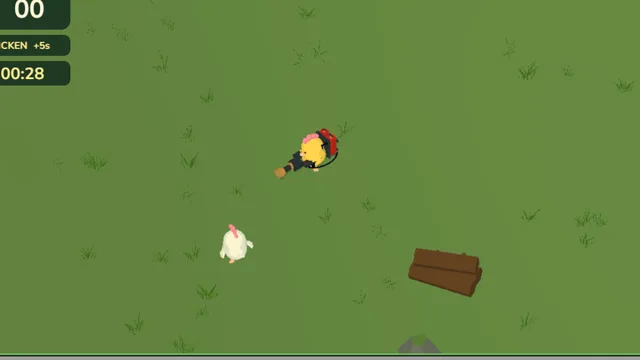
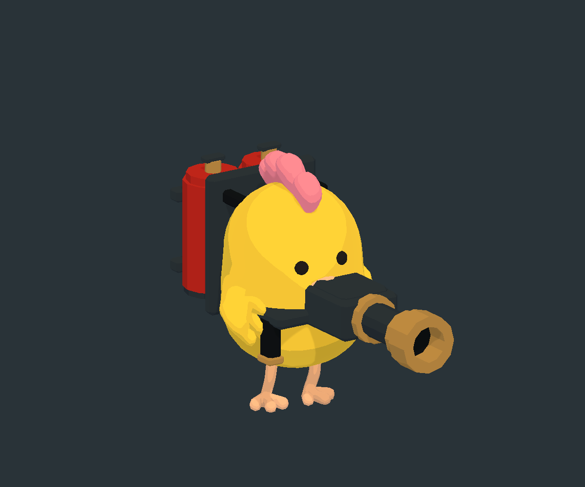
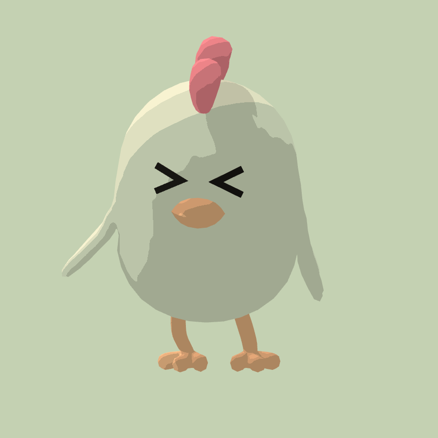
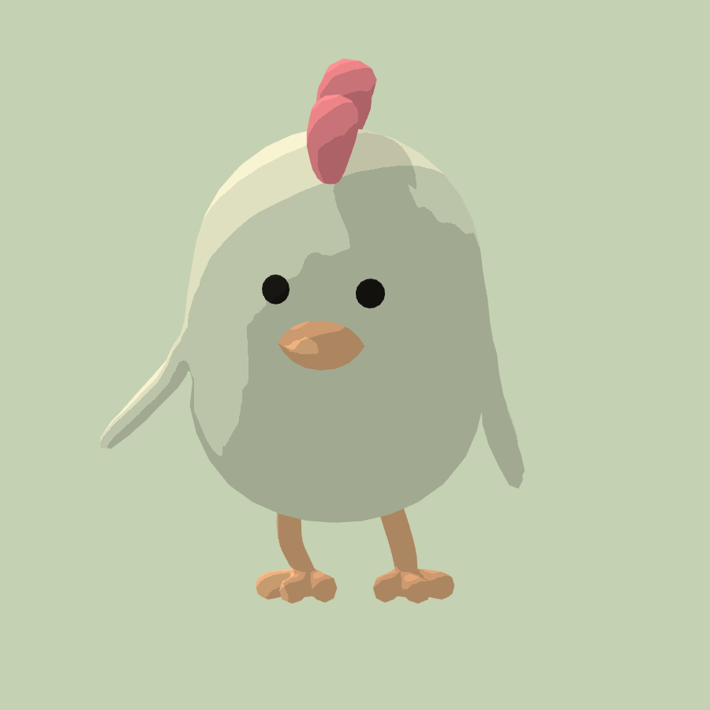
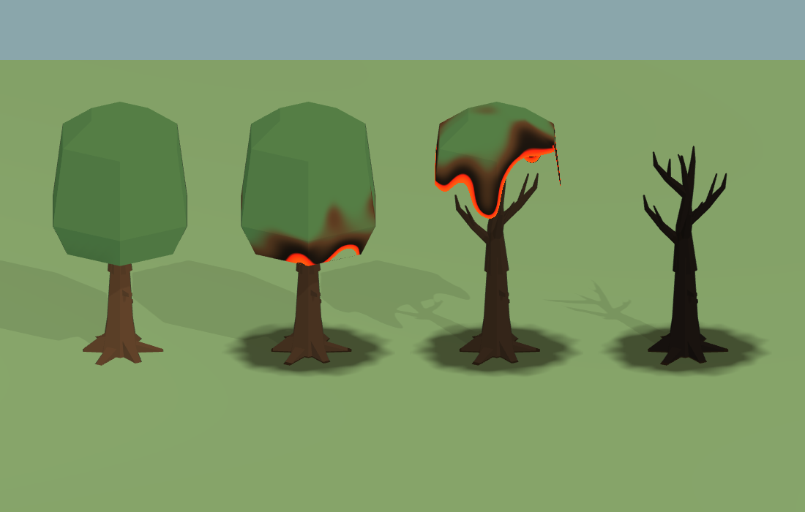
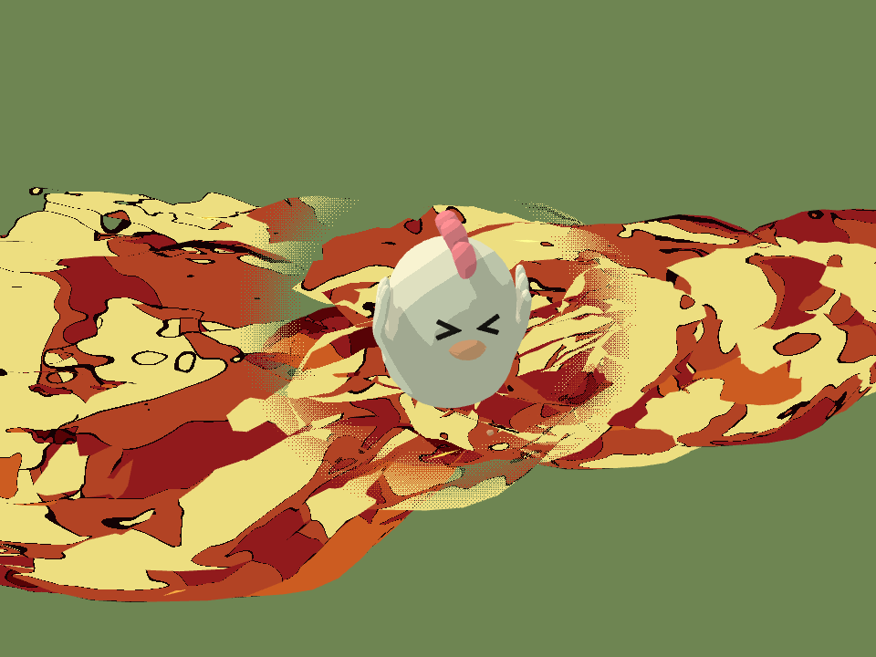
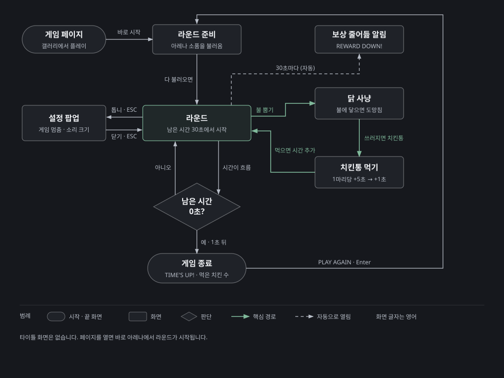

# Chicken Fire — 게임 기획서



> Chicken Fire는 화염방사기를 멘 닭이 목장 아레나에서 시간과 싸우는 PC 웹 게임입니다. 1인 개발이고 정식 출시하지 않은 시제품(프로토타입)입니다. 갤러리에서 웹 빌드로 해 볼 수 있습니다.
> 이 문서는 무엇을 왜 그렇게 설계했는지를 적은 기획서입니다. 숫자는 설계 결정을 보여 줄 때만 씁니다.
> 의도는 작업 메모, 계획서, 코드 주석에 적힌 이유만 옮겼습니다. 이유가 기록에 없는 곳은 **(의도 기록 없음)**이라고 표시했습니다. 규칙과 수치는 게임 코드와 장면 데이터에서 확인했고 메모와 코드가 다르면 코드를 따랐습니다. 기준은 2026-10-11 보관본입니다.

## 목차

1. [개요](#1-개요)
2. [목표와 배경](#2-목표와-배경)
3. [핵심 게임플레이](#3-핵심-게임플레이)
4. [메카닉](#4-메카닉)
5. [아레나 생존 설계](#5-아레나-생존-설계)
6. [진행과 밸런스](#6-진행과-밸런스)
7. [아레나 디자인 원칙](#7-아레나-디자인-원칙)
8. [아트와 사운드 방향](#8-아트와-사운드-방향)
9. [UX 흐름](#9-ux-흐름)
10. [성공 지표와 결과](#10-성공-지표와-결과)
11. [범위 밖으로 둔 것](#11-범위-밖으로-둔-것)
12. [가정과 의존성](#12-가정과-의존성)


---

## 1. 개요

### 핵심 컨셉



플레이어는 연료 가방과 화염방사기를 멘 노란 닭입니다. 40 × 40 m 목장 아레나를 위에서 비스듬히 내려다보는 쿼터뷰로 움직입니다. 하얀 닭을 불로 태우면 그 자리에 치킨통이 떨어지고 치킨통을 먹으면 남은 시간이 늘어납니다. 남은 시간은 30초에서 시작해 계속 줄어듭니다. 시간이 0이 되면 한 판이 끝나고 먹은 치킨 수가 점수가 됩니다. 불은 작물, 나무, 장작더미로 옮겨붙어 목장이 점점 타 들어갑니다.

### 대상 플레이어

| 누구 | 근거 |
|---|---|
| 키보드와 마우스로 하는 PC 플레이어 | 조작이 WASD 이동, 마우스 조준, 왼쪽 버튼 발사뿐입니다. 터치·게임패드 조작은 없습니다 |
| 짧게 한 판씩 하는 사람 | 한 판이 30초에서 시작하고, 끝나면 버튼 하나로 바로 다시 합니다 |

대상 플레이어를 따로 정한 기록은 없습니다(의도 기록 없음). 위 표는 실제 조작과 규칙에서 읽은 것입니다.

### 차별점 (USP)

항목마다 빼면 무엇이 남는지 따져 보았습니다. USP는 Unique Selling Point의 줄임말입니다.

| # | 차별점 | 빼면? |
|---|---|---|
| 1 | 사냥감이 곧 시간: 태운 닭이 치킨통이 되고, 먹어야 시간이 늘어남 | 점수만 쌓는 사격 게임이 됩니다. 시간과 싸우는 긴장이 사라집니다 |
| 2 | 번지는 불: 작물·나무·장작더미에 불이 옮겨붙고 탄 자국이 한 판 내내 남음 | 불이 그냥 총알이 됩니다. 목장이 변해 가는 모습이 없어집니다 |
| 3 | 슬랩스틱 닭 반응: 맞으면 > < 눈으로 놀라 날개를 퍼덕이며 도망 | 맞았는지 화면에서 바로 읽기 어렵습니다 |

차별점을 이렇게 셋으로 정리한 기록은 없습니다(의도 기록 없음). 각 항목은 실제로 만든 시스템입니다.

<sub>출처: `README.txt` 구현된 내용, `Workspace_Notes.txt`, 라운드·난이도 코드, 게임 장면 데이터</sub>

---

## 2. 목표와 배경

### 기획 배경

- **출발점**: 불 효과를 따로 시험하던 프로젝트(FirePreview)의 화염방사기 효과를 가져와 2026-10-09에 새 프로젝트로 시작했습니다.
- **환경 방향**: 작업 메모의 첫 제안은 작은 농장 마당, 쿼터뷰, 낮은 채도의 잔디와 흙, 그리고 눈에 잘 띄는 닭과 불꽃이었습니다. 불붙는 대상은 상자·울타리·작물 중 몇 개로 시작해 연쇄 점화를 확인하기로 했습니다.
- **첫 시제품**: 플레이어 주변 구역을 계속 만들어 끝없이 이어지는 농장이었습니다. 불탄 상태를 구역별로 저장해 돌아와도 그대로 남게 했습니다.
- **아레나로 바꿈**: 마지막 이틀 동안 끝없는 농장을 손으로 배치한 40 × 40 m 아레나로 바꾸고 생존 라운드와 게임 종료 화면을 넣었습니다. 아레나는 아무것도 저장하지 않아 매 판이 새로 시작합니다. 끝없는 농장을 버리고 닫힌 아레나로 간 이유는 기록에 없습니다(의도 기록 없음).

### 프로젝트 목표

| # | 목표 | 확인 방법 · 결과 |
|---|---|---|
| G1 | 불을 뿜고 번지게 하는 놀이를 만든다 | 화염방사기, 점화, 불 번짐, 탄 자국 (4·5장) |
| G2 | 그 놀이를 한 판짜리 생존 게임으로 묶는다 | 30초 타이머, 치킨통으로 시간 늘리기, 게임 종료 화면 (3·5장) |
| G3 | 웹에서 돌아가게 한다 | 웹 빌드 설정까지 마침. 갤러리에서 플레이 가능 (10장) |

위 목표는 만들어진 결과에서 정리한 것이고 목표 문장이 기록에 따로 있지는 않습니다(의도 기록 없음). 수치 목표도 없습니다.

<sub>출처: `Workspace_Notes.txt`, `README.txt`, `ARCHIVE_INFO.txt`, 아레나 배치 코드 주석</sub>

---

## 3. 핵심 게임플레이

### 디자인 기둥

기둥의 우선순위를 정한 기록은 없습니다(의도 기록 없음). 아래 순위는 만들어진 순서(불 → 닭 반응 → 생존 라운드)를 따랐습니다.

| 순위 | 기둥 | 뜻 | 근거 |
|---|---|---|---|
| 1 | 불을 뿜는 손맛 | 쏘고, 맞히고, 번지는 감각이 재미의 중심 | `README.txt` 점화·전파, 작업 메모 "연쇄 점화를 확인" |
| 2 | 한눈에 읽히는 닭 | 작은 쿼터뷰 화면에서도 닭과 불, 닭의 반응이 바로 보임 | 작업 메모 "눈에 잘 띄는 닭/불꽃", 표정 계획 "게임 카메라에서 읽히는지를 우선" |
| 3 | 시간과의 경주 | 계속 먹어야 버티고, 결국 시계가 이김 | 난이도 코드 주석 "시계가 이길 때까지 점점 더 많이 먹어야 한다" |

### 핵심 루프 (코어 루프)

```
[행동]   닭을 조준하고 왼쪽 버튼으로 불을 뿜는다
   ↓
[반응]   닭이 > < 눈으로 놀라 도망침 · 지글지글 소리
         약 1.4초 맞으면 펑 · 치킨통이 떨어짐
         근처 작물과 나무에 불이 번짐
   ↓
[보상]   치킨통을 먹음 · 바삭 소리
         남은 시간 +5초 (갈수록 +1초까지 줄어듦)
   ↓
[다시 할 이유]  시간이 계속 줄어 다음 닭을 찾아야 함
                30초마다 보상이 줄어 더 많이 먹어야 함
                끝나면 PLAY AGAIN 한 번에 다시
```

| 항목 | 내용 |
|---|---|
| 한 판 길이 | 측정 기록 없음. 하나도 못 먹으면 30초. 2분이 지나면 한 마리가 1초뿐이라 버티기가 급격히 어려워짐 |
| 판마다 달라지는 것 | 닭이 나오는 자리(플레이어에게서 6~16 m 떨어진 빈 곳), 닭마다 다른 성격과 속도, 불이 번진 모양 |
| 판마다 같은 것 | 아레나 배치, 시작 시간, 보상이 줄어드는 시점 |

### 승리와 실패

- **승리는 없습니다.** 시간이 다 되기 전까지 얼마나 많이 먹는지 겨룹니다.
- **실패**: 남은 시간이 0이 되면 끝납니다. 닭은 플레이어를 공격하지 않으므로 체력이나 목숨은 없습니다.
- 끝나는 순간 조작과 불이 멈추고 시간 종료 징글이 울린 뒤 1초 있다가 게임 종료 화면이 나옵니다. 이 1초는 징글이 다 들리게 하려는 것입니다(코드 주석).
- 최고 기록은 저장하지 않습니다. 매 판이 처음 상태에서 시작합니다(아레나 코드 주석 "매 라운드가 새로 시작").

<sub>출처: 라운드·난이도·게임 종료 코드와 주석, `Workspace_Notes.txt`, `EnemyBurnEyesPlan.txt`</sub>

---

## 4. 메카닉

### 플레이어의 동사

| 동사 | 하는 일 | 받치는 기둥 |
|---|---|---|
| **움직이기** | 화면 방향 기준으로 걷기. 조준과 따로 움직여 뒷걸음질도 됨 | 3 시간과의 경주 |
| **조준하기** | 마우스가 가리키는 땅 쪽으로 몸을 돌림 | 1 손맛 |
| **불 뿜기** | 왼쪽 버튼을 누르는 동안 불이 나감. 닭을 태우고 물건에 불을 붙임 | 1 손맛 |
| **먹기** | 치킨통에 가까이 가면 자동으로 먹음. 남은 시간이 늘어남 | 3 시간과의 경주 |

먹기에 따로 버튼이 없는 이유는 기록에 없습니다(의도 기록 없음).

### 조작

| 하고 싶은 것 | 키보드 · 마우스 |
|---|---|
| 이동 | W A S D (화면 기준) |
| 조준 | 마우스 위치 |
| 불 뿜기 | 왼쪽 버튼 누르고 있기 |
| 확대 · 축소 | 마우스 휠 |
| 설정 열기 · 닫기 | 오른쪽 위 톱니 버튼, ESC |
| 다시 하기 | 게임 종료 화면의 PLAY AGAIN 버튼, Enter |

버튼이나 설정 창 위에서 누른 클릭으로는 불이 나가지 않습니다. 게임 창이 선택되어 있을 때만 발사합니다.

### 접근성 (실제로 넣은 것)

- **가려진 닭 보이기**: 불꽃이나 건물이 닭을 가리면 닭 둘레에 둥근 창이 뚫려 닭이 보입니다. 작업 메모는 쿼터뷰 앞쪽에 캐릭터를 가리는 높은 물체를 줄이자고 했습니다.
- **색에만 기대지 않는 시간 경고**: 10초 이하가 되면 숫자 색이 바뀌고 1초마다 똑딱 소리가 납니다.
- **맞았다는 표시**: 맞은 닭은 아주 짧게 빨갛게 깜빡이고, 눈이 > < 로 바뀌고, 지글지글 소리가 납니다.
- **소리**: 전체 음량과 효과음 음량을 따로 조절하고 소리를 끌 수 있습니다. 값은 다음에 열어도 남습니다.
- **멈춤**: 설정 창을 열면 게임이 멈추고 소리가 작아집니다.
- **확대 · 축소**: 마우스 휠로 화면 크기를 바꿉니다.
- 조작 키 바꾸기, 난이도 선택, 한국어 화면은 없습니다(의도 기록 없음). 화면 글자는 영어입니다.

<sub>출처: 플레이어 조작·설정 창·소리·화면 표시 코드, `Workspace_Notes.txt`, `EnemyOcclusionWindowResults.txt`</sub>

---

## 5. 아레나 생존 설계

### 적 닭의 행동

 

| 상태 | 하는 일 |
|---|---|
| 돌아다니기 | 플레이어가 멀면 처음 나온 자리 근처를 어슬렁거림 |
| 다가오기 | 플레이어가 7.5~13.5 m 안에 들어오면(닭마다 다름) 다가와서 2.3~4.1 m 거리를 두고 옆으로 돌아 들어옴 |
| 성격 셋 | 가까이 붙어 천천히 맴도는 닭, 거리를 두고 크게 맴도는 닭, 너무 가까우면 물러서는 닭이 번갈아 나옴 |
| 놀람 → 도망 → 회복 | 불에 맞으면 0.2초 움찔하고 불 반대쪽으로 2배 빠르게 도망침. 마지막으로 맞고 2초 뒤 0.3초 동안 멈춰 숨을 고르고 평소로 돌아옴 |
| 쓰러짐 | 체력이 다하면 펑 소리와 함께 사라지고 그 자리에 치킨통이 떨어짐 |

- 닭은 공격하지 않습니다. 애니메이션 계획에 쪼기 공격과 피격 판정이 다음 작업으로 적혀 있지만 만들지 않았습니다(11장).
- 닭끼리 너무 붙으면 서로 밀어냅니다. 한 무리가 같은 길이나 문으로 몰려 겹치지 않게 하려는 것입니다(코드 주석).
- 도망은 날지 않고 땅을 박차며 뛰는 동작으로 만들었습니다. 참고 그림 지시문은 아프거나 탄 모습 없이 장난스러운 만화 슬랩스틱 분위기를 요구했습니다.
- 표정 계획의 목표는 불에 맞은 닭이 눈을 > < 로 꽉 감아 뜨겁고 당황한 느낌을 주는 것이었습니다. 다시 맞아도 표정은 깜빡이지 않고 회복할 때 원래 눈으로 돌아옵니다.

### 라운드 · 타이머 · 점수 규칙

| 규칙 | 내용 |
|---|---|
| 시작 | 아레나 물건이 다 놓이면 30초부터 줄어들기 시작 |
| 시간 늘리기 | 치킨통 하나를 먹을 때마다 +5초. 30초마다 1초씩 줄어 2분부터는 +1초 |
| 점수 | 먹은 치킨 수. 태운 수가 아니라 먹은 수만 셈 |
| 치킨통 | 쓰러진 자리에 0.28초 동안 커지며 나타난 뒤부터 먹을 수 있음. 25초 동안 안 먹으면 사라짐 |
| 먹는 거리 | 치킨통 1.1 m 안에 들어가면 자동으로 먹음 |
| 끝 | 남은 시간 0 → 조작·발사 멈춤 → 1초 뒤 게임 종료 화면 |

화면 왼쪽 위에는 먹은 수, 지금 한 마리당 몇 초인지(`1 CHICKEN +5s`), 남은 시간이 차례로 있습니다. 보상이 줄어드는 순간 화면 위 가운데에 `REWARD DOWN!` 알림이 2초쯤 뜨고 짧은 소리가 납니다.

### 불 번짐

| 대상 | 불에 탐? | 탄 뒤 |
|---|---|---|
| 밀 · 옥수수 · 호박 · 풀숲 · 장작더미 | 탐 | 검게 그을리고 바닥에 탄 자국 |
| 참나무 | 탐 | 잎이 타 들어가 사라지고 검은 가지만 남음 |
| 헛간 · 사일로 · 닭장 · 우물 · 물탱크 · 바위 | 안 탐 | 그대로 |
| 울타리(아레나 경계) | 안 탐 | 그대로 |

- 불길은 약 5.8 m까지 나가고 멀어질수록 넓어집니다. 벽이나 바위 뒤는 불이 닿지 않습니다.
- 불길에 닿은 물건은 0.4초쯤이면 불이 붙습니다. 타는 물건은 6초 동안 타고 2.4 m 안의 다른 물건을 데워 불을 옮깁니다.
- 다 탄 물건은 다시 타지 않습니다. 한 판 동안 탄 자국이 그대로 남아 목장이 점점 검게 변합니다.
- 건물과 바위는 길잡이와 엄폐물이라서 타지 않게 했습니다(코드 주석).
- 물건에 붙은 불은 닭에게 피해를 주지 않습니다. 닭은 화염방사기 불길에 직접 맞아야만 다칩니다(의도 기록 없음).



<sub>출처: 적 행동·라운드·난이도·불 번짐 코드와 주석, 게임 장면 데이터, `EnemyPanicPlan.txt`, `EnemyPanicReferencePrompt.txt`, `EnemyBurnEyesPlan.txt`, `AnimationPlan.txt`, `TreeBurnProgress.txt`</sub>

---

## 6. 진행과 밸런스

### 진행 방식

한 판 안에서 시간이 흐르는 것만이 진행입니다. 레벨, 성장, 해금은 없습니다. 판과 판 사이에 이어지는 것은 소리 설정뿐입니다.

### 난이도 곡선: 30초마다 한 계단

| 지난 시간 | 1마리당 보상 | 한꺼번에 있는 닭 | 쓰러진 닭이 다시 나오기까지 |
|---|---|---|---|
| 0초~ | +5초 | 6마리 | 8초 |
| 30초~ | +4초 | 8마리 | 6초 |
| 60초~ | +3초 | 10마리 | 5초 |
| 90초~ | +2초 | 12마리 | 4초 |
| 120초~ | +1초 | 12마리 | 4초 |

- **설계 의도**: 닭을 잡는 일은 계속 쉽게 두고 치킨통 하나의 가치를 줄입니다. 그러면 플레이어는 따라가려고 점점 더 많이 먹어야 하고 결국 시계가 이깁니다. 닭 수를 늘리고 다시 나오는 시간을 줄이는 것은 먹을 닭이 모자라지 않게 하려는 것입니다(난이도 코드 주석).
- 값은 중간을 섞지 않고 계단처럼 한 번에 바뀝니다. 계단이 내려갈 때만 알림을 띄웁니다.

### 수치와 그 의미

| 수치 | 값 | 설계에서 하는 일 |
|---|---|---|
| 닭을 쓰러뜨리는 시간 | 불을 계속 맞히면 약 1.4초 | 한 번 훑어서는 안 죽고 잠깐 따라가며 맞혀야 함 |
| 플레이어 속도 · 닭 속도 | 플레이어 3.4 m/s, 닭 평소 1.3 m/s, 도망칠 때 2.6 m/s (닭마다 0.78~1.25배) | 도망치는 닭도 대부분 따라잡을 수 있음(의도 기록 없음) |
| 플레이어 걷기 속도를 낮춤 | 처음 6 → 3.4 | 예전에는 빠른 이동에 고정된 달리기 동작을 써서 닭이 나는 것처럼 보였음. 달리기를 걷기로 바꾸고 재생 속도를 실제 이동에 맞춤. 3.4로 정한 이유는 기록 없음 |
| 닭이 나오는 거리 | 플레이어에게서 6~16 m | 바로 옆에서 튀어나오지 않고 화면 근처에서 나타남(의도 기록 없음) |
| 치킨통 유지 | 25초 | 늦게 가면 시간 보상을 잃음(의도 기록 없음) |

### 경제

게임 안 경제는 없습니다. 화폐, 상점, 강화가 없고 남은 시간이 유일한 자원입니다. 보상은 남은 시간과 먹은 수, 그리고 바삭 소리와 시간 추가 효과뿐입니다.

### 밸런스의 한계

위 수치를 플레이 테스트로 맞춘 기록은 없습니다. 한 판이 보통 얼마나 가는지, 몇 마리를 먹는지도 재지 않았습니다. 성능도 정식으로 측정하지 않았습니다(`README.txt` "FPS/GPU 성능을 정식 벤치마크한 결과는 아닙니다").

<sub>출처: 난이도·적 행동·라운드 코드와 주석, 게임 장면 데이터, `AnimationPlan.txt`, `MeadowUpdate.txt`, `README.txt` 검증</sub>

---

## 7. 아레나 디자인 원칙

### 구역



아레나는 40 × 40 m 정사각형이고 울타리 32개와 보이지 않는 벽 4면으로 둘러싸여 있습니다. 소품 134개를 손으로 배치했습니다.

| 구역 | 놓인 것 | 불에 탐? |
|---|---|---|
| 북쪽 헛간 마당 | 헛간, 사일로, 물탱크, 장작더미 2 | 장작더미만 |
| 북동쪽 밀밭 | 밀 36 | 전부 |
| 동쪽 호박밭 | 호박 20 | 전부 |
| 남동쪽 참나무 숲 | 참나무 8, 풀숲 6 | 전부 |
| 남서쪽 닭장과 우물 | 닭장 2, 우물, 바위 3, 장작더미 2 | 장작더미만 |
| 서쪽 옥수수밭 | 옥수수 24 | 전부 |
| 곳곳의 엄폐물 | 참나무 4, 풀숲 18, 바위 3, 장작더미 2 | 바위 빼고 전부 |

탈 수 있는 소품은 122개, 타지 않는 소품은 12개입니다.

### 설계 원칙 (실제로 지킨 것)

1. **건물은 가장자리에, 가운데는 싸우는 곳으로.** 작업 메모의 첫 장면 제안은 가장자리에 건물 1~2채와 나무를 두고 가운데를 전투 공간으로 비우는 것이었습니다. 아레나도 헛간·사일로·물탱크·닭장·우물을 가운데에서 10~16 m 떨어진 가장자리 쪽에 두었고 플레이어는 가운데에서 시작합니다.
2. **타지 않는 것은 길잡이와 엄폐물.** 건물과 바위는 타지 않게 해서 판 끝까지 위치를 알려 주는 기준이 됩니다(코드 주석).
3. **잘 타는 것은 무리 지어.** 작물은 밭 단위로 모여 있어 한 곳에 불이 붙으면 줄줄이 번집니다. 밭 단위로 모은 이유는 기록에 없습니다(의도 기록 없음).
4. **캐릭터를 가리지 않기.** 작업 메모는 쿼터뷰 앞쪽에 높은 나무나 지붕을 줄여 캐릭터를 가리지 않게 하자고 했습니다. 닭이 불꽃이나 건물에 가려지면 둥근 창으로 보이게 하는 기능도 넣었습니다.
5. **매 판 같은 판.** 배치는 고정이고 아무것도 저장하지 않습니다. 다시 하면 탄 자국 없이 처음 목장으로 돌아갑니다.

<sub>출처: 게임 장면 데이터(구역·소품 수), 아레나 배치 코드 주석, `Workspace_Notes.txt` 첫 장면 제안, `EnemyOcclusionWindowResults.txt`</sub>

---

## 8. 아트와 사운드 방향

### 아트

| 결정 | 내용 | 의도 |
|---|---|---|
| 카메라 | 위에서 비스듬히 내려다보는 쿼터뷰, 원근 없음 | 작업 메모의 첫 환경 제안 |
| 색 | 낮은 채도의 잔디와 흙, 눈에 띄는 노란 닭·하얀 닭·주황 불꽃 | 작업 메모 "눈에 잘 띄는 닭/불꽃" |
| 카툰 렌더링 | 3단 명암, 따뜻한 밝은 면과 푸른 그림자 | (의도 기록 없음) |
| 외곽선 | 캐릭터·장비·치킨통은 짙은 자줏빛 갈색 굵은 선, 나무·바위·건물은 옅은 녹색 얇은 선, 풀과 바닥은 선 없음 | (의도 기록 없음) |
| 플레이어 장비 | 빨간 쌍연료통 가방, 짙은 회색 화염방사기, 둘을 잇는 호스. 양 날개로 총을 쥠 | 장비 다시 그리기 참고 그림 지시문: 둥근 닭이 짧은 날개로 직접 쥔 모습, 작은 기계 장식 없이 큰 형태 |
| 치킨통 | 빨간 줄무늬 통에 닭다리 7개 | (의도 기록 없음) |
| 풀 | 바람에 흔들리는 풀을 바닥 전체에 깔기 | (의도 기록 없음) |

닭 모델은 외부 에셋(Chickensoft 마스코트)을 쓰고 화염방사기·연료 가방·치킨통·불타는 참나무·걷기와 도망 동작은 Blender로 직접 만들었습니다. 작업 메모는 기본 건물과 자연물은 외부 에셋을 쓰고 Blender는 닭장·화염방사기·탄 잔해처럼 꼭 필요한 것에만 쓰자고 했습니다.

### 사운드

| 결정 | 내용 | 의도 |
|---|---|---|
| 화염방사기 | 켤 때 점화음, 누르는 동안 토치 소리 반복, 뗄 때 꺼지는 소리. 불이 물체에 닿으면 지글지글 | (의도 기록 없음) |
| 닭 | 맞으면 놀란 울음, 도망치는 동안 꼬꼬댁 소리, 쓰러질 때 비명과 펑 | (의도 기록 없음) |
| 불 번짐 | 물건에 불이 붙을 때 점화음, 타는 동안 장작 타는 소리 | (의도 기록 없음) |
| 시간 | 먹으면 바삭 소리 뒤에 차임, 10초 이하 1초마다 똑딱, 끝나면 짧은 징글 | 징글이 끝까지 들리도록 다른 소리는 1초에 걸쳐 줄이고 게임 종료 화면은 1초 뒤에 띄움(코드 주석) |
| 설정 창 | 열려 있는 동안 게임 소리를 40%로 줄임 | (의도 기록 없음) |
| 거리감 | 카메라가 플레이어에게서 약 26 m 떨어져 있어, 24 m까지는 크게 들리고 55 m에서 사라지게 맞춤 | 카메라 거리 때문에 소리가 너무 작아지지 않게 함(코드 주석) |
| 배경음 | 없음, 효과음만 | 소리 설정 코드 주석에 배경음이 생기면 채널을 더한다고만 적혀 있음(의도 기록 없음) |

효과음은 모두 CC0 소리(BigSoundBank, Kenney)입니다. 필요한 부분만 잘라 앞뒤를 부드럽게 하고 반복 소리는 끊김 없이 이어지게 다듬고 크기를 맞췄습니다.

<sub>출처: `Workspace_Notes.txt`, `CartoonLook.txt`, `FlamethrowerRedesign_A_prompt.txt`, `MeadowUpdate.txt`, 소리 코드와 주석, `ArtSource/Audio/CREDITS.md`</sub>

---

## 9. UX 흐름

### 화면 흐름

[](images/screen-flow.svg)

<sub>그림: `diagram-design` 스킬로 그린 순서도(누르면 크게). 핵심 경로(초록)는 라운드 → 닭 사냥 → 치킨통 먹기 → 라운드입니다.</sub>

- 타이틀, 메뉴, 일시정지 화면이 따로 없습니다. 설정 창이 일시정지 역할을 합니다(의도 기록 없음).
- 다시 하기는 장면 전체를 처음부터 다시 불러옵니다. 탄 자국과 닭, 시간이 모두 처음 상태로 돌아갑니다.
- 설정 창은 게임 종료 화면 위에서도 열 수 있습니다. 설정 창이 열려 있는 동안 Enter는 다시 하기로 넘어가지 않습니다.

### 첫 실행 경험

1. 갤러리에서 플레이를 누르면 게임이 열리고 아레나 물건이 다 놓이는 즉시 30초가 줄기 시작합니다.
2. 게임 안에 조작 안내나 튜토리얼이 없습니다. 이동·조준·발사 방법은 직접 눌러 보며 알아내야 합니다. 설정 창에만 ESC로 열고 닫는다는 안내가 있습니다(의도 기록 없음).
3. 처음에는 닭 6마리가 플레이어에게서 6~16 m 떨어진 곳에 나타나고 가까워지면 먼저 다가옵니다.
4. 먹은 수와 남은 시간은 왼쪽 위에 늘 보입니다.

<sub>출처: 게임 종료 화면·설정 창·라운드 코드, 게임 장면 데이터</sub>

---

## 10. 성공 지표와 결과

**상태: 미출시 프로토타입입니다.** 스토어나 외부 사이트에 정식으로 낸 적이 없고 다운로드·플레이 수 같은 지표도 없습니다. 근거가 있는 결과만 적습니다.

| 항목 | 결과 |
|---|---|
| 개발 기간 | 2026-10-09 끝없는 농장 시제품·카툰 렌더링·닭 도망 동작 → 10-10 표정·가려진 닭 보이기·생존 HUD → 10-11 아레나와 게임 종료 화면, 보관 (1인 개발, 3일) |
| 콘텐츠 | 아레나 1개(소품 134개), 적 닭 1종, 30초부터 시작하는 생존 라운드 1가지 |
| 공개 | 웹 빌드로 이 갤러리에서 플레이 가능. 원래 프로젝트에는 itch.io용 웹 빌드 설정까지 해 두었음 |
| 품질 확인 | 기능별 자동 검사 기록 107개 통과, 실패 0개(점화·번짐, 닭 반응, 표정, 깜빡임, 둥근 창, 치킨통 등) |
| 스스로 적은 한계 | 성능은 정식으로 측정하지 않음. 앞으로 할 일로 적의 공격, 무기 동작, 연료 규칙이 남아 있음 |

플레이 테스트 결과, 평균 플레이 시간, 점수 분포는 기록에 없습니다.

<sub>출처: `Workspace_Notes.txt`, `ARCHIVE_INFO.txt`, `README.txt` 검증, `_Archive/Tests` 결과 기록, `AnimationPlan.txt`</sub>

---

## 11. 범위 밖으로 둔 것

| 하지 않은 것 | 이유 |
|---|---|
| 적의 공격 · 플레이어 체력 | 애니메이션 계획에 쪼기 공격과 피격 판정을 함께 설계한다고 적었지만 만들지 않음. 메모에도 아직 포함하지 않았다고 적음 |
| 과열 · 냉각 · 연료 보충 | 관련 게임 규칙을 확정한 뒤 만들기로 함(애니메이션 계획 P3) |
| 건물 · 바위 연소, 건물 붕괴 | 건물과 바위는 길잡이와 엄폐물로 남김(코드 주석). 붕괴는 첫 시제품 범위에서 뺌 |
| 언덕 · 계단 | 첫 시제품은 평평한 땅. 언덕을 넣으면 발 디딤 보정을 더 해야 한다고 적음 |
| 끝없이 이어지는 농장 · 불탄 상태 저장 | 첫 시제품에는 있었으나 아레나로 바꾸며 끔(의도 기록 없음) |
| 최고 기록 저장 | 매 판이 새로 시작(아레나 코드 주석). 기록을 남기지 않은 이유는 따로 없음 |
| 타이틀 화면 · 튜토리얼 | (의도 기록 없음) |
| 배경음 | 아직 없음. 생기면 음량 채널을 더한다고만 적음 |
| 터치 · 게임패드 조작 | (의도 기록 없음) |
| 개발용 비교 버튼 | 카툰 렌더링 켜고 끄기, 가려진 닭 보기 조절 창은 비교용으로 만들고 게임에서는 숨김 |

<sub>출처: `AnimationPlan.txt`, `MeadowUpdate.txt`, `README.txt` 현재 범위, 아레나·소리 설정·비교 도구 코드 주석</sub>

---

## 12. 가정과 의존성

| 구분 | 내용 |
|---|---|
| 가정 | 플레이어가 키보드와 마우스로 PC 브라우저에서 한다. 조작 안내 없이도 WASD와 마우스 조준을 안다 |
| 외부 에셋 | 닭 모델은 Chickensoft 마스코트(Tibo 제작, CC BY 4.0)라 출처 표시가 필요합니다. 닭 기본 동작은 CC0. 목장 건물은 Quaternius, 작물·바위·장작은 Kenney, 풀은 Quaternius(모두 CC0). 효과음은 BigSoundBank·Kenney(CC0), 설정 아이콘은 Kenney(CC0), 글꼴은 Nunito(OFL) |
| 상표 | 치킨통 라벨은 실제 패스트푸드 브랜드(KFC)의 로고와 창업자 초상을 본뜬 그림입니다. AI 이미지 도구로 사진을 참고해 그렸습니다. 상표권자의 허락을 받은 기록은 없습니다 |
| 제작 도구 | 치킨통 라벨은 AI 이미지 도구로 그려 그대로 썼습니다. 장비, 닭 표정, 도망 동작은 AI로 그린 참고 그림을 보고 Blender로 만들었습니다 |
| 플랫폼 | 웹 브라우저. 브라우저는 컴퓨터에 깔린 글꼴을 쓸 수 없어 화면 글자는 게임에 넣은 글꼴 하나로 씁니다(코드 주석) |
| 자세한 목록 | 쓰인 모델·소리·그림의 파일과 라이선스는 [리소스 목록](resources.md)에 있습니다 |

<sub>출처: `Assets/ChickenFire/Credits`, `ArtSource/Audio/CREDITS.md`, `ArtSource/UI/CREDITS.md`, `ArtSource/Farm/CREDITS.md`, `BucketRemodel.txt`, `FlamethrowerRedesign_A_prompt.txt`, `EnemyPanicReferencePrompt.txt`, UI 글꼴 코드 주석</sub>
