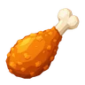

<!-- wide -->
# Chicken Fire 리소스 목록

> 게임(아레나 장면)이 실제로 불러 쓰는 리소스만 적었습니다. 에디터 도구, 시험용 장면, 보관용 예전 파일은 뺐습니다. 기준은 2026-10-11 보관본입니다.
> 사실은 파일과 출처 기록(`Assets/ChickenFire/Credits`, `ArtSource`의 CREDITS)에서 옮겼습니다. 어떻게 만들었는지 기록이 없으면 기록 없음이라고 적었습니다.
> 썸네일은 PNG 그림이 있는 표에만 넣었고, 크기/길이 칸은 값이 있는 표에만 두었습니다. 폴더 경로는 표 위에 적었습니다.

## 목차

1. [모델](#1-모델)
2. [애니메이션](#2-애니메이션)
3. [셰이더 · 머티리얼](#3-셰이더--머티리얼)
4. [사운드](#4-사운드)
5. [UI · 아이콘 · 글꼴](#5-ui--아이콘--글꼴)
6. [외부 에셋 라이선스](#6-외부-에셋-라이선스)

---

## 1. 모델

`Assets/ChickenFire/Art/Chicken/`

| 순번 | 리소스명 | 파일 이름 | 쓰는 곳 | 제작 방식 | 라이선스 |
|---|---|---|---|---|---|
| 1 | 닭 | Chicken.fbx | 플레이어(노란 닭)와 적(하얀 닭) 모두 | 외부 에셋 (FBX로 바꾸고 크기 맞춤) | CC BY 4.0 (Chickensoft) |

`Assets/ChickenFire/Generated/` — 게임이 닭 모델에서 나눠 만든 적 닭용 메시

| 순번 | 리소스명 | 파일 이름 | 쓰는 곳 | 제작 방식 | 라이선스 |
|---|---|---|---|---|---|
| 2 | 적 닭 몸(눈 뺌) | EnemyBodyWithoutEyes.asset | 적 닭 몸 | 외부 에셋을 고침 (눈을 떼어 냄) | CC BY 4.0 (Chickensoft) |
| 3 | 적 닭 평소 눈 | EnemyNormalEyes.asset | 적 닭 평소 표정 (삼각형 384개) | 외부 에셋을 고침 | CC BY 4.0 (Chickensoft) |
| 4 | 적 닭 > < 눈 | EnemySqueezedEyes.asset | 불에 맞은 적 닭 표정 | 직접 제작 (AI 참고 그림) | CC BY 4.0 (Chickensoft) |

`Assets/ChickenFire/Art/Handmade/GearV2/`

| 순번 | 리소스명 | 파일 이름 | 쓰는 곳 | 제작 방식 | 라이선스 |
|---|---|---|---|---|---|
| 5 | 화염방사기 | FireGunV2.fbx | 플레이어가 양 날개로 쥔 총 | 직접 제작 (Blender, AI 참고 그림) | 자체 제작 |
| 6 | 연료 가방 | FuelBackpackV2.fbx | 플레이어 등의 쌍연료통과 호스 | 직접 제작 (Blender, AI 참고 그림) | 자체 제작 |

`Assets/ChickenFire/Art/Handmade/` — 게임은 이 FBX로 만든 메시(`Generated/KFCBucketCombined.asset`, `Generated/Wind_Oak_*.asset`)를 씁니다

| 순번 | 리소스명 | 파일 이름 | 쓰는 곳 | 크기/길이 | 제작 방식 | 라이선스 |
|---|---|---|---|---|---|---|
| 7 | 치킨통 | KFCBucket.fbx | 쓰러진 닭 자리에 떨어지는 치킨통 | 삼각형 8,292개 | 직접 제작 (Blender, 사진 참고) | 자체 제작 (라벨은 3장 15번) |
| 8 | 불타는 참나무 | BurnableOak.fbx | 아레나 참나무 12그루 | 삼각형 560개 | 외부 에셋을 고침 (잎과 가지를 나눔) | CC0 (Kenney Nature Kit) |

`Assets/ChickenFire/Art/Farm/Quaternius/`

| 순번 | 리소스명 | 파일 이름 | 쓰는 곳 | 제작 방식 | 라이선스 |
|---|---|---|---|---|---|
| 9 | 헛간 | Barn.fbx | 북쪽 헛간 마당 (타지 않음) | 외부 에셋 | CC0 (Quaternius) |
| 10 | 닭장 | ChickenCoop.fbx | 남서쪽 2채 (타지 않음) | 외부 에셋 | CC0 (Quaternius) |
| 11 | 울타리 | Fence.fbx | 아레나 경계 32개 | 외부 에셋 | CC0 (Quaternius) |
| 12 | 사일로 | Silo.fbx | 북쪽 헛간 마당 (타지 않음) | 외부 에셋 | CC0 (Quaternius) |
| 13 | 물탱크 | WaterTower.fbx | 북쪽 헛간 마당 (타지 않음) | 외부 에셋 | CC0 (Quaternius) |
| 14 | 우물 | Well.fbx | 남서쪽 (타지 않음) | 외부 에셋 | CC0 (Quaternius) |

`Assets/ChickenFire/Art/Nature/`

| 순번 | 리소스명 | 파일 이름 | 쓰는 곳 | 제작 방식 | 라이선스 |
|---|---|---|---|---|---|
| 15 | 호박 | crop_pumpkin.fbx | 동쪽 호박밭 20개 (탐) | 외부 에셋 | CC0 (Kenney Nature Kit) |
| 16 | 옥수수 | crops_cornStageC.fbx | 서쪽 옥수수밭 24개 (탐) | 외부 에셋 | CC0 (Kenney Nature Kit) |
| 17 | 밀 | crops_wheatStageB.fbx | 북동쪽 밀밭 36개 (탐) | 외부 에셋 | CC0 (Kenney Nature Kit) |
| 18 | 장작더미 | log_stack.fbx | 곳곳 6개 (탐) | 외부 에셋 | CC0 (Kenney Nature Kit) |
| 19 | 작은 바위 | rock_smallA.fbx | 곳곳 6개 (타지 않음) | 외부 에셋 | CC0 (Kenney Nature Kit) |

`Assets/ChickenFire/Art/QuaterniusGrass/` — 게임은 이 FBX로 만든 메시(`Generated/Quaternius_Grass_*.asset`)를 씁니다

| 순번 | 리소스명 | 파일 이름 | 쓰는 곳 | 제작 방식 | 라이선스 |
|---|---|---|---|---|---|
| 20 | 작은 풀 | Grass_Small.fbx | 바닥 전체에 깔린 풀 (타지 않음) | 외부 에셋 (크기·기준점 맞춤) | CC0 (Quaternius) |
| 21 | 큰 풀 | Grass_Large.fbx | 바닥 풀, 곳곳의 타는 풀숲 24개 | 외부 에셋 (크기·기준점 맞춤) | CC0 (Quaternius) |

`Assets/FireBreathParticles/Generated/`

| 순번 | 리소스명 | 파일 이름 | 쓰는 곳 | 제작 방식 | 라이선스 |
|---|---|---|---|---|---|
| 22 | 불길 줄기 메시 | FlameStreamOverlapMesh.asset | 화염방사기 불길 | 직접 제작 (Blender) | 자체 제작 |
| 23 | 불혀 메시 | FlameTongueForwardMesh.asset | 화염방사기 불길 끝 | 직접 제작 (Blender) | 자체 제작 |
| 24 | 연기 덩어리 메시 | SmokePuffMesh.asset | 불길 연기 | 직접 제작 (Blender) | 자체 제작 |
| 25 | 불티 메시 | SparkForwardMesh.asset | 불길 불티 | 직접 제작 (Blender) | 자체 제작 |

`Assets/ChickenFire/Generated/Cartoon/`

| 순번 | 리소스명 | 파일 이름 | 쓰는 곳 | 제작 방식 | 라이선스 |
|---|---|---|---|---|---|
| 26 | 외곽선 메시 8개 | Silhouette_….asset (8개) | 닭·장비·치킨통·나무·건물의 카툰 외곽선 | 직접 제작 (에디터 도구) | 원본 모델의 라이선스를 따름 |

---

## 2. 애니메이션

`Assets/ChickenFire/Art/Chicken/` — Chicken.fbx 안에 든 동작 중 게임이 쓰는 것

| 순번 | 리소스명 | 파일 이름 | 쓰는 곳 | 크기/길이 | 제작 방식 | 라이선스 |
|---|---|---|---|---|---|---|
| 1 | 서 있기 | Chicken.fbx (idle) | 플레이어·적 닭이 멈췄을 때 |  | 외부 에셋 | CC0 (Chickensoft) |
| 2 | 걷기 | Chicken.fbx (walk) | 플레이어 이동, 적 닭 이동 | 0.792초 반복 | 외부 에셋 | CC0 (Chickensoft) |
| 3 | 달리기 | Chicken.fbx (run) | 플레이어 이동 동작에 걷기와 섞어 씀 | 0.5초 반복 | 외부 에셋 | CC0 (Chickensoft) |

`Assets/ChickenFire/Art/Chicken/Locomotion/`

| 순번 | 리소스명 | 파일 이름 | 쓰는 곳 | 크기/길이 | 제작 방식 | 라이선스 |
|---|---|---|---|---|---|---|
| 4 | 뒷걸음질 | Backpedal.fbx | 조준 반대쪽으로 걸을 때 | 0.5초 반복 | 직접 제작 (Blender 스크립트) | 자체 제작 (Chickensoft 뼈대) |
| 5 | 왼발로 멈추기 | StopL.fbx | 왼발이 땅에 있을 때 멈춤 | 0.42초 | 직접 제작 (Blender 스크립트) | 자체 제작 (Chickensoft 뼈대) |
| 6 | 오른발로 멈추기 | StopR.fbx | 오른발이 땅에 있을 때 멈춤 | 0.42초 | 직접 제작 (Blender 스크립트) | 자체 제작 (Chickensoft 뼈대) |

`Assets/ChickenFire/Art/Chicken/Panic/`

| 순번 | 리소스명 | 파일 이름 | 쓰는 곳 | 크기/길이 | 제작 방식 | 라이선스 |
|---|---|---|---|---|---|---|
| 7 | 불에 놀람 | BurnStartle.fbx | 적 닭이 처음 불에 맞았을 때 | 0.2초 | 직접 제작 (Blender, AI 참고 그림) | 자체 제작 (Chickensoft 뼈대) |
| 8 | 허둥지둥 도망 | PanicRun.fbx | 적 닭이 날개를 퍼덕이며 도망칠 때 | 0.5초 반복 | 직접 제작 (Blender, AI 참고 그림) | 자체 제작 (Chickensoft 뼈대) |
| 9 | 숨 고르기 | PanicRecover.fbx | 도망이 끝나고 평소로 돌아올 때 | 0.3초 | 직접 제작 (Blender, AI 참고 그림) | 자체 제작 (Chickensoft 뼈대) |

`Assets/ChickenFire/Generated/`

| 순번 | 리소스명 | 파일 이름 | 쓰는 곳 | 제작 방식 | 라이선스 |
|---|---|---|---|---|---|
| 10 | 플레이어 동작 연결 | Chicken.controller | 서 있기·걷기·뒷걸음질·멈추기 전환 | 직접 제작 (에디터 도구) | 자체 제작 |
| 11 | 적 닭 동작 연결 | EnemyPanic.controller | 서 있기·걷기·놀람·도망·회복 전환 | 직접 제작 (에디터 도구) | 자체 제작 |

---

## 3. 셰이더 · 머티리얼

`Assets/ChickenFire/Shaders/`

| 순번 | 리소스명 | 파일 이름 | 쓰는 곳 | 제작 방식 | 라이선스 |
|---|---|---|---|---|---|
| 1 | 카툰 명암 셰이더 | VertexFarm.shader | 거의 모든 모델의 3단 명암, 바람 흔들림 | 직접 제작 | 자체 제작 |
| 2 | 외곽선 셰이더 | CartoonOutline.shader | 캐릭터·장비·나무·건물 외곽선 | 직접 제작 | 자체 제작 |
| 3 | 풀 외곽선 셰이더 | GrassOutline.shader | 풀 외곽선 | 직접 제작 | 자체 제작 |
| 4 | 타는 잎 셰이더 | BurningFoliage.shader | 참나무 잎이 타 들어가는 모습 | 직접 제작 | 자체 제작 |
| 5 | 타는 잎 외곽선 셰이더 | BurningFoliageOutline.shader | 타는 잎의 외곽선 | 직접 제작 | 자체 제작 |
| 6 | 붙은 불 셰이더 | AttachedFlame.shader | 물건에 옮겨붙은 불꽃 | 직접 제작 | 자체 제작 |
| 7 | 바람 계산 | FarmWind.hlsl | 풀과 나무 흔들림 | 직접 제작 | 자체 제작 |
| 8 | 탄 자국 계산 | TreeBurnMask.hlsl | 잎이 타 들어가는 경계 | 직접 제작 | 자체 제작 |

`Assets/FireBreathParticles/Shaders/`

| 순번 | 리소스명 | 파일 이름 | 쓰는 곳 | 제작 방식 | 라이선스 |
|---|---|---|---|---|---|
| 9 | 만화풍 불꽃 셰이더 | ToonFlowFire.shader | 화염방사기 불길 | 직접 제작 | 자체 제작 |
| 10 | 부드러운 연기 셰이더 | SoftSmoke.shader | 불길 연기 | 직접 제작 | 자체 제작 |
| 11 | 둥근 창 계산 | EnemyOcclusionWindow.hlsl | 가려진 적 닭 둘레를 뚫어 보이게 함 | 직접 제작 | 자체 제작 |

`Assets/FireBreathParticles/Textures/`, `Assets/ChickenFire/Art/Textures/`, `Assets/ChickenFire/Generated/`

| 순번 | 리소스명 | 파일 이름 | 쓰는 곳 | 크기/길이 | 썸네일 | 제작 방식 | 라이선스 |
|---|---|---|---|---|---|---|---|
| 12 | 연기 그림 묶음 | SmokeAtlas.png | 불길 연기 | 512 × 256 |  | 직접 제작 (에디터 도구가 만듦) | 자체 제작 |
| 13 | 타는 빛 그림 | BurnGlow.asset | 불타는 물건의 빛 |  |  | 직접 제작 (에디터 도구가 만듦) | 자체 제작 |
| 14 | 탄 자국 모양 | ScorchMask.asset | 바닥 탄 자국 |  |  | 직접 제작 (에디터 도구가 만듦) | 자체 제작 |
| 15 | 치킨통 라벨 | KFCLabel.png | 치킨통 겉면 그림 | 1024 × 1536 | — | AI 생성 (사진 참고, 사용자 승인) | 실제 상표(KFC) 로고와 초상을 본뜸. 허락 기록 없음 |

`Assets/ChickenFire/Generated/` — 머티리얼은 모델마다 묶어 적었습니다

| 순번 | 리소스명 | 파일 이름 | 쓰는 곳 | 제작 방식 | 라이선스 |
|---|---|---|---|---|---|
| 16 | 플레이어 닭 재질 | Chicken_DefaultMaterial.mat | 노란 닭 | 직접 제작 (에디터 도구) | 자체 제작 |
| 17 | 적 닭 재질 | WhiteChicken.mat | 하얀 닭 | 직접 제작 (에디터 도구) | 자체 제작 |
| 18 | 장비 재질 5개 | GearV2 Brass / Charcoal / Dial / Red / Rubber.mat | 화염방사기·연료 가방 | 직접 제작 | 자체 제작 |
| 19 | 치킨통 재질 5개 | KFCBucket_Bucket crimson / Bucket paper / Drumstick ivory / Drumstick roast / KFC printed label.mat | 치킨통 | 직접 제작 | 자체 제작 |
| 20 | 헛간 재질 4개 | Barn_DarkRed / LightRed / RoofBlack / White.mat | 헛간 | 직접 제작 (원본 색을 옮김) | CC0 (Quaternius) |
| 21 | 닭장 재질 5개 | ChickenCoop_Brown / DarkRed / LightRed / RoofBlack / White.mat | 닭장 | 직접 제작 (원본 색을 옮김) | CC0 (Quaternius) |
| 22 | 사일로 재질 5개 | Silo_Brown / DarkRed / Grey / LightRed / White.mat | 사일로 | 직접 제작 (원본 색을 옮김) | CC0 (Quaternius) |
| 23 | 물탱크 재질 3개 | WaterTower_Brown / DarkGrey / Grey.mat | 물탱크 | 직접 제작 (원본 색을 옮김) | CC0 (Quaternius) |
| 24 | 우물 재질 5개 | Well_Brown / DarkGrey / Grey / LightRed / White.mat | 우물 | 직접 제작 (원본 색을 옮김) | CC0 (Quaternius) |
| 25 | 울타리 재질 | Fence_Brown.mat | 울타리 | 직접 제작 (원본 색을 옮김) | CC0 (Quaternius) |
| 26 | 작물·장작·바위 재질 9개 | crop_pumpkin_grass / crop_pumpkin_leafsFall / crops_cornStageC_grass / crops_wheatStageB__defaultMat / crops_wheatStageB_woodInner / log_stack_woodBark / log_stack_woodInner / rock_smallA_dirt / rock_smallA_grass.mat | 호박·옥수수·밀·장작더미·바위 | 직접 제작 (원본 색을 옮김) | CC0 (Kenney) |
| 27 | 참나무 재질 3개 | tree_oak_woodBark / BurningLeaves / BurningLeavesOutline.mat | 참나무 줄기, 타는 잎과 그 외곽선 | 직접 제작 (에디터 도구) | 자체 제작 |
| 28 | 풀 재질 2개 | QuaterniusGrass / QuaterniusGrassOutline.mat | 바닥 풀과 외곽선 | 직접 제작 (색·바람 조절) | 자체 제작 |
| 29 | 바닥 재질 4개 | Pasture / Field / Grove / Dirt.mat | 아레나 바닥 | 직접 제작 | 자체 제작 |
| 30 | 외곽선 재질 2개 | CharacterOutline / SceneryOutline.mat (Cartoon 폴더) | 캐릭터용 굵은 선, 배경용 얇은 선 | 직접 제작 | 자체 제작 |
| 31 | 불·연기·자국 재질 4개 | AttachedFlame / TreeSmoke / Scorch / BurnGlow.mat | 붙은 불, 타는 연기, 탄 자국, 타는 빛 | 직접 제작 | 자체 제작 |

`Assets/FireBreathParticles/Generated/`

| 순번 | 리소스명 | 파일 이름 | 쓰는 곳 | 제작 방식 | 라이선스 |
|---|---|---|---|---|---|
| 32 | 화염방사기 불길 재질 5개 | FlyingFire / MuzzleFire / OuterFire / Smoke / Sparks.mat | 불길, 총구 불, 바깥 불, 연기, 불티 | 직접 제작 | 자체 제작 |

---

## 4. 사운드

`Assets/ChickenFire/Audio/` — 소리마다 기본 크기를 정한 묶음 설정

| 순번 | 리소스명 | 파일 이름 | 쓰는 곳 | 제작 방식 | 라이선스 |
|---|---|---|---|---|---|
| 1 | 소리 묶음 설정 | ChickenSoundBank.asset | 아래 모든 효과음의 연결과 기본 크기 | 직접 제작 | 자체 제작 |

`Assets/ChickenFire/Audio/SFX/` — 모두 외부 소리를 잘라 앞뒤를 다듬고, 반복 소리는 끊김 없이 이어지게 하고, 크기를 맞춘 것입니다

| 순번 | 리소스명 | 파일 이름 | 쓰는 곳 | 크기/길이 | 제작 방식 | 라이선스 |
|---|---|---|---|---|---|---|
| 2 | 화염방사기 점화 | Flame_Ignite.wav | 불을 켤 때 | 1.10초 | 외부 에셋 (BigSoundBank #1340) | CC0 |
| 3 | 화염방사기 분사 | Flame_Loop.wav | 불을 뿜는 동안 반복 | 4.00초 | 외부 에셋 (BigSoundBank #0930) | CC0 |
| 4 | 화염방사기 끄기 | Flame_Stop.wav | 불을 끌 때 | 1.35초 | 외부 에셋 (BigSoundBank #0930) | CC0 |
| 5 | 지글지글 | Flame_Sizzle_Loop.wav | 불이 물체나 닭에 닿는 동안 반복 | 4.00초 | 외부 에셋 (BigSoundBank #0145) | CC0 |
| 6 | 풀밭 발소리 1~5 | Step_Grass_0~4.ogg | 플레이어 발이 땅에 닿을 때 | 0.59~0.78초 | 외부 에셋 (Kenney Impact Sounds) | CC0 |
| 7 | 닭 놀람 1 | Hen_Startle_0.wav | 적 닭이 불에 맞았을 때 | 0.75초 | 외부 에셋 (BigSoundBank #0453) | CC0 |
| 8 | 닭 놀람 2·3 | Hen_Startle_1.wav, Hen_Startle_2.wav | 적 닭이 불에 맞았을 때 | 0.60초, 0.90초 | 외부 에셋 (BigSoundBank #1040) | CC0 |
| 9 | 닭 허둥지둥 1~3 | Hen_Panic_0~2.wav | 도망치는 닭이 있을 때 가끔 | 1.30초 | 외부 에셋 (BigSoundBank #0282) | CC0 |
| 10 | 닭 허둥지둥 4 | Hen_Panic_3.wav | 도망치는 닭이 있을 때 가끔 | 1.10초 | 외부 에셋 (BigSoundBank #1039) | CC0 |
| 11 | 닭 비명 | Hen_Death.wav | 적 닭이 쓰러질 때 | 0.90초 | 외부 에셋 (BigSoundBank #1040) | CC0 |
| 12 | 펑 1·2 | Death_Poof_0.ogg, Death_Poof_1.ogg | 적 닭이 사라질 때 | 0.51초, 0.57초 | 외부 에셋 (Kenney Impact Sounds) | CC0 |
| 13 | 치킨통 등장 1·2 | Bucket_Pop_0.ogg, Bucket_Pop_1.ogg | 치킨통이 떨어질 때 | 0.19초 | 외부 에셋 (Kenney Interface Sounds) | CC0 |
| 14 | 물건 점화 | Prop_Ignite.wav | 작물·나무에 불이 붙을 때 | 1.80초 | 외부 에셋 (BigSoundBank #1340) | CC0 |
| 15 | 타는 소리 1·2 | Burn_Loop_0.wav, Burn_Loop_1.wav | 물건이 타는 동안 반복 | 6.00초 | 외부 에셋 (BigSoundBank #0987) | CC0 |
| 16 | 바삭 | Eat_Crunch.wav | 치킨통을 먹을 때 | 0.80초 | 외부 에셋 (BigSoundBank #1113) | CC0 |
| 17 | 시간 추가 차임 | Time_Gain_Chime.ogg | 먹고 0.1초 뒤 | 0.54초 | 외부 에셋 (Kenney Interface Sounds) | CC0 |
| 18 | 남은 시간 똑딱 | Time_Warning_Tick.ogg | 10초 이하에서 1초마다 | 0.02초 | 외부 에셋 (Kenney Interface Sounds) | CC0 |
| 19 | 시간 종료 징글 | TimeUp_Jingle.ogg | 남은 시간이 0이 될 때 | 1.00초 | 외부 에셋 (Kenney Music Jingles) | CC0 |
| 20 | 보상 줄어듦 | Reward_Drop.ogg | 한 마리당 보상이 줄어들 때 | 0.21초 | 외부 에셋 (Kenney Interface Sounds) | CC0 |

---

## 5. UI · 아이콘 · 글꼴

`Assets/ChickenFire/Resources/GameSettings/`

| 순번 | 리소스명 | 파일 이름 | 쓰는 곳 | 크기/길이 | 썸네일 | 제작 방식 | 라이선스 |
|---|---|---|---|---|---|---|---|
| 1 | 톱니 아이콘 | gear.png | 오른쪽 위 설정 버튼 | 100 × 100 |  | 외부 에셋 (Kenney Game Icons) | CC0 |
| 2 | 닫기 아이콘 | cross.png | 설정 창 닫기 버튼 | 100 × 100 |  | 외부 에셋 (Kenney Game Icons) | CC0 |
| 3 | 소리 켬 아이콘 | audioOn.png | 설정 창 소리 켜기 · 끄기 버튼 | 100 × 100 |  | 외부 에셋 (Kenney Game Icons) | CC0 |
| 4 | 소리 끔 아이콘 | audioOff.png | 설정 창 소리 켜기 · 끄기 버튼 | 100 × 100 |  | 외부 에셋 (Kenney Game Icons) | CC0 |

`Assets/ChickenFire/Resources/SurvivalHud/`

| 순번 | 리소스명 | 파일 이름 | 쓰는 곳 | 크기/길이 | 썸네일 | 제작 방식 | 라이선스 |
|---|---|---|---|---|---|---|---|
| 5 | 둥근 판 | Panel.png | HUD·설정 창·게임 종료 창의 둥근 바탕 | 256 × 256 |  | 직접 제작 (스크립트로 그림) | 자체 제작 |
| 6 | 시계 아이콘 | Clock.png | 남은 시간 옆 | 256 × 256 |  | 직접 제작 (스크립트로 그림) | 자체 제작 |
| 7 | 닭다리 아이콘 | Drumstick.png | 먹은 수 옆 | 1254 × 1254 |  | 기록 없음 | 기록 없음 |
| 8 | HUD 화면 배치 | HudCanvas.prefab | 먹은 수 · 보상 · 남은 시간 칸 |  |  | 직접 제작 | 자체 제작 |
| 9 | HUD 위치 값 | Layout.asset | HUD 칸의 위치와 크기 |  |  | 직접 제작 | 자체 제작 |

`Assets/ChickenFire/Resources/Fonts/`

| 순번 | 리소스명 | 파일 이름 | 쓰는 곳 | 크기/길이 | 제작 방식 | 라이선스 |
|---|---|---|---|---|---|---|
| 10 | 게임 글꼴 | Nunito-Bold.ttf (+ Nunito-OFL.txt) | 게임 안 모든 글자 | 39 KB (라틴 글자만) | 외부 에셋 | SIL OFL 1.1 |

---

## 6. 외부 에셋 라이선스

| 에셋 팩 | 만든 사람 | 라이선스 | 출처 |
|---|---|---|---|
| Chickensoft Mascot (닭 모델) | Tibo, Chickensoft | 모델 CC BY 4.0 (출처 표시 필요), 동작 CC0 1.0 | https://github.com/chickensoft-games/Chicken |
| Nature Kit | Kenney | CC0 1.0 | https://kenney.nl/assets/nature-kit |
| LowPoly Farm Buildings | Quaternius | CC0 1.0 | https://quaternius.itch.io/lowpoly-farm-buildings |
| Ultimate Stylized Nature Pack (풀) | Quaternius | CC0 1.0 | https://quaternius.com/packs/ultimatestylizednature.html |
| BigSoundBank | Joseph Sardin | CC0 | https://bigsoundbank.com |
| Impact Sounds · Interface Sounds · Music Jingles | Kenney | CC0 | https://kenney.nl |
| Game Icons | Kenney | CC0 | https://kenney.nl/assets/game-icons |
| Nunito | The Nunito Project Authors | SIL Open Font License 1.1 | Google Fonts / Fontsource (주소는 기록에 없음) |

출처: `Assets/ChickenFire/Credits/Attribution.txt`, `ArtSource/Audio/CREDITS.md`, `ArtSource/UI/CREDITS.md`, `ArtSource/Farm/CREDITS.md`, `BucketRemodel.txt`, `EnemyBurnEyesPlan.txt`, `EnemyPanicPlan.txt`, 아레나 장면과 프리팹의 참조 관계
