# 쭉쭉냥 : 고양이 퍼즐 — 제작 프롬프트

> **쭉쭉냥 : 고양이 퍼즐**은 제가 AI와 함께 기획부터 개발, Google Play 출시(`com.minari.zzukzzuknyang`)까지 해낸 게임입니다.
> 이 문서는 그렇게 만든 게임을 **AI가 그대로 다시 만들 수 있도록** 정리한 제작 프롬프트입니다. 아래 내용을 통째로 AI에게 주면 같은 규칙, 같은 숫자, 같은 화면의 게임이 나오도록 실제 게임의 코드와 데이터에서 값을 그대로 옮겨 적었습니다.
> 함께 주는 자료: 리소스 목록 [`zzukzzuk-nyang-resources.xlsx`](zzukzzuk-nyang-resources.xlsx), 레벨 데이터 [`data/`](data/), 그림 [`images/`](images/). 기준 버전: 1.1.1(Android 버전 코드 4), Unity 6000.5.6f1, URP 17.5.0.

## 프롬프트

```text
너는 Unity 6(6000.5.6f1, URP) 게임 개발자다.
아래 명세대로 세로형 모바일 퍼즐 게임 "쭉쭉냥 : 고양이 퍼즐"을 만들어라.

- 명세에 적힌 규칙, 숫자, 문구, 화면 순서는 바꾸지 말고 그대로 구현한다.
- 레벨은 함께 준 data/levels.json(197개 + 튜토리얼 4개)을 그대로 쓴다.
- 그림·소리·글꼴은 함께 준 리소스 목록의 이름과 규격을 따른다.
- 명세에 없는 부분(부록 A)만 스스로 정하고, 정한 내용을 따로 적어 둔다.
- 12장 "다시 만들 때 순서"대로 만들고, 단계마다 그 장의 확인 방법으로 검사한 뒤 다음 단계로 간다.
```

아래부터가 프롬프트와 함께 주는 **게임 명세**입니다.

## 목차

1. [개요](#1-개요)
2. [핵심 규칙](#2-핵심-규칙)
3. [조작과 물리(냥이 몸 계산)](#3-조작과-물리냥이-몸-계산)
4. [레벨](#4-레벨)
5. [메달·도감·힌트·일일 도전](#5-메달도감힌트일일-도전)
6. [화면 흐름과 UI](#6-화면-흐름과-ui)
7. [연출](#7-연출)
8. [사운드](#8-사운드)
9. [아트 기준](#9-아트-기준)
10. [저장 데이터·설정·진행](#10-저장-데이터설정진행)
11. [기술 구조](#11-기술-구조)
12. [다시 만들 때 순서](#12-다시-만들-때-순서)

- [부록 A. 명세에 없는 부분](#부록-a-명세에-없는-부분)
- [부록 B. 원본 자료끼리 다른 곳](#부록-b-원본-자료끼리-다른-곳)
- [부록 C. 함께 둔 파일](#부록-c-함께-둔-파일)

---

## 1. 개요

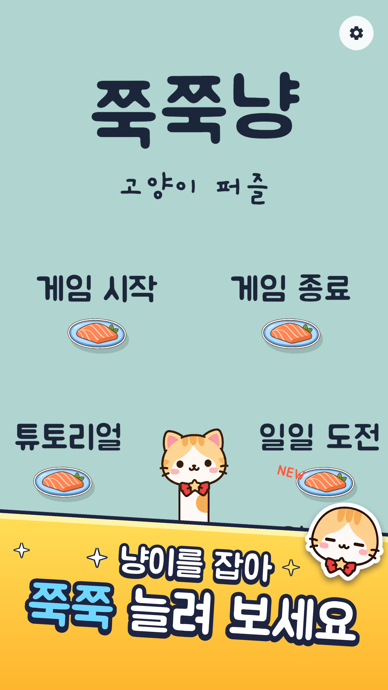

| 항목 | 내용 |
|---|---|
| 한 줄 소개 | 쭉쭉 늘어나는 냥이를 연어 접시에 감아서, 견본 그림을 한붓에 그리는 퍼즐 |
| 이름 | 한국어 `쭉쭉냥` (스토어: `쭉쭉냥: 고양이 퍼즐`), 영어 `Zzuk-Zzuk Nyang` (부제 `A Stretchy Cat Puzzle`) |
| 장르 | 한붓그리기(one-stroke) 퍼즐. 줄 대신 늘어나는 고양이 몸을 쓴다 |
| 플랫폼 | Android(Google Play, 패키지 `com.minari.zzukzzuknyang`), Windows PC, Web(WebGL) |
| 화면 방향 | 세로. 휴대폰(가장 짧은 변 600dp 미만)은 실행할 때 세로로 고정, 태블릿·폴더블은 회전 허용(`ScreenOrientationRule`) |
| 기준 해상도 | UI 캔버스 기준 1080×1920(Canvas Scaler). PC 창 540×960, 모니터 높이의 88%보다 크면 9:16을 지키며 줄임(최소 높이 320). F11 = 전체 화면 전환, Alt+Enter도 됨 |
| 넓은 화면 | 화면비(가로/세로)가 0.9 이하면 화면 전체를 쓴다. 더 넓으면 가운데에 9:16 세로 기둥만 그리고, 양옆은 배경색 × (0.8, 0.8, 0.82)로 칠한다(`BoardCamera`) |
| 안전 영역 | UI 루트가 `Screen.safeArea`에 맞춰 줄어든다(`SafeArea`). 노치·둥근 모서리·홈 바를 피함 |
| 프레임 | 60fps 고정(`Application.targetFrameRate = 60`). PC 빌드는 vSync 1(모니터 주사율) |
| 대상 | 스토어 문구 "누구나 편하게". 연령 등급·주 대상층은 원본에 없음 → **확인 못 함** |
| 수익 모델 | 없음. 광고·결제·로그인 없음, 인터넷 없이 플레이 |
| 언어 | 한국어·영어. 처음엔 기기 언어(한국어 기기 → 한국어, 그 밖 → 영어), 설정에서 바로 바꿈 |
| 핵심 재미 | 팽팽한 고양이 몸이 접시에 감기고 풀리는 손맛 + 감을 때마다 한 음씩 올라가 풀이가 멜로디가 됨 + 다 그리면 배경 그림이 나타나는 보상 |
| 분량 | 일반 레벨 197개 + 튜토리얼 4단계 + 일일 도전(날짜로 매일 3개 생성, 끝없음) |

---

## 2. 핵심 규칙

### 2.1 판 위의 것

- **접시(peg)**: 연어 접시 그림(`salmon_dish.png`). 좌표가 있는 점. 한 레벨에 3~14개.
- **견본 그림(sample card)**: 화면 위쪽 흰 카드에 그려진 선 그림. 접시 사이를 잇는 선(edge)들의 모음. 카드 중심 (0, 3.45), 크기 2.3×1.6, 안쪽 여백 0.25, 선 굵기 0.06(월드 단위).
- **냥이**: 몸이 줄이다. 꼬리 쪽이 시작 접시에 묶이고, 머리가 손가락을 따라간다.
- **연어 카운터**: 왼쪽 위 "접시 아이콘 × N". N = 아직 안 그린 견본 선 수.

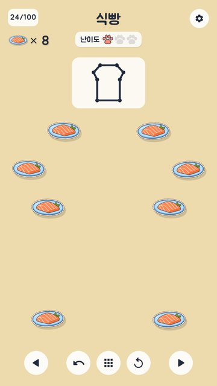

### 2.2 한 판의 순서

1. **시작 접시 고르기**: 접시를 탭(접시 중심에서 0.6 안). 레벨에 `fixedStart`가 있으면 그 접시만 된다. 다른 접시를 누르면 토스트 "'시작' 생선에서 시작해요"(1.5초) + 틀림 소리(0.5). 일반 레벨 197개 중 시작 고정은 **0개**, 튜토리얼 0-1·0-2·0-3만 고정.
2. **그리기**: 고른 순간 냥이 꼬리가 그 접시에 묶이고, 머리를 끌면 몸이 늘어난다. 접시 근처를 지나거나 돌면 몸이 그 접시에 걸린다(3장).
3. **손 떼기**: 머리를 접시 위(0.6 안)에서 놓으면 그 접시에 고정된다. 접시가 아닌 곳에서 놓으면 머리가 그 자리에 떠 있고, 머리에서 0.9 안을 다시 잡으면 이어 그린다.
4. **판정**: 몸이 지나간 접시 순서(꼬리 접시부터 걸린 접시들, 떠 있는 머리는 빼고)로 선을 만든다.

### 2.3 선을 정확히 한 번씩 (판정 `ShapeMatcher`)

- 견본 선과 그린 선은 모두 **방향 없는** 접시 쌍.
- 그린 선 한 개가 다른 접시 위를 정확히 지나면(선과의 거리 0.05 미만, 양 끝 0.0001 안쪽) 그 접시에서 잘라 여러 선으로 센다.
- 결과: `Matched`(맞힌 견본 선 수), `Missing`(남은 견본 선), `Extra`(견본에 없는 선, 지난 횟수만큼), `Duplicate`(같은 견본 선을 두 번 이상 지난 횟수 − 1).
- **틀린 선 = Extra + Duplicate.** 틀린 선마다 빨간 선(#E64242, 굵기 0.14)을 겹쳐 그린다.
- **클리어 = Missing 0, Extra 0, Duplicate 0.**

### 2.4 클리어 판정 시점

- 손을 떼서 머리가 접시에 붙은 직후 판정. 맞으면 클리어.
- 모든 선을 다 그렸는데 머리를 접시 밖에서 놓았으면, 머리를 마지막 접시로 되감은 뒤(되감기 속도는 3.5절) 클리어.
- 그리는 동안에도 매 프레임 판정해서 카운터·표정·소리를 바꾼다(클리어는 손을 뗄 때만).

### 2.5 인정되는 세 가지 풀이 방식

어떤 방식이든 결과가 같으면 정답이다. 모든 레벨은 이 방식들로 자동 재생해 통과해야 한다(`SolutionReplay`, 4.5절).

| 방식 | 하는 법 | 계산 |
|---|---|---|
| 바깥 감기 | 몸을 접시 바깥으로 돌려 감는다 | `RopeSolver`가 쓸고 지나간 삼각형 안의 접시를 감는다 |
| 지나가며 잇기 | 손을 떼지 않고 접시 위를 지나가며 꺾는다(안쪽으로 꺾어도 됨) | `DotConnector`: 접시 0.45 안에 들어갔다 나오면 그 접시에 건다 |
| 놓고 다시 잡기 | 접시마다 손을 놓았다가 다시 잡아 끈다 | `PegMagnet` + `RopeSolver.PinEnd` |

### 2.6 실패·되돌리기·처음부터

- **실패라는 끝은 없다.** 틀린 선이 있으면 빨간 선이 보이고, 손을 접시에서 떼면 토스트 "틀린 선이 N개 있어요"(1.8초, 영어 "N wrong line(s)") + 냥이 놀란 얼굴 + 말풍선 "어라?"(1.2초).
- **한 단계 뒤로(↶, 키보드 Z / Backspace)**
  - 머리가 마지막 접시에서 떠 있으면 → 마지막 접시로 되감는다.
  - 머리가 마지막 접시에 붙어 있으면 → 그 접시를 빼고 그 앞 접시로 되감는다.
  - 남은 것이 시작 접시뿐이고 머리도 거기 있으면 → 시작 접시 고르기로 돌아간다.
  - 되감은 뒤 그 접시는 "막 고정된" 상태가 되어, 다음에 끄는 방향으로 감는 쪽이 다시 정해진다.
- **처음부터(↻, 키보드 R)**: 시작 접시 고르기로 돌아간다. 버튼은 토스트 "처음부터 다시!"(1.2초)를 띄우고, R 키는 토스트 없이 바로.
  - 예외: 머리가 화면 밖에 나가 "눌러서 냥이 데려오기"가 떠 있으면 ↻는 처음부터가 아니라 머리를 되감는다(3.6절).
- 판 위에 이미 감긴 접시는 몸을 반대로 휘둘러도 **절대 풀리지 않는다**(감긴 방향만 뒤집힘). 빼는 방법은 ↶와 ↻뿐이다.

---

## 3. 조작과 물리(냥이 몸 계산)

모든 좌표는 월드 단위. 판은 대략 x −3~3, y −4.6~2.6. 카메라는 직교(orthographic), 위치 (0,0,−10), 반높이 = max(6, 3.4 ÷ 화면비).

### 3.1 입력

- Unity Input System의 `Pointer.current` 하나로 터치와 마우스를 같이 받는다(멀티터치 없음).
- UI 위를 누른 것은 판 입력으로 치지 않는다.
- 설정 창·오버레이·화면 전환 중에는 판 입력을 막는다. 그사이 손가락이 떨어졌으면 바로 손 뗌 처리.
- 앱이 백그라운드로 가거나 포커스를 잃으면 끄는 중이던 것을 손 뗌 처리.
- 키보드: R 처음부터, Z/Backspace 한 단계 뒤로, Esc(안드로이드 뒤로 가기) = 한 화면 뒤로(6.10절), F11 전체 화면(PC). N/P(다음/이전 레벨)는 에디터에서만.

### 3.2 잡기와 끌기

| 값 | 수치 | 뜻 |
|---|---|---|
| `StartPickRadius` | 0.6 | 시작 접시 고르기 탭 반경 |
| `GrabRadius` | 0.9 | 떠 있는 머리를 다시 잡는 반경 |
| `GrabOffsetFade` | 1.2 | 잡을 때 손가락과 머리 사이 차이를 바로 없애지 않고, 손가락이 움직인 거리 d마다 차이 × e^(−d/1.2)로 줄인다(머리가 손가락으로 순간이동하지 않게) |
| `ClearTapDelay` | 0.6초 | 클리어 직후 이 시간 동안 탭 무시 |

매 프레임 끄는 순서: `PegMagnet.Track(이전 끝, 목표)` → `RopeSolver.MoveEnd(목표)` → `DotConnector.Update(...)` → 판정(`Evaluate`) → 그리기.

### 3.3 몸 계산 `RopeSolver` (핵심 알고리즘)

몸 = **고정점(anchor) 스택 + 자유로운 끝(머리)**. 첫 고정점은 시작 접시(묶인 곳).

고정점 하나: `Peg`(접시 번호), `Winding`(+1 반시계, −1 시계, 0 = 아직 안 정함), `SweptAngle`(감긴 뒤 끝이 그 접시를 돈 각도, 부호 있음), `Locked`(판에서는 항상 참).

**끝 움직이기 `MoveEnd(target)`**: 이동을 0.1 이하 조각으로 나누어(`MaxStep` 0.1) 조각마다 `Step(prev, cur)`. 한 조각에서 사건은 최대 32개(`MaxEventsPerStep`).

**`Step(prev, cur)`** (b = 마지막 고정점 위치):
1. 마지막 고정점의 `Winding`이 0이면(막 고정됨): 끝이 b에서 `PinDecideRadius` 0.6 안이면 아무것도 안 함. 밖으로 나가면 `SweptAngle = 부호각(b − 앞 고정점, cur − b)`, `Winding = 부호(SweptAngle)`(0 이상이면 +1).
2. **감김 찾기 `FindWrap`**: 선분 b→끝이 prev에서 cur로 쓸고 지나간 삼각형(b, prev, cur) 안에 있는 접시 중 가장 먼저 닿는 것(마지막 고정점, 방금 풀린 접시는 빼고). 삼각형 판정: prev 쪽 변은 제외, cur 쪽 변은 포함(경계의 접시가 두 조각에서 다 빠지지 않게). 닿는 비율 t = d1 / (d1 − d2), d1 = 외적(p−b, prev−b), d2 = 외적(p−b, cur−b).
3. **풀림 찾기**: 고정점이 2개 이상일 때 `turn = 부호각(prev−b, cur−b) × Winding`, `swept = SweptAngle × Winding`. `swept + turn < −UnwrapMargin(10°)`이면 풀림. 풀리는 비율 = (−10° − swept) / turn(0~1로 자름).
4. 풀림이 감김보다 먼저(또는 감김 없음)이고 **고정점이 `Locked`이면**: 풀지 않고 `Winding`만 뒤집는다(접시 반대쪽으로 돌아감). 다시 2번부터.
5. 풀림이 먼저이고 잠기지 않았으면(타이틀 화면만): 고정점을 빼고, 그 접시를 "방금 풀림"으로 기억, prev = b로 놓고 다시.
6. 감김이면: 닿은 지점까지 `SweptAngle`을 더하고, 새 고정점 추가(`Winding` = 외적(prev−b, cur−b) > 0 ? +1 : −1, `SweptAngle` 0, `Locked` = 판에서는 참). prev = 닿은 지점으로 놓고 다시.
7. 아무 일도 없으면 `SweptAngle += 부호각(prev−b, cur−b)` 하고 끝.

부호각(a, b) = atan2(외적, 내적). 길이 제곱이 1e−6보다 작으면 0. Epsilon = 1e−6.

**`PinEnd(peg)`**: 끝을 접시 위치로 옮기고, 마지막 고정점이 그 접시가 아니면 고정점 추가(`Winding` 0, `Locked` 참).
**`SlideEndTo(peg)`**: `MoveEnd(접시 위치)`(빠르게 튕긴 손이 접시를 지나쳤어도 가는 길에 감김·풀림 처리) 후 `PinEnd`.
**`HookPassedPeg(peg)`**(지나가며 잇기): 마지막 고정점이 그 접시면 안 함. back = 마지막 고정점 − 접시, head = 끝 − 접시. 두 벡터 사이 각이 `BackOutDegrees` 20° 이하이면 "들어온 길로 되돌아 나감"으로 보고 안 함. 아니면 `SweptAngle = 부호각(−back, head)`로 고정점 추가(`Locked` 참).
**`StepBackTarget()`**: 끝이 마지막 접시에 붙어 있으면(거리² < 1e−6) 고정점 수 − 1, 아니면 고정점 수.
**`ReelBack(keep, distance)`**: 끝을 마지막 고정점 쪽으로 distance만큼 당긴다. 고정점에 닿으면 남길 수보다 많을 때 그 고정점을 뺀다. 남길 수에 이르면 마지막 고정점을 `Winding 0, Locked 참`으로 다시 만들고 끝.
**`ReelIn(distance, restLength)`**(타이틀 전용): 묶인 점에서 restLength 거리까지 당긴다.

### 3.4 자석 `PegMagnet`

| 값 | 수치 | 뜻 |
|---|---|---|
| `SnapRadius` | 0.6 | 손 뗄 때 이 안의 가장 가까운 접시에 붙음 |
| `GraceSeconds` | 0.15초 | 그 안에 0.6 안을 스치고 지나간 접시가 있으면, 놓은 자리가 멀어도 그 접시에 붙음(빠른 튕김 보정) |
| `PullRadius` | 0.6 | 그리는 머리만 이 안의 접시 쪽으로 끌려 보임: 위치 = Lerp(끝, 접시, Smooth(1 − 거리/0.6)) |
| `StickRadius` | 0.3 | 머리가 이 안에 새로 들어오면 "착": 접시 Pulse + Tick 소리(0.5) |

- 스침 검사는 프레임 사이 이동 **선분**과 접시의 거리로 한다(빠른 손도 놓치지 않음).
- "떠나는 중인 마지막 고정 접시"는 스침·끌림·착에서 뺀다. 손 뗄 때 정확히 0.6 안이면 그 접시도 된다.
- Smooth(x) = x² × (3 − 2x), x는 0~1로 자름(`Ease.Smooth`).

### 3.5 지나가며 잇기 `DotConnector`

- `HookRadius` 0.45: 머리(또는 한 프레임 이동 선분)가 접시에서 0.45 안이면 "닿음".
- 머리가 들어온 접시에서 나가면(또는 한 프레임에 가로질러 날아가면) 그 접시를 후보로 둔다. 들어올 때 이미 마지막 고정점이던 접시는 후보가 아님.
- 후보가 생기면 `HookPassedPeg` 시도. 되돌아 나가는 각도(20° 이하)라서 실패하면, 머리가 다른 접시 안에 있거나 후보에서 `DecideRadius` 1.2보다 멀어질 때까지 매 프레임 다시 시도하고, 그 뒤 버린다.
- 걸리면 그 접시 Pulse.

### 3.6 되감기·화면 밖 머리

- 되감기 속도 = max(6, 남은 거리 × 5) 월드 단위/초(`ReelMinSpeed` 6, `ReelRate` 5). 끝나면 마지막 접시 Pulse + Pin 소리(0.6).
- 머리가 화면(카메라 뷰포트) 밖에 0.5초 있으면 ↻ 버튼 위에 "눌러서 냥이 데려오기". 그 뒤 3초 안에 안 누르면 저절로 되감는다.

### 3.7 몸 그리기 `RopeView` (냥이 스킨)

- 몸 = LineRenderer 하나, 꼭짓점 = 고정점들 + 머리. 굵기 0.55(`CatSkin.bodyWidth`), 몸통 무늬 타일(`body_tile.png`) 반복(가로 스케일 = 그림 높이/폭), 끝모양 없음(머리·꼬리가 덮음), 모서리 꼭짓점 6.
- **젤리 부풂**: 새 고정점이 생길 때마다 그 자리 둘레 몸 굵기가 0.5초 동안 출렁인다. 세기 0.55 × cos(24t) × e^(−7t), 퍼짐 0.45(가우스), 최소 −0.6.
- **클리어 떨림**: 0.8초 동안 굵기 × (1 + sin(45t) × e^(−6t) × 0.35).
- 머리는 끝, 꼬리는 시작 접시, 감긴 접시마다 앞발(바깥쪽에서 누름). 꼬리 흔들기 sin(t × 3)(기쁜 직후 1.2초는 × 14) × 0.9.
- 표정: 평소, 깜빡(0.2초, 2~4초 또는 2.5~5초 간격), 기쁨(맞는 선 0.8초, 클리어), 놀람(틀린 선 0.9초).
- 실 스킨(`RopeSkin.Thread`, 출시판은 안 씀): 굵기 0.075, 색 #21293D, 끝 원 0.26.

### 3.8 판정 허용치 한눈에

| 항목 | 값 |
|---|---|
| 시작 접시 탭 | 0.6 |
| 머리 다시 잡기 | 0.9 |
| 손 뗄 때 붙기 | 0.6 (+ 0.15초 스침 보정) |
| 지나가며 잇기 닿음 | 0.45, 결정 거리 1.2, 되돌아 나감 20° |
| 막 고정된 접시 방향 결정 | 0.6 |
| 풀림 여유각 | 10° |
| 선 위의 접시 | 0.05 |
| 접시 사이 최소 거리(레벨 규칙) | 1.3 (일일 도전 생성은 1.4) |

---

## 4. 레벨

### 4.1 데이터 형식 (`LevelData`)

레벨은 코드로 만든다(`BuiltInLevels.Create()`, 197개). 장면의 `levels` 칸이 비어 있으면 이 목록을 쓴다(출시판은 비어 있음).

```csharp
LevelData.FromPath("삼각형", "아무 생선에서나 냥이를 늘려 견본처럼 그려요", false,
    new[] { new Vector2(0f, 1.4f), new Vector2(-2.2f, -3.4f), new Vector2(2.2f, -3.4f) },
    0, 1, 2, 0).Says("첫 그림 성공이다냥!")
    .En("Triangle", "Stretch the cat from any dish and copy the sample", "First drawing done, meow!"),
```

| 필드 | 형식 | 뜻 |
|---|---|---|
| `shapeName` | string | 한국어 이름. **저장 키로도 씀**(진행 저장이 번호가 아닌 이름) |
| `hint` | string | 힌트 문구(5.3절) |
| `pegs` | Vector2[] | 접시 좌표(월드 단위) |
| `edges` | Vector2Int[] | 견본 선 = 풀이 순서의 이웃 쌍. `FromPath`가 자동으로 만듦 |
| `fixedStart` | int | 시작 고정 접시 번호, −1 = 자유. `FromPath`의 세 번째 인자가 true면 `solution[0]` |
| `solution` | int[] | 맞는 한붓 순서 하나(테스트·힌트·튜토리얼 손가락에 씀) |
| `clearLine` | string | 클리어 때 냥이 대사. 비면 "잘했다냥~" |
| `shapeNameEn`, `hintEn`, `clearLineEn` | string | 영어. 비면 한국어로 대체 |
| `artFrame` | Vector3 (x, y, 변) | 배경 그림 정사각형. 변 0이면 접시에 맞춰 계산. 내장 레벨 197개는 모두 0 |

- 좌표 범위 규칙: x −3~3, y −4.6~2.6, 접시 사이 1.3 이상, 견본 선 위에 다른 접시 없음, 같은 선 두 번 없음, 모든 접시 사용, 홀수 개 선이 모이는 접시는 0개 또는 2개(2개면 `solution[0]`이 그중 하나).
- 설계 규칙(코드 주석): 몸이 꺾이거나 지나가는 곳에 접시 3개를 일직선으로 두지 않는다(실수 오차로 가운데 접시를 건너뜀).
- 전체 데이터: [`data/levels.json`](data/levels.json)(197개 + 튜토리얼 4개, 아래 필드 그대로 + 계산한 난이도), 한 줄 요약 표 [`data/level_table.md`](data/level_table.md).

`levels.json` 필드: `index`(1부터, 튜토리얼은 "0-1"…), `name`, `hint`, `clearLine`, `nameEn`, `hintEn`, `clearLineEn`, `fixedStart`, `pegs`[[x,y]…], `solution`, `edges`, `artFrame`(null), `boss`, `difficulty`{`lines`,`passes`,`junctions`,`crossings`,`sharp`,`stuck`,`score`,`paws`}. 튜토리얼에는 `prefill`, `showGuide`가 더 있다.

### 4.2 레벨 그림(배경 그림)

- 파일: `Resources/Shapes/<키>.png`, 키 = 영어 이름 소문자, 영문·숫자 아닌 글자 묶음은 "-" 하나, 앞뒤 "-" 제거(예: "Seven-Point Star" → `seven-point-star`). 197장, 합계 약 55MB(이 폴더에는 예시 2장만: [heart](images/heart.png), [house](images/house.png)).
- 놓는 곳: 접시들의 바운딩 박스 중심, 한 변 = 박스의 긴 변 × 1.3(`FrameScale`). 불투명도 0.35, 그리기 순서 −10(견본 카드 −5, 냥이 0 이상보다 뒤).
- 레벨이 열리면 잠깐 보여 주고(5.3절 시간표) 사라진다. 그리기 시작하면 바로 0.5초에 걸쳐 사라짐. 클리어하면 0.8초에 걸쳐 다시 나타나 남는다. 나타남 0.25초.

### 4.3 197개 + 튜토리얼 구성

**튜토리얼 4단계** (`TutorialLevels`, 칩 표시 `0-1`~`0-4`, 진행 저장 안 함)

| 단계 | 이름 | 접시 좌표 | 풀이 | 시작 | 특이 |
|---|---|---|---|---|---|
| 0-1 | 끌어서 놓기 | (0,−3), (0,1) | 0,1 | 고정 | |
| 0-2 | 생선에서 꺾기 | (−1.8,−2.9), (−1.8,0.9), (1.8,0.9) | 0,1,2 | 고정 | |
| 0-3 | 한 단계 뒤로 | (−2,−2.7), (−0.7,0.7), (0.7,−2.7), (2,0.7) | 0,1,2,3 | 고정 | **틀린 선이 그려진 채 시작**: 0→1→3 미리 그림 |
| 0-4 | 견본 따라 그리기 | (−1.6,−0.1), (1.6,−0.1), (0,−3.5), (0,1.5) | 0,3,1,0,2,1 | 자유 | 손가락 안내 없음, 시작 가능한 접시 깜빡임 |

튜토리얼 문구(아래 토스트에 계속 떠 있는 안내 = `hint`, 클리어 대사 = `clearLine`). 같은 내용이 `data/levels.json`의 `tutorial`에도 있다.

| 단계 | 영어 이름 | 안내(한) | 안내(영) | 클리어 대사(한) | 클리어 대사(영) |
|---|---|---|---|---|---|
| 0-1 | Drag and Drop | '시작' 생선에서 냥이를 끌어 위 생선에 놓아요 | Drag the cat from the 'Start' dish to the top dish | 잘했다냥! 이렇게 선을 그리는 거다냥 | Nice, meow! That's how you draw a line |
| 0-2 | Turn at a Dish | 왼쪽 위 생선에서 꺾어요. 놓았다 다시 잡아도 돼요 | Turn at the top-left dish. You can let go and grab the cat again | 꺾기도 잘한다냥! | Great turning, meow! |
| 0-3 | One Step Back | 남은 생선을 이어 지그재그를 완성해요 | Join the remaining dishes to finish the zigzag | 실수해도 괜찮다냥~ | Mistakes are okay, meow~ |
| 0-4 | Copy the Sample | 시작 생선을 골라 견본의 선을 한 번씩 그려요 | Pick a starting dish and draw each line of the sample once | 튜토리얼 끝! 이제 진짜 퍼즐이다냥! | Tutorial done! Now for the real puzzles, meow! |

0-4는 아이스크림콘 모양이라 가로선 양 끝 두 접시만 시작할 수 있다.

**일반 레벨 197개** — 이름 목록과 숫자는 `data/level_table.md`. 첫 레벨 삼각형, 마지막 레벨 해바라기(가장 어려움, 점수 18.93).

| 통계 | 값 |
|---|---|
| 접시 수 | 3~14개 |
| 선 수 | 3~18개 |
| 발바닥(난이도 단계) | 쉬움 69 · 보통 38 · 어려움 90 |
| 시작 고정 | 0개 |
| 고비 레벨(10의 배수 번) | 19개: 10 화살표, 20 망치, 30 당근, 40 버섯, 50 마이크, 60 사과, 70 야자수, 80 잠수함, 90 나뭇잎, 100 거북이, 110 햄버거, 120 먹구름, 130 부채, 140 물뿌리개, 150 안경, 160 기타, 170 케이크 조각, 180 튤립, 190 호랑나비 |

### 4.4 난이도 계산과 곡선 (`LevelDifficulty`)

**발바닥 단계(내장 레벨)** = 같은 접시를 다시 지나는 횟수(`passes`)로만 정한다: 0번 → 1개(쉬움), 1번 → 2개(보통), 2번 이상 → 3개(어려움).
`passes = 풀이 길이 − 서로 다른 접시 수 − (닫힌 고리면 1)`.

**점수(score)** — 같은 단계 안의 순서, 그림 미리보기 시간, 힌트 시간에 쓴다:

```
score = start + (lines − 3) × 0.3 + junctions × 0.75 + passes × 0.5 + stuck × 8 + crossings × 0.4 + sharp × 0.25
```

| 요소 | 계산 |
|---|---|
| start | 시작 고정 0 / 홀수 접시 없음(고리) 0.5 / 홀수 접시 2개이고 그중 하나라도 선 3개 이상 1.5, 아니면 0.5 |
| lines | 선 수 |
| junctions | 선 3개 이상 모이는 접시 수 |
| stuck | 맞는 시작 접시들에서, 접시마다 안 쓴 선을 무작위로 고를 때 끝까지 못 그릴 확률(정확 계산, 메모이제이션), 시작 접시들 평균 |
| crossings | 서로 진짜로 교차하는 선 쌍(끝을 공유하면 제외) |
| sharp | 40°보다 뾰족한 꺾임 수(고리면 시작점 꺾임 포함) |

**일일 도전의 발바닥**은 점수로: 4 미만 1개, 5.6 미만 2개, 그 이상 3개(`StarCuts` 4, 5.6).

**고비(보스)**: 실행 중 판정은 번호뿐 — `(index + 1) % 10 == 0`(내장 레벨일 때만). 고비 레벨을 어디에 둘지는 도구(`difficulty.py --reorder`)가 정했다: 앞 9개 평균보다 점수가 2.5(`BossMargin`) 이상 높은 레벨 중 가장 쉬운 것.

**순서(도구가 미리 정해 둔 것, 게임은 파일 순서 그대로)**: 단계별로 점수 순으로 세우고 게임 전체에 섞어 펼친다(쉬움은 앞, 어려움은 뒤로 몰리게 `MIX_CURVE` 1.5, 보통은 고르게). 처음 3개는 쉬움. 요령을 가르치는 레벨(물고기 = 같은 접시 두 번, 깃발 = 홀수 접시에서 시작)은 그 요령이 처음 필요한 레벨 바로 앞. 마지막이 가장 어렵다.

**실제 곡선(20개 묶음, `data/levels.json`에서 계산)**

| 구간 | 평균 점수 | 쉬움/보통/어려움 | 평균 접시 | 평균 선 |
|---|---|---|---|---|
| 1–20 | 2.69 | 11/5/4 | 4.9 | 4.8 |
| 21–40 | 3.42 | 9/3/8 | 5.9 | 6.2 |
| 41–60 | 3.81 | 8/5/7 | 6.5 | 7.0 |
| 61–80 | 4.06 | 8/2/10 | 6.9 | 7.3 |
| 81–100 | 4.39 | 7/5/8 | 7.5 | 8.0 |
| 101–120 | 4.66 | 7/7/6 | 8.2 | 8.4 |
| 121–140 | 5.75 | 6/4/10 | 7.7 | 8.7 |
| 141–160 | 6.63 | 5/4/11 | 9.2 | 10.2 |
| 161–180 | 7.51 | 5/3/12 | 9.8 | 10.9 |
| 181–197 | 10.56 | 3/0/14 | 9.9 | 12.2 |

### 4.5 레벨 검증(자동 재생, `SolutionReplay`)

레벨은 다음을 모두 통과해야 한다(일일 도전도 실행 중에 같은 검사).
1. 모양 규칙(4.1절의 좌표 범위 규칙).
2. **휘둘러 감기**: 꺾이는 접시마다, 들어오는 선의 중간 + 바깥쪽 0.25로 갔다가, 접시를 0.6 지나친 바깥쪽 0.25로 간 뒤 다음으로. 마지막은 중간점 → 접시 → `PinEnd`.
3. **점 잇기**(모서리 안 자름): 접시에서 접시로 한 프레임 0.12씩(60fps 가정) 끌고, 마지막 접시에서 놓기.
4. **점 잇기**(모서리를 안쪽으로 0.25 자름).
5. **놓고 다시 잡기**: 접시마다 놓고, 다시 잡을 때 옆으로 ±0.2 흔들어 잡기(번갈아).
결과 고정점 순서가 `ShapeMatcher`로 클리어여야 통과.

### 4.6 레벨 선택 화면

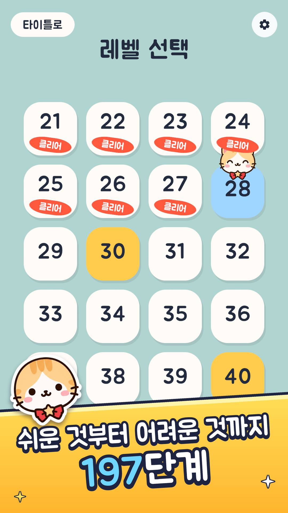

- 한 쪽 20개(4열 × 5행), 197개 → **10쪽**(마지막 쪽 17개).
- 칸 200×200, 간격 34(캔버스 단위), 격자 중심은 화면 중심에서 y +10.
- **잠금 없음.** 모든 레벨을 언제든 고를 수 있다.
- 칸 색: 마지막으로 열었던 레벨 = 하늘색 #9ED6FF + 그 위에 기쁜 냥이 머리(150, 통통 튐), 고비 레벨 = 금색 #FFCC4C, 나머지 = #FFFCF7. 칸 아래 그림자 (6, −10) 검정 16%.
- 깬 레벨: 산호색 #FF5A3D "클리어" 도장(160×54, −8° 기울임, 칸 아래에서 40 위), 숫자는 조금 위로. 이번에 새로 깬 레벨은 쪽이 보이고 0.25초 뒤 0.45초 동안 도장이 쾅 찍힘.
- 아래: ◀ ▶ 둥근 버튼(130, 중심에서 x ∓300) 사이에 "3 / 10" 쪽 표시. 옆으로 90 이상 밀면 쪽 넘김. 끝 쪽에서 더 넘기면 틀림 소리(0.3).
- 왼쪽 위 "타이틀로" 알약 버튼(240×92), 오른쪽 위 설정(톱니). 제목 "레벨 선택"(글자 96).
- 열릴 때 마지막 레벨이 있는 쪽으로 연다.

---

## 5. 메달·도감·힌트·일일 도전

### 5.1 고비(보스) 레벨 입장

- 10번째마다. 열리고 화면 전환이 끝나면 "두둥 탁!" 소리(`Challenge`), 0.42초 뒤("탁") **"도전!" 도장** 1.3초 + (아직 시작 접시를 안 골랐으면) 판 가운데에서 놀란 냥이 머리(크기 2.6)가 2.2초 동안 "이번 건 좀 어렵다냥!".
- 위쪽 난이도 배지가 금색 판(#FFD961)과 "도전"으로 바뀐다. 발바닥 개수는 그대로.
- 그림 미리보기 70%, 힌트 시간 1.5배.

### 5.2 그림 미리보기 시간 (`ShapeArt.PreviewSeconds`)

점수 2 이하 3.5초 → 4에서 2.5초 → 7에서 1.5초 → 10 이상 1초, 사이는 직선으로 잇는다. 고비는 × 0.7. 튜토리얼은 점수 0으로 친다(3.5초). 화면 전환이 끝난 뒤 시작.

### 5.3 힌트 단계 (`HintSchedule`)

막힌 시간(stuckTime)은 레벨에서 시작 접시 고르기·그리기 중에만 흐른다(설정 창, 화면 전환, 클리어 뒤에는 멈춤, 한 프레임 최대 0.1초만 셈). 튜토리얼에는 이 힌트가 없다.

| 단계 | 내용 | 점수 4 이하 | 7 | 10 이상 | 최소 시간 |
|---|---|---|---|---|---|
| ① 그림 | 배경 그림을 미리보기 시간만큼(최소 1초) 다시 보여 줌. 그리는 중이면 다음 시작 접시 고르기 때로 미룸 | 25초 | 40초 | 60초 | 15초 |
| ② 문구 | 레벨 `hint`를 6초 동안. 냥이 스킨: 그리는 중엔 머리 위 말풍선, 고르기 중엔 판 가운데 냥이 머리(1.9) + 말풍선. 다른 스킨: 위쪽 띠(견본 카드가 0.75 내려감) | 40초 | 60초 | 90초 | 25초 |
| ③ 시작 접시 | 시작할 수 있는 접시(고정 시작, 아니면 홀수 선 접시, 없으면 전부)에 "시작" 표시 + 반짝이. 접시를 고르면 숨고, 다시 고르기로 돌아오면 다시 나옴 | 55초 | 85초 | 120초 | 35초 |

- 사이 값은 직선으로 잇고 양 끝 밖은 평평.
- 고비 × 1.5.
- **실패 3번 이상**(그리는 중 ↻/R, 또는 새 틀린 선이 생긴 채 접시에서 손 뗌)이면 시간 × 0.5, 단 최소 시간보다 빠르지 않음. 일일 도전은 실패를 세지 않는다.
- 단계 사이는 최소 10초.
- 배경 그림이 없는 퍼즐은 ①을 건너뛴다. **일일 도전은 ③만**(①②를 건너뜀).

### 5.4 일일 도전 — 규칙

- 하루 3문제(슬롯 0·1·2 = 쉬움·보통·어려움). 날짜만으로 만든다(서버·파일 없음). 같은 날짜면 모든 기기에서 같은 퍼즐.
- **오늘** = 기기의 현지 날짜 `DateTime.Now.Date`(빌드에서는 날짜 옮기기 없음). 하루 경계 = 현지 자정.
- **번호**: 2026-10-01 첫 문제가 No.1. `No = (날짜 − 2026-10-01)일 × 3 + 슬롯 + 1`. 이름 = "<테마 이름> No.<번호>"(예 "북적이는 별자리 No.64"). 1 미만이면 번호 없이 테마 이름만.
- **요일 테마**(월요일 = 0, `요일 = (DayOfWeek + 6) % 7`)

| 요일 | 테마 | 배치 | 접시 수 | 선 수(슬롯 0/1/2) | 다시 지남(최소,최대) | 교차(최소,최대) | 고리 확률 |
|---|---|---|---|---|---|---|---|
| 월 | 대칭 별자리 Mirror Stars | Mirror | 5~8 | 4–6 / 5–7 / 8–10 | (0,0)/(1,1)/(1,2) | (0,0)/(0,1)/(0,2) | 0.5/0.8/0.5 |
| 화 | 반짝이는 별자리 Twinkling Stars | Ring | 5~7 | 5–5 / 5–6 / 7–9 | (0,0)/(1,1)/(1,2) | (1,5)/(1,2)/(2,6) | 0.7/0.8/0.7 |
| 수 | 지그재그 별자리 Zigzag Stars | Rows | 5~8 | 4–6 / 5–7 / 8–10 | (0,0)/(1,1)/(1,2) | (0,0)/(0,1)/(0,2) | 0.2/0.8/0.2 |
| 목 | 북적이는 별자리 Crowded Stars | Scatter | 7~10 | 6–8 / 6–8 / 8–11 | (0,0)/(1,1)/(1,2) | (0,0)/(0,0)/(0,1) | 0.3/0.8/0.3 |
| 금 | 기다란 별자리 Long Stars | Scatter | 8~11 | 7–9 / 7–8 / 9–11 | (0,0)/(1,1)/(1,2) | (0,0)/(0,1)/(0,1) | 0.4/0.8/0.4 |
| 토 | 엇갈린 별자리 Crossed Stars | Scatter | 5~7 | 5–6 / 5–6 / 7–9 | (0,0)/(1,1)/(1,2) | (1,2)/(1,1)/(2,3) | 0.5/0.8/0.5 |
| 일 | 느긋한 별자리 Easy Stars | Scatter | 5~9 | 3–5 / 5–7 / 6–8 | (0,0)/(0,0)/(1,1) | (0,0)/(0,1)/(0,1) | 0.5/0.5/0.8 |

- **점수 범위**(아래 이상, 위 미만): 평일 (1.0, 3.8) / (4.0, 5.6) / (5.6, 9.5). 일요일 (0.5, 2.6) / (1.6, 3.8) / (4.0, 5.6).
- 테마별 클리어 대사 4개씩, 고르는 번호 = `Seed(날짜, 슬롯, 7777) % 4`(아래 표의 0~3번):

| 테마 | 0 | 1 | 2 | 3 |
|---|---|---|---|---|
| 대칭 (한) | 양쪽이 똑같다냥! | 거울 속 별자리 같다냥~ | 반쪽씩 딱 맞았다냥! | 좌우 대칭 완벽하다냥! |
| 대칭 (영) | Both sides match, meow! | Like a mirror, meow~ | Two halves, a perfect fit! | Perfectly even, meow! |
| 반짝이는 (한) | 반짝반짝 빛난다냥! | 별빛이 쏟아진다냥~ | 눈부신 별자리다냥! | 오늘 밤 제일 반짝인다냥! |
| 반짝이는 (영) | Twinkle twinkle, meow! | Starlight everywhere, meow~ | What a shiny one, meow! | The brightest tonight, meow! |
| 지그재그 (한) | 왔다 갔다 잘 이었다냥! | 지그재그 성공이다냥~ | 이리저리 다 이었다냥! | 꼬불꼬불 완성이다냥! |
| 지그재그 (영) | Back and forth, all linked, meow! | Zig, zag, done, meow~ | This way and that, meow! | Wiggly and finished, meow! |
| 북적이는 (한) | 별이 한가득이다냥! | 북적북적 다 이었다냥~ | 별 하나도 안 놓쳤다냥! | 별 잔치가 열렸다냥! |
| 북적이는 (영) | So many stars, meow! | A crowd of stars, all linked~ | Not one star missed, meow! | A star party, meow! |
| 기다란 (한) | 쭈욱~ 길쭉한 별자리다냥! | 끝까지 다 이었다냥! | 꼬리가 긴 별자리다냥~ | 길게 길게 성공이다냥! |
| 기다란 (영) | Such a long one, meow! | All the way to the end, meow! | A long-tailed one, meow~ | Long and done, meow! |
| 엇갈린 (한) | 엇갈린 별도 문제없다냥! | 엉킨 줄을 다 풀었다냥~ | 교차로도 척척이다냥! | 엇갈려도 완벽하다냥! |
| 엇갈린 (영) | Crossed stars, no problem, meow! | Tangle solved, meow~ | Crossings, no sweat, meow! | Crossed and perfect, meow! |
| 느긋한 (한) | 느긋하게 한 판 끝이다냥~ | 오늘은 쉬엄쉬엄이다냥~ | 여유롭게 완성이다냥! | 낮잠 자기 딱 좋다냥~ |
| 느긋한 (영) | Nice and easy, meow~ | Taking it slow, meow~ | Done without a rush, meow! | Nap time now, meow~ |

- 퍼즐 이름 영어 = "<영어 테마 이름> No.<번호>". 안전망 퍼즐 이름 = "<레벨 이름> (거울)" / "<English> (Mirror)", 힌트·대사는 원래 레벨 것. 내부 이름 = "Daily yyyy-MM-dd <슬롯+1>".

### 5.5 일일 도전 — 생성 알고리즘 (`DailyPuzzle.Make`)

```
for attempt in 0..399:
    rng = mulberry32(Seed(date, slot, attempt))
    접시 놓기 + 한붓 경로 그리기(TryDraw) → 실패면 다음 attempt
    Tidy(쓰지 않은 접시 지우고 번호 다시, 바운딩 박스 중심을 (0, −1)로, 좌표 소수 둘째 자리 반올림)
    Mirror 배치면 Validate 다시(교차 ≤ 슬롯 최대)
    폭·높이 2.8 미만이거나 |x| > 2.6 이면 다음
    LevelData 만들기 → score가 범위 밖이거나 SolutionReplay 실패면 다음
    성공이면 반환
안전망: 범위에 맞는 내장 레벨을 좌우 반전("<이름> (거울)"), Seed(date, slot, 9999)로 고름
```

**씨앗**(32비트 부호 없는 정수, 넘침 무시):
```
s    = (년 × 10000 + 월 × 100 + 일) × 4 + 슬롯
seed = s × 0x9E3779B1 + attempt × 0x85EBCA77
```

**난수 mulberry32**:
```
state += 0x6D2B79F5
t = state
t = (t ^ (t >> 15)) * (t | 1)
t ^= t + (t ^ (t >> 7)) * (t | 61)
return t ^ (t >> 14)          // 32비트 부호 없음
Value() = next / 4294967296.0        // [0,1)
Range(a,b) = a + (b − a) × Value()   // [a,b)
Int(a,b) = a + (int)(Value() × (b − a + 1))   // [a,b] 양 끝 포함
Shuffle = Fisher–Yates 뒤에서부터, j = (int)(Value() × (i + 1))
```

**상수**: x 범위 ±2.6, 중심 y −1.0, 반높이 3.2(y −4.2~2.2), 접시 간격 1.4 이상, 선과 다른 접시 0.5 이상, 꺾임 28°~152°, 교차각 25° 이상, 최소 크기 2.8, 시도 400.

**접시 놓기 `Place`**(난수 호출 순서가 결과를 정하므로 그대로 따라야 함):
- Ring: rx = Range(2.1,2.6), ry = Range(2.4,3.1), offset = Range(0, 2π). i마다 a = offset + 2πi/n + Range(−0.18,0.18), r = Range(0.85,1.0), 점 (cos a·rx·r, −1 + sin a·ry·r). n ≥ 6이고 Value() < 0.5면 가운데 점 (Range(−0.3,0.3), −1 + Range(−0.3,0.3)) 추가. 간격 실패면 null.
- Rows: 줄 수 = n ≤ 6 ? 3 : 4. i마다 row = i % 줄수, y = −1 + 3.2 − row × 6.4/(줄수−1), side = ((i / 줄수 + row) % 2 == 0) ? −1 : +1, 30번까지 (side × Range(0.6,2.6), y + Range(−0.45,0.45)) 시도.
- Scatter: i마다 60번까지 (Range(−2.6,2.6), Range(−4.2,2.2)) 시도.
- 접시 수 n = Int(테마 최소, 최대). 그다음 선 수 = Int(슬롯 최소, 최대), 고리 = Value() < 고리 확률.

**경로 그리기 `Draw`**: 시작 = Int(0, n−1). 선마다 접시 번호를 섞고(Shuffle), 각 후보 b에 대해: 이미 지난 접시인데 다시 지남이 최대에 닿았으면 제외(고리를 닫는 마지막 선은 예외), 고리를 원하고 마지막 선이면 시작 접시만. `EdgeOk`(새 선이 이미 쓴 선 아님, 다른 접시와 0.5 이상, 앞 선과 꺾임 28~152°, 교차각 25° 이상, 교차 합 ≤ 최대). 후보를 "새 접시 먼저", (지그재그 날은) "반대쪽 x 먼저"로 **안정 정렬**. Value() < 0.7이면 첫 후보, 아니면 Int(0, 후보수−1)번째. 고리면 시작점 꺾임도 28~152° 검사. 마지막에 교차 ≥ 최소, 다시 지남 ≥ 최소 확인.

**Mirror 배치 `DrawMirror`**: 축 접시 A (0, Range(0.4,2.2)), B (0, Range(−4.2,−2.2)). 오른쪽 접시 개수 = Int(1,3) (+1 어려움 슬롯), 각 40번까지 (Range(0.75,2.6), Range(−4.2,2.2)) 시도(간격, |x|×2 ≥ 1.4). 거울 접시 추가. 오른쪽 순서 섞기. 나비 = 슬롯 ≥ 1 && 오른쪽 ≥ 2 && Value() < (슬롯1 0.8, 슬롯2 0.5). a = Int(0,1). Value() < 0.7이면 오른쪽 접시를 위→아래(a=0) 또는 아래→위 정렬. 반쪽 경로 a → 오른쪽들 → b(나비면 a, 아니면 1−a), 이어서 거울로 되돌아옴. 어려움 슬롯만: 나비면 꼬리(1−a) 추가, 아니면 Int(0,1)==0이면 축 선(b) 추가, 아니면 가로대(한 오른쪽 접시에서 그 거울로).

**힌트 문구(자동)**: 모든 접시가 짝수 선 → "어느 생선에서 시작해도 한 바퀴 돌아올 수 있어요". 홀수 선 접시가 모두 1개짜리 → "선이 하나뿐인 끝 생선에서 시작해요". 그 밖 → "선이 1개나 3개 모인 생선에서 시작해요" 식. 다시 지남이 있으면 ". 한 생선을 두 번 지나도 괜찮아요"를 붙임(영어도 같은 규칙).

**검증용 예시**: [`data/daily_samples.txt`](data/daily_samples.txt) = 원본 파이썬판 생성기(`Tools/levelcheck/daily.py`, 비공개)로 2026-10-01~07을 만든 결과(예: 2026-10-01 = 목요일 "북적이는 별자리 No.1~3"). 원본 설명에 따르면 파이썬판은 게임의 C#판과 10년(10,950문제) 중 23문제가 다르다(파이썬판은 단순한 재생 검사, C#판은 4.5절의 실제 몸 계산 재생 검사). 원본 저장소는 비공개이므로 다시 만들 때 기준은 이 문서의 규칙이고, 예시 파일은 맞춰 보기용이다.

**미리 만들기**: 타이틀이 보이고 0.8초 뒤부터 한 프레임에 한 문제씩 오늘 3문제를 만들어 둔다(폰에서 문제당 수십 ms).

### 5.6 일일 도전 — 진행

- 타이틀 일일 도전 접시를 고르면: 오늘 소개 카드를 아직 안 봤거나 오늘 3개를 다 했으면 **카드**, 아니면 바로 **오늘 첫 안 푼 문제**.
- 카드 "시작"(완료 카드는 "다시 풀기") → 소개를 본 것으로 저장하고 첫 안 푼 문제(다 풀었으면 0번).
- ◀ ▶: 앞뒤 문제로(끝이면 틀림 소리 0.4). 클리어 뒤 탭: 이 문제 다음부터 한 바퀴 돌며 안 푼 문제로, 없으면 타이틀. "다시 풀기"로 들어온 경우엔 순서대로 다음, 끝이면 타이틀.
- ▦(레벨 선택) 버튼과 뒤로 가기는 타이틀로.
- 판 색 #9EABDB + 밤하늘 그림(`night_sky.png`, 위 24%·아래 14%를 흰 막 60%·35%로 덮음, 별 26개 반짝, 40초 주기로 0.12 흔들림, 9~15초마다 별똥별 0.9초).
- 클리어하면 그린 선을 따라 빛이 번진다(최대 0.9초, 선 하나 최대 0.14초, 빛 굵기 0.8, #FFEB8C) + 접시들이 별(0.85)처럼 빛난다. 다시 하면 빛 사라짐.
- **하루를 채울 때만 축하**: 세 번째를 채운 클리어에서만 특별 도장·대사·색종이 140개. 순서 상관없음.

### 5.7 연속 기록과 메달 (`DailyProgress`, `DailyMedals`)

- 날짜별로 몇 번 문제를 깼는지 비트로 모두 저장(달력용).
- 어떤 날 3개를 다 채웠을 때, **그 날이 마지막으로 다 채운 날보다 뒤일 때만** 기록이 늘어난다:
  - 전날이 마지막 날이었으면 연속 + 1, 아니면 1.
  - 최고 기록 = max, 다 채운 날 수 + 1, 메달 날이면 메달 기록.
  - 시계를 되돌려 지난날을 채우면 달력만 채워지고 기록·축하는 없음.
- **지금 연속** = 마지막으로 다 채운 날이 어제 이후(오늘 포함)면 저장된 연속, 아니면 0. 마지막 날이 오늘보다 미래(시계를 되돌림)여도 살아 있는 것으로 침.
- **메달 날짜**: 3 · 7 · 14 · 30 · 50 · 100일, 그 뒤 100일마다(200, 300…). 단계(tier) 0~5 = 3·7·14·30·50·100일(100일 넘으면 계속 5).
- 다음 메달까지 남은 날 = 다음 메달 − 지금 연속(오늘이 아직 안 끝났으면 오늘도 셈).

### 5.8 메달 그림·타이틀 메달·메달 연출

- 메달 그림 6종(구리·은·금·발바닥·왕관·무지개 순, 3072×512 한 장에 6칸): `medal_sheet_numbered.png`(3~100일, 숫자가 그려져 있음), `medal_sheet.png`(숫자 없음, 200일 이상에서 게임이 가운데 빈 원에 숫자를 씀, 숫자 색 #6B3D1F, 크기 = 메달 폭 × 0.42). 미리보기: [medal_sheet_numbered_half.png](images/medal_sheet_numbered_half.png)(절반 크기).
- **타이틀 메달**: 연속이 살아 있는 동안 지금까지 도달한 가장 높은 메달을 일일 도전 접시 오른쪽(+0.62, −0.15, 폭 0.8)에 붙여 둔다. 탭하면 메달 도감. 첫 메달 전, 오늘 다 끝낸 날은 그 자리에 발바닥 도장(0.7).
- 타이틀은 "지난번에 보여 준 메달"(일수)을 기억한다. 지금과 다르면 타이틀이 열리고(전환이 끝나고) 0.6초 뒤 한 번 연출. 연출이 실제로 시작될 때 "봄"으로 저장. 기록이 끊겼다가 다시 메달을 땄으면 잃음 → 얻음 순서로 둘 다.
- **얻을 때**(어둠 #080A1F, 86%): 어두워짐 0.4초 → (50일 이상) 별자리 배경 0.7초, (14일 이상) 빛줄기 0.5초 → 냥이가 메달을 들고 아래에서 올라옴 0.4초 → 메달이 가운데(크기 440)로 날아가 쾅 0.35초(Pin + Clear 0.8 소리, 반짝이 40개) → "N일 메달!", "다음: M일 메달까지 K일"(100일 이상은 "N일 연속 달성! 정말 대단해요, 축하해요!"), 냥이 대사 0.4초 → 탭 또는 2.5초(50일 이상 3.5초) → 메달이 접시 옆으로 0.6초 날아가 붙음(Pin 0.7) → 밝아짐 0.35초. 50일 이상은 팡파르(0.3초 뒤 Happy, 0.35초 뒤 Clear 0.6, 0.4초 뒤 Happy 0.8).
- **잃을 때**: 메달이 접시 옆에서 가운데로 0.6초(Pop 0.8) → 떨며 회색으로 0.65초(Wrong 0.7) → 네 조각으로 깨져 떨어짐 1초(Unwrap 0.8) → "연속 기록 끝", "최고 기록 N일", 냥이 "연속 기록이 끊겼다냥... 오늘부터 다시 모으자냥!", [바로 도전] 0.3초 → 탭(마지막 장면이 아니면 3초 뒤 자동) → 글자 사라짐 0.25초. [바로 도전] = 바로 일일 도전.
- 탭·뒤로 가기는 지금 움직이는 단계를 건너뛴다.

### 5.9 메달 도감 (`MedalBook`)

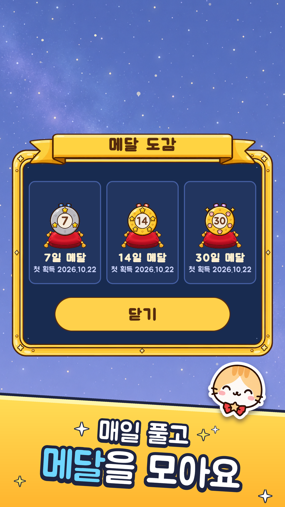

- 여는 곳: 타이틀 메달 탭, 일일 도전 카드의 "메달 도감" 링크.
- **받은 메달만** 보인다(못 받은 메달은 실루엣도 없음). 없으면 "아직 메달이 없어요 / 3일 연속으로 풀면 첫 메달!".
- 금테 남색 판(폭 1000, 안쪽 #182B50) + 위에 금색 리본 "메달 도감". 카드: 1~2개면 한 줄에 2개, 3개 이상이면 3개. 카드 = 방석 위 메달(240) + 이름 "N일 메달" + "첫 획득 yyyy.MM.dd"(첫 날짜가 없으면 "예전에 받음") + 두 번째부터 "×N" 금색 배지. 지금 달고 있는 메달 = 금테 카드 + 뒤 빛 + "착용 중"(#FF6B5C). 100일 칸은 100일을 넘겼으면 "최고 N일".
- 받은 횟수가 저장돼 있지 않아도 최고 기록이 그 메달 이상이면 1번으로 친다(도감 전 기록 호환).
- "닫기"(660×124) 또는 판 밖 탭으로 닫힘. 배경 = 밤하늘.

---

## 6. 화면 흐름과 UI

### 6.1 흐름

[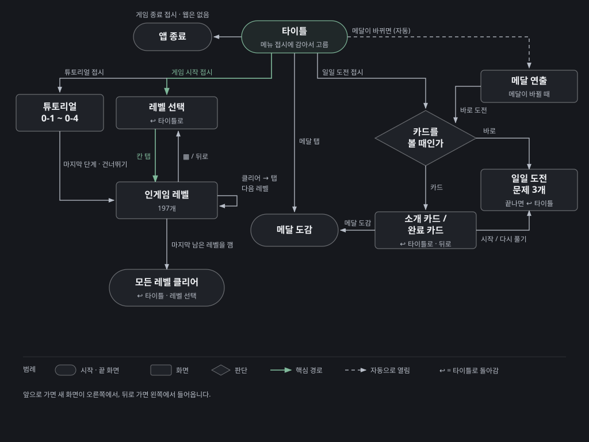](images/screen-flow.svg)

모든 화면 이동은 6.9절의 화면 전환을 거친다. 앞으로 가면 새 화면이 오른쪽에서, 뒤로 가면 왼쪽에서 온다.

### 6.2 타이틀 화면

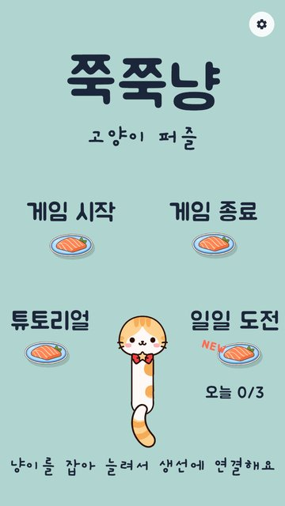

- 메뉴가 버튼이 아니라 **게임 방식 그대로**: 냥이 꼬리가 보이지 않는 접시 (0, −3.6)에 묶여 있고, 머리를 끌어 메뉴 접시에 놓으면 고른다. 쉴 때 머리는 (0, −2.2)(꼬리에서 1.4 위).
- 배경색 = 레벨 1 배경(#B0D4CF). 글자색 #21293D.

| 요소 | 위치(월드) | 글꼴 | 문구(한/영) |
|---|---|---|---|
| 로고 | (0, 4), 상자 6×1.5, 최대 15 | Jua | 쭉쭉냥 / Zzuk-Zzuk Nyang (천천히 출렁임 0.3배, 탭하면 흔들) |
| 부제 | (0, 2.75), 5.5×0.7 | Gaegu Bold | 고양이 퍼즐 / A Stretchy Cat Puzzle |
| 게임 시작 접시 | (−1.7, 0.2), 글자 0.75 위 | Jua | 게임 시작 / Start |
| 게임 종료 접시 | (1.7, 0.2) | Jua | 게임 종료 / Quit (**웹 빌드는 없음**) |
| 튜토리얼 접시 | (−2.3, −2.4) | Jua | 튜토리얼 / Tutorial |
| 일일 도전 접시 | (2.3, −2.4) | Jua | 일일 도전 / Daily |
| 일일 상태 | 일일 접시 (−0.1, −0.95) 아래 | Jua | "오늘 0/3" 또는 "오늘 완료", 2일 이상이면 둘째 줄 "N일 연속" |
| NEW | 일일 접시 (−0.6, +0.15) | | 오늘 하나도 안 풀었으면 산호색 "NEW"가 까딱 |
| 안내 | (0, −5.1), 6.4×0.7 | Gaegu Bold | 냥이를 잡아 늘려서 생선에 연결해요 / Stretch the cat to a dish! |
| 설정 | 오른쪽 위 톱니 | | |

- 냥이 반응(말풍선 + 표정): 잡음 "냥?!"(놀람, 0.6초 동안 유지) / 늘인 길이 3.5 이하 "영차영차" / 3.5 초과 "쭈욱~ 늘어난다!"(기쁨) / 6.5 초과 "으앗, 너무 늘어나!"(놀람, 틀림 소리 0.5) / 접시 1.1 안: 시작 "시작하자냥!", 종료 "벌써 가려고...?"(깜빡), 튜토리얼 "배워 볼까냥?", 일일 "오늘은 뭐가 나올까냥?". 기쁨 쪽 반응은 Tick 소리(2.0).
- 메뉴가 아닌 곳에 놓으면 "휴~". 3초 그대로 두거나 R 키 → "제자리로~" 하며 되감김(속도 max(6, 늘인 길이 × 5)).
- 머리가 글자에 부딪히면 글자가 날아갔다 돌아온다(중력 −16, 최대 14, 비행 1.4초, 복귀 0.7초; 메뉴 글자는 0.45배만) + Pop + "냥!"(1.5초에 한 번).
- 타이틀에서는 감긴 접시가 풀린다(`lockWraps = false`).
- 메뉴 접시에 놓으면 그 접시가 "먹힘", 기쁜 얼굴(종료는 깜빡) + Pin + Happy 소리 + 대사("가자~!" / "차근차근 배워 보자냥!" / "오늘의 별자리 찾으러 가자냥!" / "또 놀러 와요~") 1.2초 → 0.7초(종료 1.3초) 뒤 이동.

### 6.3 인게임 HUD

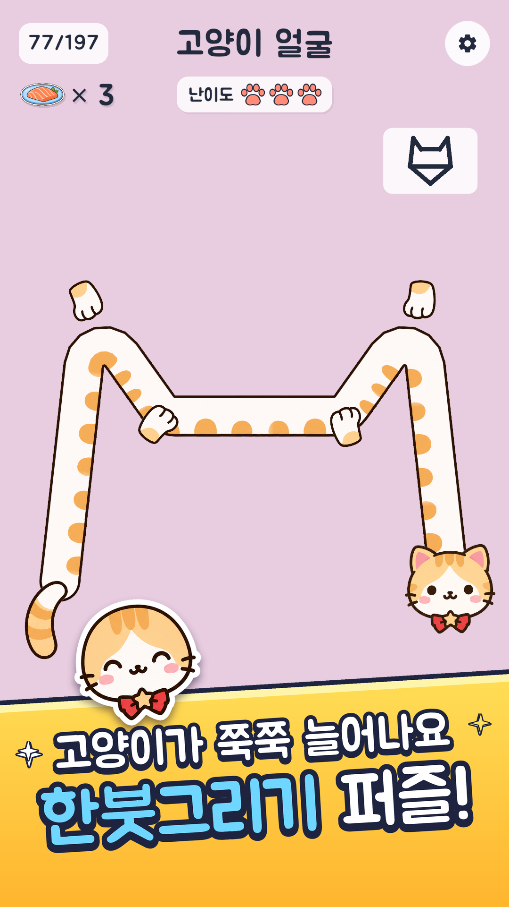

캔버스 1080×1920 기준(Screen Space - Camera). 아래 좌표는 UI 생성 도구(`StringPuzzleSetup`) 기본값이고, 최종 배치는 장면 `ER.unity`(배치 편집기로 옮겨짐) — 스토어 그림 기준으로는 위쪽 가운데 제목, 그 아래 가운데 난이도 배지.

| 요소 | 기본 위치·크기 | 내용 |
|---|---|---|
| 레벨 칩 | 왼쪽 위 (40, −44), 150×86 | "24/197"(레벨), "0-1"(튜토리얼), "오늘 1/3"(일일) |
| 제목 | 위쪽 가운데, 최소 글자 34 | 레벨 이름 |
| 연어 카운터 | 칩 아래 6 | 접시 아이콘(100×80) + "× N". 바뀔 때 1.5배 튐, 틀리면 0.4초 흔들림(sin 60t × 10 × 감쇠) |
| 난이도 배지 | 400×76 | "난이도" + 발바닥 3개(56, 켜진 것 #FF8C78, 꺼진 것 25%). 고비면 금색 판 + "도전" |
| 설정 | 오른쪽 위 (−40, −44), 96 | 톱니 |
| 건너뛰기 | 설정 아래 | 튜토리얼에서만 "건너뛰기" |
| 견본 카드 | 판 (0, 3.45) | 그리기 시작하면 (2.35, 3.9)로 가며 0.55배로 작아짐(놀이를 가리지 않게) |
| 아래 바 | 높이 230, 버튼 중심 y 115 | ◀(−360) ↶(−150) ▦(0) ↻(+150) ▶(+360), 지름 120 |
| 토스트 | 아래 (0, 240), 폭 화면−120, 높이 110 | 짧은 안내 |
| 말풍선 | 냥이 머리 위 90 | 최소 300×130, 최대 폭 760, 여백 90×56. 위 정보와 겹치면 머리 아래로 뒤집힘 |

버튼: ◀ 이전 레벨(1번에서는 197번으로), ▶ 다음 레벨(197번에서는 1번으로), ↶ 한 단계 뒤로, ▦ 레벨 선택(튜토리얼·일일은 타이틀), ↻ 처음부터. 버튼은 누르면 0.88배로 눌렸다가 튕겨 돌아온다(0.5초, cos 22t × e^(−9t)).

레벨 배경색은 번호 순으로 6색 반복(9.2절).

### 6.4 클리어 화면

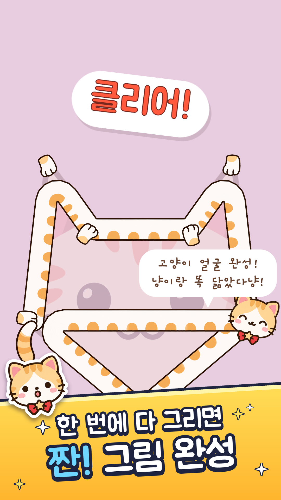

- 냥이 스킨(출시판): 위·아래 바가 숨고 견본 카드도 숨는다. 남는 것 = 냥이 + 완성 그림 + 배경 그림.
- 기울어진 흰 판 위 산호색 "클리어!" 도장이 쾅(6.9절), 일반 레벨 "클리어!", 모든 레벨을 다 깬 판 "올 클리어!", 튜토리얼 "잘했어요!"/마지막 "튜토리얼 완료!", 일일 "클리어!" / 하루 완료 때 "오늘 완료!"·"N일 연속 클리어!"(2일 이상)·"N일 메달!"(메달 날, 도장 위에 메달 220).
- 말풍선 "<이름> 완성!" → 0.9초 뒤 둘째 줄(레벨 대사, 하루 완료 날은 "N일 연속 성공이다냥!" 등) → 1.9초 뒤 판 가운데 "탭하면 다음으로"(숨 쉬듯 커졌다 작아짐, 글자 80).
- 탭 문구: 일반 "탭하면 다음으로", 마지막 레벨이고 덜 깼으면 "탭하면 처음으로", 모두 깼으면 "모든 레벨 클리어!\n탭하면 처음으로", 튜토리얼 "탭하면 다음 단계로"/마지막 "탭하면 레벨 N으로", 일일 "탭하면 다음 별자리로"/"오늘 도전 끝!\n탭하면 타이틀로".

### 6.5 모든 레벨 클리어

- 197개를 모두 처음 다 깬 클리어(또는 그 화면을 못 본 채 다음 클리어) 2.6초 뒤 한 번. 탭하면 바로.
- 완전히 어두운 판(#080A1F, 100%) 위 천천히 도는 빛줄기(1150), 통통 튀는 기쁜 냥이(420), "모든 레벨 클리어!", "레벨 197개를 모두 풀었어요", "다 풀다니 정말 최고다냥!", 색종이 60개가 계속 내림. 버튼 "타이틀로"(주 버튼) / "레벨 선택"(440×120), 0.8초 뒤부터 눌림. 뒤로 가기 = 타이틀로.

### 6.6 튜토리얼 화면

- 인게임과 같고 칩 "0-N", 설정 아래 "건너뛰기"(누르면 저장된 레벨로, 처음이면 레벨 1).
- 아래 토스트에 그 단계 문구가 계속 떠 있음.
- 0.8초 손을 안 대면 흰 동그라미 손가락(0.55, 흰색 85%)이 남은 풀이를 따라 끈다(속도 3.2/초, 누름 0.35초, 접시마다 0.15초 멈춤, 놓음 0.35초, 다음까지 0.7초). 풀이와 다른 길로 갔으면 안 보임. 0-4는 손가락 대신 시작 가능 접시가 1.4초마다 깜빡.
- 틀린 선이 있으면 ↶ 위에 "눌러서 한 단계 뒤로"가 커졌다 작아지고, 냥이가 "빨간 선은 틀린 선이다냥!"(3초, 한 번).
- ◀ ▶는 튜토리얼 단계 안에서만. 0-1에서 ◀, 마지막 단계를 안 깨고 ▶는 틀림 소리.

### 6.7 일일 도전 소개·완료 카드

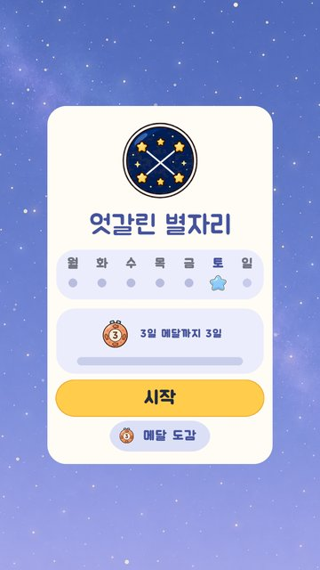 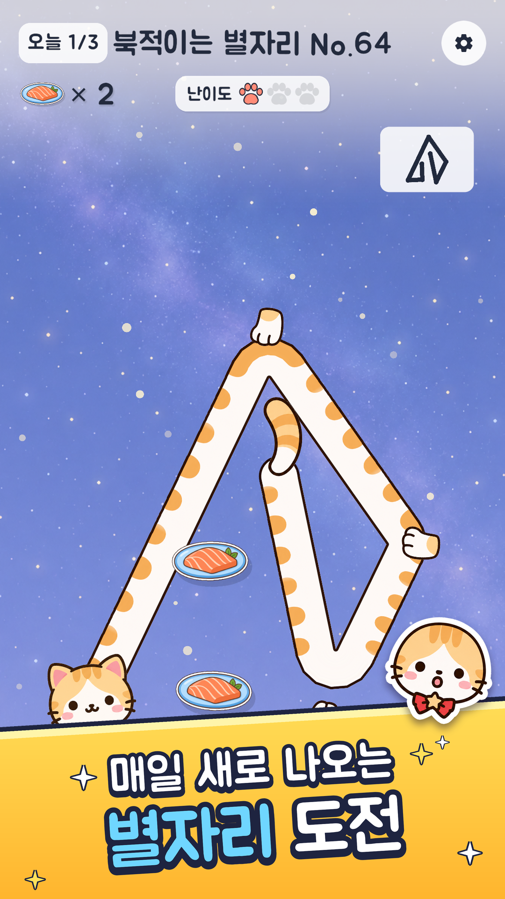

- 밤하늘 위 크림색 카드(#FFFCF5, 폭 760, 높이는 내용에 맞춤). 뒤 어둠 #141A40 60%.
- **소개 카드**(그날 처음): 요일 별자리 아이콘(320, `theme_sheet.png` 3584×512에 7칸, 월요일부터; [미리보기](images/theme_sheet_half.png)) → 테마 이름(#45529E) → 이번 주 월~일 글자와 점(다 끝낸 날 = 발바닥 도장, 오늘 = 별 #73B8FF, 지난 날 못 함 = 회색 점 30, 앞으로 = 옅은 점 30) → 다음 메달 그림 + "N일 연속!"(2일 이상) + "M일 메달까지 K일"(오늘 다 풀면 메달이면 "오늘 다 풀면 M일 메달!") → 금색 "시작" 버튼(높이 120) → 링크 "메달 도감".
- **완료 카드**(3개 다 한 날은 일일 도전을 열 때마다): "오늘 별자리 완료!" + "다음 별자리까지 5시간 12분"(자정까지, 분 올림, 0분이면 "새 별자리가 왔어요!") + 연속 줄 + "타이틀로" + 작은 "다시 풀기". 메달 딴 날은 아이콘 자리에 그 메달, 연속 줄은 "N일 메달 획득!".

### 6.8 설정 창

- 화면을 어둡게(#141A29, 45%) 하고 흰 판(800 폭)이 스프링으로 튀어나옴(`Ease.Spring(t, 16, 8)`), 열림 Pop 소리. 닫힘: 투명도 6/초, 크기 0.8까지.
- 항목(위→아래): 제목 "설정"(Jua 80) / 효과음 볼륨 슬라이더 + 숫자 "80%"(음소거면 "음소거") + 소리 아이콘 버튼 / "고양이 귀" ON·OFF 토글(켜짐 #FFC238, 꺼짐 #D1D4DE) / "언어" 버튼("한국어"↔"English") / 아래 빨간 버튼(#ED6161).
- 빨간 버튼: 게임 중에는 "타이틀로", 타이틀·레벨 선택 등에서는 "게임 나가기" → 한 번 누르면 "한 번 더 누르면 나가요"(3초) → 다시 누르면 종료. 웹 빌드의 타이틀에서는 버튼 숨김.
- 슬라이더를 움직이면 0.12초마다 그 볼륨으로 감김 음(단계 = round(값 × 7))을 들려줌. 음소거 중 값을 올리면 음소거 풀림.
- 판 밖을 탭하면 닫힘(열고 0.35초 안의 탭은 무시). 오른쪽 위 X 버튼. 닫을 때 저장(`PlayerPrefs.Save`).

### 6.9 화면 전환

- "휙 패닝(whip-pan)": 지금 화면을 찍어 두고(Pop 0.5) → 내용 바꿈 → 한 프레임 뒤 새 화면을 찍음 → 0.32초 동안 옛 화면은 밀려 나가고 새 화면이 들어옴(`InOutQuint`), 속도에 맞춰 모션 블러(최대 화면 폭의 0.22, `MotionBlurUI.shader`).
- 전환 중에는 입력을 막는다.

### 6.10 뒤로 가기(Esc / 안드로이드 뒤로)

우선순위: 설정 창 닫기 → 메달 도감 닫기 → 모든 레벨 클리어 = 타이틀로 → 메달 연출 건너뛰기 → (전환 중이면 무시) → 레벨 선택·일일 카드 = 타이틀로 → 레벨 = 레벨 선택(튜토리얼·일일은 타이틀) → 타이틀 = 설정 창 열기.

---

## 7. 연출

| 대상 | 내용 | 값 |
|---|---|---|
| 접시(평소) | 좌우로 흔들 + 위아래 둥실 | ±3°, 0.015, 2.2 rad/초(한 번 약 2.9초). 그림자 (0.05, −0.08) 검붉은 28% |
| 접시 감김 | 회전하며 빨려 들어가 "먹힘" | 0.35초. 풀리면 다시 튀어나옴 |
| 접시 Pulse | 커졌다 돌아옴 | 0.4초, +25% |
| 시작 표시 | 접시 위 "시작" 글자 + 반짝이 5개가 돎 | 반짝 sin(6t) |
| 냥이 몸 | 젤리 부풂, 클리어 떨림 | 3.7절 |
| 냥이 표정 | 깜빡·기쁨·놀람 | 0.2초 / 0.8초 / 0.9초 |
| 견본 카드 | 그리기 시작하면 구석으로, 클리어 때 선이 #FFC238로 | 0.55배 |
| 배경 그림 | 미리보기·사라짐·보상 | 나타남 0.25초, 사라짐 0.5초, 보상 0.8초, 불투명 0.35 |
| 클리어 도장 | 떨어짐: 크기 2.6 → 0.85, 회전 −22° → −7°, 0.18초. 출렁임 0.32초 | |
| 색종이 | 70개(모든 레벨 클리어·튜토리얼 끝·일일 하루 완료는 140), 12개 중 1개는 접시 그림. 3줄: 왼쪽 위·오른쪽 위 대포(속도 x 2.5~6 안쪽, y 2~6) + 위에서 비(x ±0.5, y −2.5~−1.2). 중력 9, 최저 낙하 −2.2, 좌우 흔들 0.8, 종이 뒤집힘 4~10. 3.2초 살고 마지막 0.8초 사라짐. 색 #FFC738 #FF8C9E #FA994C #73D1B8 #8CB3FF 흰색 | |
| 글자 등장 | 글자마다 0.035초 간격으로 튀어 오름(짝수 글자마다 Tick) | `TextFx` |
| 말풍선 | 스프링으로 나와 글자를 타이핑, 사라질 때 글자가 풀리듯 | |
| 화면 전환 | 휙 패닝 0.32초 + 모션 블러 | 6.9절 |
| 일일 판 | 밤하늘, 별, 별똥별 / 클리어 빛 번짐 | 5.6절 |
| 메달 연출 | 5.8절 | |
| 카메라 | 고정(흔들기 없음). 화면비에 맞춰 크기만 매 프레임 맞춤 | 3장 |
| 진동 | 없음(코드에 진동 호출 없음) | |

---

## 8. 사운드

### 8.1 방식

- **배경음 없음.** 효과음만.
- 대부분 코드로 합성(`SfxSynth`, 44100Hz 모노). 장면에서 **틀림(`wrong`) = `kenney_error_008.ogg`, 버튼·팝(`pop`) = `kenney_drop_002.ogg`**(Kenney, CC0)를 넣어 두어 그 둘은 파일을 쓴다.
- AudioSource 10개 풀, 쉬고 있는 소스를 먼저 씀. 재생 음량 = gain × 효과음 볼륨.
- 기본: 볼륨 **0.8(80%)**, 음소거 꺼짐. 소리마다 음높이 ±4% 무작위(Clear·Challenge·감김 음은 0).
- Tick은 0.05초 안에 다시 울리지 않고 gain × 0.35.

### 8.2 효과음 목록

| 소리 | 만드는 법 | 쓰이는 곳(gain) |
|---|---|---|
| Wrap(감김 음) | 아래 8.3 | 몸이 새 접시에 걸림(감기·지나가며 잇기), 0.9 |
| Unwrap | 뜯는 줄(Karplus–Strong) 196Hz, 0.35초, 감쇠 0.985, 씨앗 3 | 고정점이 줄어듦 0.7, 한 단계 뒤로·되감기 시작 0.7, 타이틀 되감기 0.7/0.5, 메달 깨짐 0.8 |
| Pin | 나무 두드림: sin 820Hz × e^(−55t) × 0.9 + sin 1630Hz × e^(−90t) × 0.3, 0.12초 | 시작 접시 고름, 접시에 놓음 1.0, 되감기 끝 0.6, 메달 쾅 |
| Wrong | `kenney_error_008.ogg`(합성 대체: 230→130Hz 내려가는 "붑" 0.2초) | 새 틀린 선 1.0, 잘못된 시작 0.5, 갈 곳 없는 ◀▶ 0.4, 쪽 끝 0.3, 너무 늘어남 0.5 |
| Pop | `kenney_drop_002.ogg`(합성 대체: 520→1250Hz 0.09초) | 화면 전환 0.5, 설정 열기 1.0/닫기 0.6, 쪽 넘김 0.7, 타이틀 잡기·글자 부딪힘, 글자 탭 0.6 |
| Tick | sin 2100Hz × e^(−140t) × 0.5, 0.035초 | 머리가 접시에 "착" 0.5, 글자 등장, 타이틀 반응 2.0 |
| Clear | 뜯는 줄 4음(펜타토닉 5·7·8·10단계 = 784, 988, 1175, 1568Hz) 0.09초 간격, 각 × 0.45 + 2349Hz 반짝임(× 0.08), 1.3초 | 클리어 1.0 |
| Happy | 880 → 1175 → 1568Hz 음 3개(각 0.075초, 떨림 28Hz ±1.2%) | 클리어 0.4초 뒤(냥이), 타이틀 메뉴 고름, 팡파르 |
| Challenge | "두둥 탁": 북 150→72Hz(0초, 0.3초) + 130→55Hz(0.17초, 0.8초) + 림샷(0.42초), 1.1초 | 고비 레벨 입장 |

합성 공통: 시작·끝 페이드(대부분 1ms/10ms), 뜯는 줄은 2ms/40ms 후 최대 0.8로 정규화.

### 8.3 감을 때 음이 올라가는 규칙

- 음 = **G4(392Hz)부터 올라가는 장조 펜타토닉**: 반음 [0, 2, 4, 7, 9], 5단계마다 한 옥타브.
  `freq(step) = 392 × 2^((PENT[step % 5] + 12 × (step / 5)) / 12)`
- 고정점이 하나 늘 때마다 `step = 고정점 수 − 2`(시작 접시 다음 첫 접시가 0), 최대 11에서 멈춤.

| step | 0 | 1 | 2 | 3 | 4 | 5 | 6 | 7 | 8 | 9 | 10 | 11 |
|---|---|---|---|---|---|---|---|---|---|---|---|---|
| Hz | 392.0 | 440.0 | 493.9 | 587.3 | 659.3 | 784.0 | 880.0 | 987.8 | 1174.7 | 1318.5 | 1568.0 | 1760.0 |

- 음색: 뜯는 줄(Karplus–Strong), 길이 0.9초, 감쇠 0.996, 씨앗 step + 11. 처음 들뜸은 저역 통과한 잡음(이전 × 0.5 + 잡음 × 0.5). 12음은 타이틀에서 한 프레임에 하나씩 미리 만든다.
- 접시에 **놓아서** 붙는 경우(손 뗌)는 감김 음 대신 Pin.

### 8.4 볼륨 기본값

효과음 0.8. 음소거 false. (이 갤러리의 웹 페이지는 따로 전체 40%를 곱하지만, 그건 게임 바깥 설정이다.)

---

## 9. 아트 기준

전체 파일 목록은 [`zzukzzuk-nyang-resources.xlsx`](zzukzzuk-nyang-resources.xlsx)를 본다. 여기는 다시 만들 때 지킬 기준만.

### 9.1 스타일

- 굵은 진갈색 외곽선, 평면 채색, 그림자·그라데이션 없음, 귀여운 2등신(chibi). 파스텔 배경 위 흰 카드.
- 냥이: 크림색 털 + 주황 줄무늬, 빨간 리본(가운데 금별) 나비넥타이. 원본 문서에 따르면 실존 게임(이터널 리턴, 님블뉴런) 캐릭터를 본뜬 **팬 창작물**이고 원본 IP 정책 안에서만 쓴다고 적혀 있다(스토어 문구에도 "비공식 창작물"). 다시 만들 때 이 캐릭터를 그대로 쓸지는 판단이 필요하다.
- 접시: 파란 테 흰 접시 위 연어 한 점과 잎.
- 앱 아이콘: [app_icon_512.png](images/app_icon_512.png).

     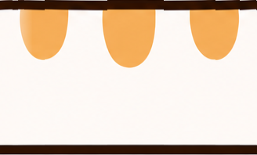 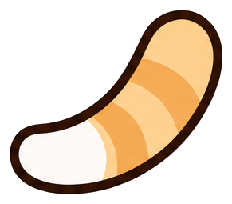 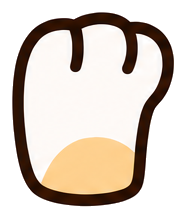 

### 9.2 색 팔레트

| 이름 | hex | 쓰임 |
|---|---|---|
| Ink / Rope | #21293D | 글자, 실 스킨 줄 |
| RopeWrong | #E64242 | 틀린 선 |
| PegLit | #FFC238 | 완성 견본 선, 켜진 토글 |
| PegIdle | #FAFAF7 | 점 스킨 접시 |
| 배경 0 sea glass | #B0D4CF | 레벨 1, 7, 13…(번호−1을 6으로 나눈 나머지 0), 타이틀 |
| 배경 1 peach | #EDC7B8 | 나머지 1 |
| 배경 2 periwinkle | #C2C9E8 | 나머지 2 |
| 배경 3 sage | #D6E0B2 | 나머지 3 |
| 배경 4 rose | #E8CCE0 | 나머지 4 |
| 배경 5 sand | #EDDBAD | 나머지 5 |
| 일일 판 | #9EABDB | 일일 도전 |
| StampCoral | #FF5A3D | 클리어 도장, 레벨 선택 도장 |
| ButtonGold | #FFCC4C | 주 버튼, 고비 칸 |
| BossPlate | #FFD961 | 고비 난이도 배지 |
| 발바닥 | #FF8C78 | 난이도 발바닥 |
| CardBackdrop | #141A40 (60%) | 카드 뒤 어둠 |
| 현재 레벨 칸 | #9ED6FF | 레벨 선택 |
| 칸 | #FFFCF7 | 레벨 선택 |
| 냥이 외곽(코드 그림) | #66402B | 기본 그림·말풍선 글자 |
| 냥이 털/외곽(CatSkin) | #FEFAF7 / #220A02 | 몸 끝 둥근 마개 |
| 견본 카드 | 흰색 82% | |
| 메달 숫자 | #6B3D1F | |
| 도감 남색 | #182B50 | |
| 연출 어둠 | #080A1F | 메달·모든 레벨 클리어 |

### 9.3 글꼴

- **Jua**(Regular, OFL): 제목, 버튼, 숫자, 메뉴 글자, 도장. TMP SDF 에셋 `Jua SDF`.
- **Gaegu Bold**(OFL): 손글씨 느낌 — 타이틀 부제·안내 문구, 말풍선.
- 두 글꼴 모두 한글 상용 2,350자와 ASCII(백틱 제외)만 있다. 그래서 영어 문구에 ’ … ` 를 쓰지 않는다. 드문 한글(예 "쌰")은 □로 나온다.
- 출시 빌드 전에 코드 안 모든 문자열 글자를 폰트 아틀라스에 미리 넣는다(`Prepare Fonts`).

### 9.4 냥이·접시 그림 규격

| 부위 | 실제 파일 크기(px) | 게임 크기(월드) | 비고 |
|---|---|---|---|
| 머리 4표정 + 귀 있는 4표정 | 381×381 | 머리 1.3 | 같은 크기·위치, 표정만 다름. 리본이 머리 그림에 포함(`headIncludesBow`) |
| 몸통 띠 `body_tile` | 328×198 | 굵기 0.55 | 좌우 이어지는 무늬, Wrap = Repeat |
| 꼬리 `tail` | 291×255 | 길이 1 | 뿌리 (0.145, 0.232), 방향 35.65° |
| 앞발 `paw` | 186×219 | 0.5 | 발가락 위, 감긴 접시마다 |
| 연어 접시 | 220×121 | 폭 1.1 | 그리기 순서 8(냥이 머리 5, 리본 6보다 위) |
| UI 아이콘 | 128×128 | | Material Icons(라이선스 파일 동봉) |
| 레벨 그림 | 197장 | 4.2절 | |
| 일일 그림 | 테마 3584×512(7칸), 메달 3072×512(6칸)×2, 밤하늘 1080×1920, 발바닥 도장·오늘 별 256, 도감 테 512, 리본 1024×256, 방석 512×256 | | |

 

---

## 10. 저장 데이터·설정·진행

저장소: Unity `PlayerPrefs`(기기 안에만, 서버 없음). 웹은 설정 창을 닫을 때 `PlayerPrefs.Save()`.

| 키 | 형식 | 뜻 |
|---|---|---|
| `zzukzzuk.lastLevel` | string | **마지막으로 연** 레벨의 한국어 이름(번호 아님). 레벨을 열 때 저장. "게임 시작"과 튜토리얼 끝이 이리로 감. 없으면 레벨 1 |
| `zzukzzuk.cleared` | string, 이름을 줄바꿈으로 | 깬 레벨들 |
| `zzukzzuk.allClearSeen` | int 1 | "모든 레벨 클리어" 화면을 봄 |
| `zzukzzuk.daily.history` | "yyyy-MM-dd=비트" 줄들(정렬) | 날짜별 깬 문제(비트 0·1·2) |
| `zzukzzuk.daily.intro` | yyyy-MM-dd | 소개 카드를 본 마지막 날 |
| `zzukzzuk.daily.lastFull` | yyyy-MM-dd | 마지막으로 3개 다 한 날 |
| `zzukzzuk.daily.streak` / `.best` / `.days` | int | 연속, 최고, 다 한 날 수 |
| `zzukzzuk.daily.titleMedal` | int | 타이틀이 마지막으로 보여 준 메달(일수, 0 없음) |
| `zzukzzuk.daily.titleMedalRun` | string | 그때의 lastFull |
| `zzukzzuk.daily.medal{0..5}.wins` / `.first` | int / yyyy-MM-dd | 메달 받은 횟수, 처음 받은 날 |
| `zzukzzuk.daily.day`, `.slots` | (옛 형식) | 있으면 history로 한 번 옮기고 지움 |
| `StringPuzzle.Volume` | float, 기본 0.8 | 효과음 볼륨 |
| `StringPuzzle.Muted` | int, 기본 0 | 음소거 |
| `StringPuzzle.CatEars` | int, 기본 0 | 고양이 귀(귀 있는 머리 그림 사용) |
| `StringPuzzle.Language` | int 0 한국어 / 1 영어, 없으면 기기 언어 | 언어 |
| `zzukzzuk.debug.dayOffset` | int | 에디터 전용 날짜 옮기기(빌드는 항상 0) |

- 튜토리얼은 저장하지 않는다. 날짜는 `CultureInfo.InvariantCulture`, 형식 `yyyy-MM-dd`.
- 설정 항목과 기본값: 효과음 볼륨 80%, 음소거 끔, 고양이 귀 끔, 언어 = 기기 언어.

---

## 11. 기술 구조

### 11.1 엔진·패키지

Unity 6000.5.6f1, URP 17.5.0(HDR 끔), Input System 1.20.0, TextMeshPro(uGUI 2.5.0), Test Framework 1.7.0. 장면은 **하나**: `Assets/Scenes/ER.unity`. 판·타이틀·오버레이 대부분은 실행 중에 코드로 만든다. HUD·설정 창은 장면에 있다(에디터 메뉴 "String Puzzle ▸ Build UI"로 생성).

### 11.2 주요 스크립트(`Assets/StringPuzzle/Scripts/`)

원본 구조를 알려 주는 목록입니다(원본 저장소는 비공개, 파일은 이 폴더에 없음).

| 파일 | 책임 |
|---|---|
| `PuzzleGame.cs` (+ `.Input` `.Clear` `.Hints` `.Tutorial` `.Daily` `.DailyTest`) | 게임 전체 흐름·상태(Title / ChoosingStart / Drawing / Cleared), 판 만들기, 판정 반영, 입력, 클리어, 힌트, 튜토리얼, 일일 도전 |
| `RopeSolver.cs` | 몸(줄) 감기·풀기 계산(순수 로직) |
| `PegMagnet.cs`, `DotConnector.cs`, `Util/PegGeometry.cs` | 자석, 지나가며 잇기, 가까운 접시 찾기 |
| `ShapeMatcher.cs` | 견본과 비교 |
| `LevelData.cs`, `BuiltInLevels.cs`, `TutorialLevels.cs` | 레벨 형식과 데이터 |
| `LevelDifficulty.cs`, `HintSchedule.cs`, `ShapeArt.cs`, `ShapeArtReveal.cs` | 난이도·힌트 시간·배경 그림 |
| `SolutionReplay.cs` | 자동 재생 검사(레벨·일일 공용) |
| `DailyPuzzle.cs`, `DailyProgress.cs`, `DailyMedals.cs`, `DailyClock.cs` | 일일 도전 생성·기록·메달·오늘 |
| `DailyArt.cs`, `DailySky.cs`, `DailyConstellation.cs` | 일일 그림, 밤하늘, 클리어 빛 |
| `Progress.cs`, `CatPrefs.cs`, `Lang.cs`, `GameText*.cs` | 진행 저장, 귀 설정, 언어, 고정 문구 |
| `RopeView.cs`, `CatDecor.cs`, `CatArt.cs`, `CatSkin.cs`, `CatPeek.cs` | 냥이 그리기 |
| `Peg.cs`, `ShapePreview.cs`, `Confetti.cs`, `TutorialGuide.cs` | 접시, 견본 카드, 색종이, 손가락 안내 |
| `TitleScreen*.cs`, `TitleDailyCorner.cs`, `TitleMedal.cs` | 타이틀 |
| `BoardCamera.cs`, `ScreenOrientationRule.cs`, `DesktopWindow.cs`, `Palette.cs` | 카메라·방향·PC 창·색 |
| `Audio/Sfx.cs`, `Audio/SfxSynth.cs` | 소리 재생·합성 |
| `UI/PuzzleHud.cs` | HUD 전체(칩, 제목, 카운터, 버튼, 토스트, 말풍선, 오버레이 생성) |
| `UI/LevelSelect.cs`, `UI/SettingsPopup.cs`, `UI/DailyIntro.cs`, `UI/MedalCeremony*.cs`, `UI/MedalBook.cs`, `UI/AllClearCelebration.cs`, `UI/ClearOverlays.cs` | 각 화면 |
| `UI/ScreenTransition.cs` + `Shaders/MotionBlurUI.shader` | 화면 전환 |
| `UI/TextFx.cs`, `UI/LetterKnocker.cs`, `UI/SpeechBubble.cs`, `UI/ButtonFx.cs`, `UI/ProgressPips.cs`, `UI/DifficultyPaws.cs`, `UI/SafeArea.cs`, `UI/UiCorners.cs` | UI 부품 |

에디터 도구(`Editor/`): UI 생성(`StringPuzzleSetup*`, `UiBuilder`), HUD 배치 편집기(`HudLayoutTool`), 냥이 시트 자르기(`CatSheetSlicer`), 레벨 그림 가져오기(`ShapeArtImporter`), 출시 빌드(`StoreBuild`, `WebBuild`), 일일 도전 테스트 메뉴(`DailyTestMenu`).
파이썬 도구(`Tools/levelcheck/`): 레벨 검사, 난이도 정렬(`difficulty.py --reorder`), 일일 도전 미리보기(`daily.py`), 브라우저 레벨 편집기.

### 11.3 빌드 설정

| 대상 | 설정 |
|---|---|
| 공통 | 회사 `Minari`, 제품 `쭉쭉냥`, 버전 1.1.1, 패키지 `com.minari.zzukzzuknyang`, 기본 방향 AutoRotation(세로 + 가로 좌우, 거꾸로 세로 X) |
| Android | IL2CPP, ARM64만, 최소 API 26(Android 8.0), 목표 API 자동(최신), R8 축소 켬, 버전 코드 4, 출력 AAB `Builds/Android/zzukzzuk-nyang.aab`(업로드 키 필요) |
| Windows | 64비트, 창 모드 540×960, 크기 조절 가능, Alt+Enter 허용, 백그라운드에서 멈춤, zip `Builds/zzukzzuk-nyang-windows.zip` |
| Web | WebGL, gzip 압축 + 압축 풀기 대체(decompression fallback) 켬(itch.io가 압축 헤더를 안 보내서), 캔버스 540×960, zip `Builds/zzukzzuk-nyang-web.zip`. 게임 종료 접시·버튼 없음 |

메뉴: String Puzzle ▸ Apply Release Settings / Build Android (Google Play) / Build Windows (PC) / Build Web (itch.io).

### 11.4 테스트

EditMode 테스트 15파일: `DailyPuzzleTests`, `DifficultyTests`, `DotConnectorTests`, `HintScheduleTests`, `LevelTests`(레벨마다 7가지, `TestCaseSource`), `PegMagnetTests`, `ProgressTests`, `RopeSolverTests`, `SfxSynthTests`, `ShapeArtTests`, `ShapeMatcherTests`, `TextFxCurveTests`, `TutorialTests`, `UiCornersTests`, `UtilTests`. 원본 README 배지: **1,573개 통과**(이 문서 작성 때 직접 실행하지는 않음).

---

## 12. 다시 만들 때 순서

1. **순수 로직부터, 테스트와 함께**: `PegGeometry` → `RopeSolver` → `PegMagnet` → `DotConnector` → `ShapeMatcher` → `SolutionReplay`. 원본 저장소는 비공개라 3장·4.5절의 규칙과 수치가 기준이다. 튜토리얼 4단계와 레벨 몇 개로 4.5절 재생 검사가 모두 통과하는지 확인.
2. **레벨 데이터**: [`data/levels.json`](data/levels.json)을 읽어 197개 + 튜토리얼 4개를 만든다. 모든 레벨이 재생 검사를 통과하는지, 난이도 숫자가 json의 `difficulty`와 같은지 확인(`LevelDifficulty`).
3. **판 하나 플레이**: 카메라(3장), 접시, 견본 카드, 냥이 몸 그리기, 입력(잡기·끌기·놓기·↶·↻·되감기·화면 밖 머리), 판정 반영(카운터, 빨간 선, 표정).
4. **소리**: 합성 소리 8종 + 펜타토닉 감김 음(8장), Kenney 2개.
5. **클리어 흐름**: 도장, 대사, 탭 문구, 색종이, 배경 그림 보상, 다음 레벨, 진행 저장(10장).
6. **HUD와 화면**: 위·아래 바, 레벨 선택(잠금 없음), 화면 전환, 설정 창, 뒤로 가기 규칙, 안전 영역, 넓은 화면 기둥.
7. **타이틀**: 냥이를 메뉴 접시에 놓는 방식(6.2절), 글자 부딪힘.
8. **난이도 장치**: 그림 미리보기 시간, 힌트 3단계, 고비 레벨 입장.
9. **튜토리얼**: 미리 그린 틀린 선, 손가락 안내, ↶ 안내, 건너뛰기.
10. **일일 도전**: mulberry32와 씨앗을 비트 단위로 똑같이 → [`data/daily_samples.txt`](data/daily_samples.txt)와 같은 퍼즐이 나오는지 비교 → 진행·연속·메달 → 소개/완료 카드 → 메달 연출 → 메달 도감.
11. **모든 레벨 클리어 화면, 언어 전환(한/영), 고양이 귀 설정.**
12. **빌드 설정**(11.3)과 출시 전 폰트 아틀라스 채우기.

---

## 부록 A. 명세에 없는 부분

| 항목 | 이유 |
|---|---|
| 연령 등급·주 대상층 | 원본 문서·스토어 문구에 없음("누구나 편하게"뿐) |
| HUD 각 요소의 최종 픽셀 위치 | 장면 `ER.unity`에서 배치 편집기로 옮긴 값이라 생성 도구 기본값과 다름. 이 문서에는 기본값과 스토어 그림만 적음 |
| 레벨 그림 197장 자체 | 합계 약 55MB라 옮기지 않음(원본 `Assets/StringPuzzle/Resources/Shapes/`, 만든 방법은 `Tools/levelcheck/shape_guides.py` 가이드 + 사람이 GPT로 그림) |
| 일일 도전 C#판과 파이썬판이 다른 23문제가 어느 날짜인지 | 원본 문서에 숫자만 있음 |
| 스플래시 화면 설정 | 원본 프로젝트 설정에서 확인하지 않음 |
| 메달 연출의 위치 이동 곡선(이징)·반짝이 궤적 세부 | `MedalCeremony*.cs`의 시간 값만 옮김. 곡선 세부는 비공개 원본 코드에만 있음 |
| 말풍선·글자 효과의 세부 곡선 | `TextFx`, `SpeechBubble`, `TextFxCurves`의 주요 값만 옮김 |
| 테스트 1,573개 통과 여부 | 이번에 실행하지 않음(README 배지 숫자) |

## 부록 B. 원본 자료끼리 다른 곳

코드를 따랐다.

| 다른 곳 | 원본 문서 | 코드(따른 것) |
|---|---|---|
| 버전 | `출시노트_1.1.0.md`: 1.1.0(코드 3) | `StoreBuild`·ProjectSettings: 1.1.1(코드 4) |
| 레벨 수 | `스토어/스토어_등록정보.md`: "레벨 100개" | 197개 |
| 출시 상태 | README: "비공개 테스트 중" | 출시 노트: "정식 출시"(프로덕션). 코드로는 판단 불가 |
| 메달 그림 숫자 | `인게임_설계정리.md`: 6칸을 숫자 없이 그리고 게임이 일수를 씀 / `계획_메달과_도감.md`: 200일부터 100일 그림과 같음 | 3~100일은 숫자가 그려진 `medal_sheet_numbered`, 200일부터 숫자 없는 그림 + 게임이 숫자를 씀 |
| 그림 미리보기 시간 | `계획_난이도곡선과_힌트.md`: 4~7점 2→1.5초, 7~10점 1.2→1초 | (2, 3.5) (4, 2.5) (7, 1.5) (10, 1) 직선 |
| "도전!" 도장 시간 | 계획 문서: 1초쯤 | 1.3초 |
| 발바닥 기준 | 계획 문서: "점수대로" | 내장 레벨은 다시 지나는 횟수, 일일만 점수 |
| 요령 가르치는 레벨 | 계획 문서: 번개·마름모·별·물고기·연 / 설계정리: 삼각형·리본·물고기·깃발 | `LevelDifficulty.Teachers` = 물고기·깃발(도구 `TRICK_TEACHERS`는 삼각형·리본·물고기·깃발) |
| 고비 판정 | 설계정리: "구간 평균보다 2.5 이상 높은 레벨" | 실행 중 판정은 번호(10의 배수)뿐. 2.5 규칙은 배치 도구의 규칙 |
| 냥이 그림 크기 | `Art/Cat/README.md`: 머리 1024×1024, 몸통 512×128, 꼬리 512×256, 앞발 256×256 | 실제 파일: 머리 381×381, 몸통 328×198, 꼬리 291×255, 앞발 186×219 |
| 오늘 날짜 옮기기 | `DailyClock` 주석: "에디터와 개발 빌드에서" | 코드는 에디터에서만(`#if UNITY_EDITOR`) |
| 효과음 출처 | `Sfx` 주석: 비어 있으면 합성 | 장면에서 wrong·pop에 Kenney 파일이 들어 있음(README "버튼·틀림은 Kenney"와 일치) |

## 부록 C. 함께 둔 파일

| 경로 | 내용 |
|---|---|
| [`data/levels.json`](data/levels.json) | 197개 + 튜토리얼 전체(4.1절 필드) + 계산한 난이도 |
| [`data/level_table.md`](data/level_table.md) | 레벨 한 줄 요약 표 |
| [`data/daily_samples.txt`](data/daily_samples.txt) | 2026-10-01~07 일일 도전 결과(검증용) |
| [`images/`](images/) | 화면 캡처(예전 1~5 jpg는 2026-10-04 캡처라 레벨 수가 100개일 때 모습), 스토어 그림 6장, 냥이·접시·일일 그림, 레벨 그림 예시 2장, 메달·테마 시트(절반 크기) |
