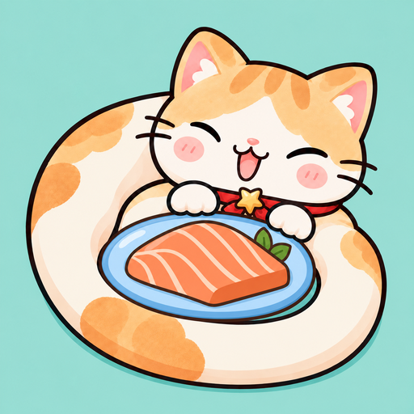
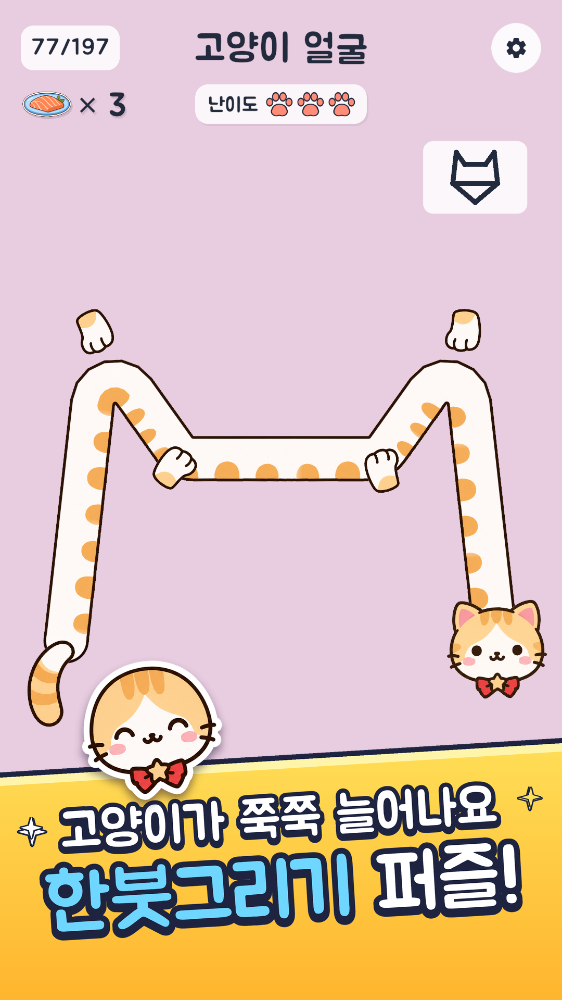
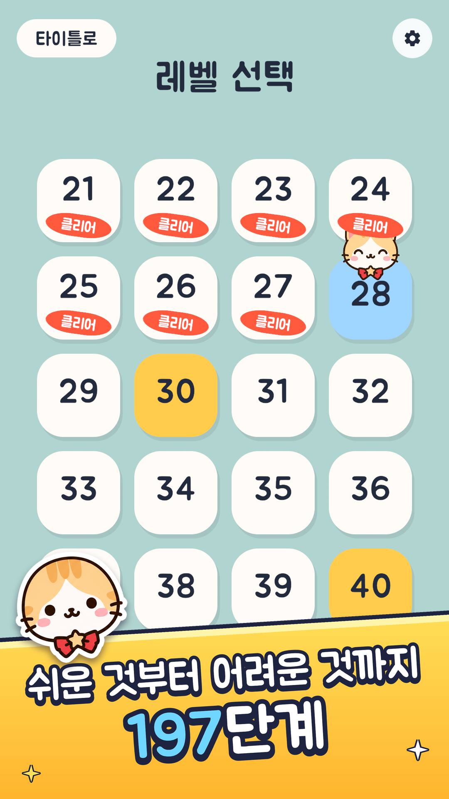
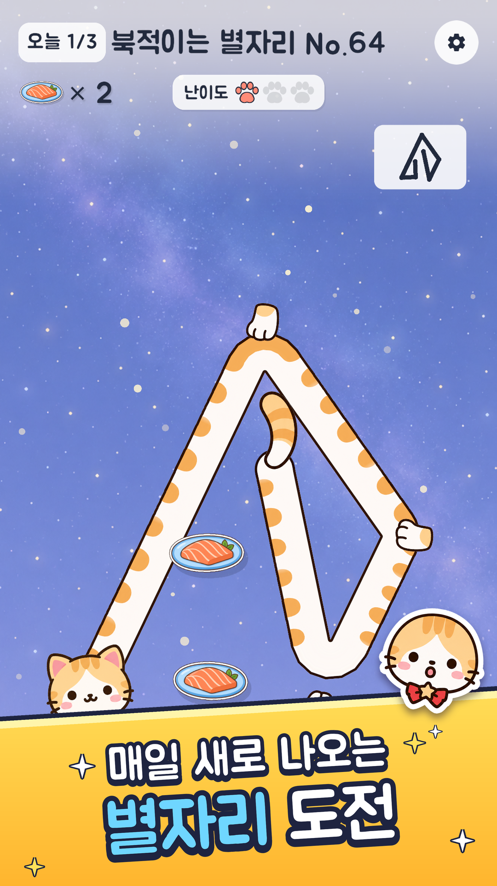
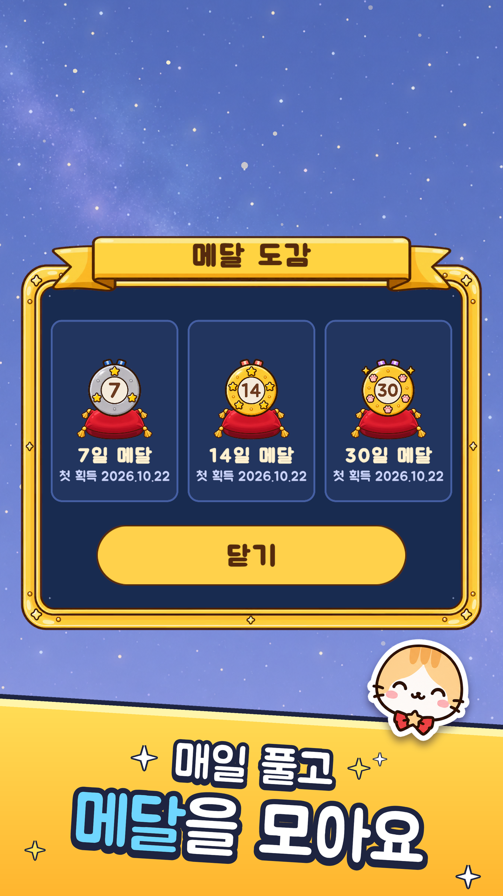
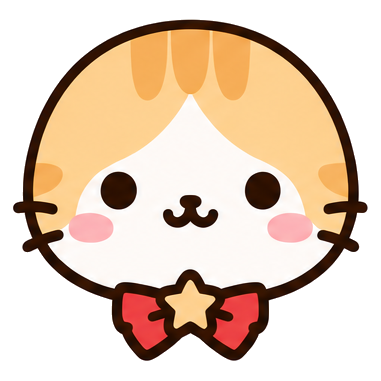
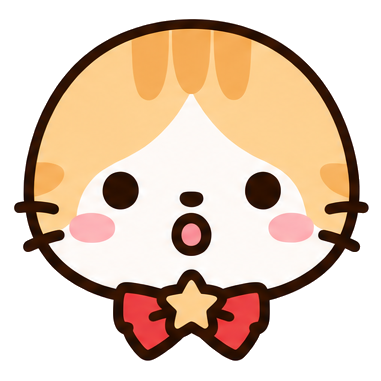
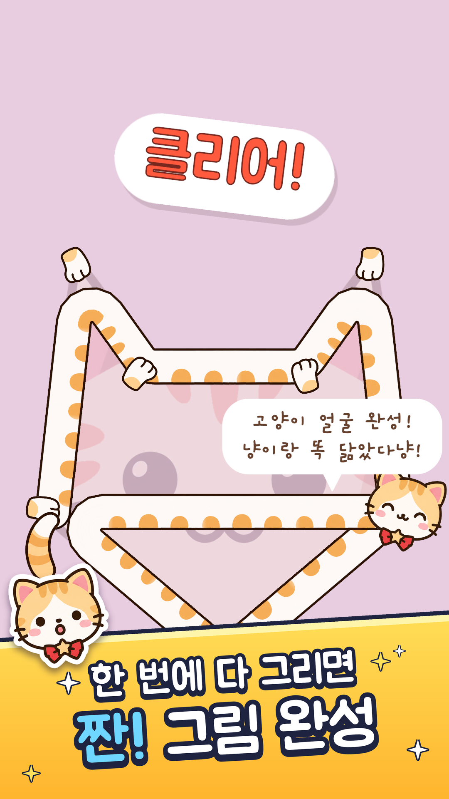
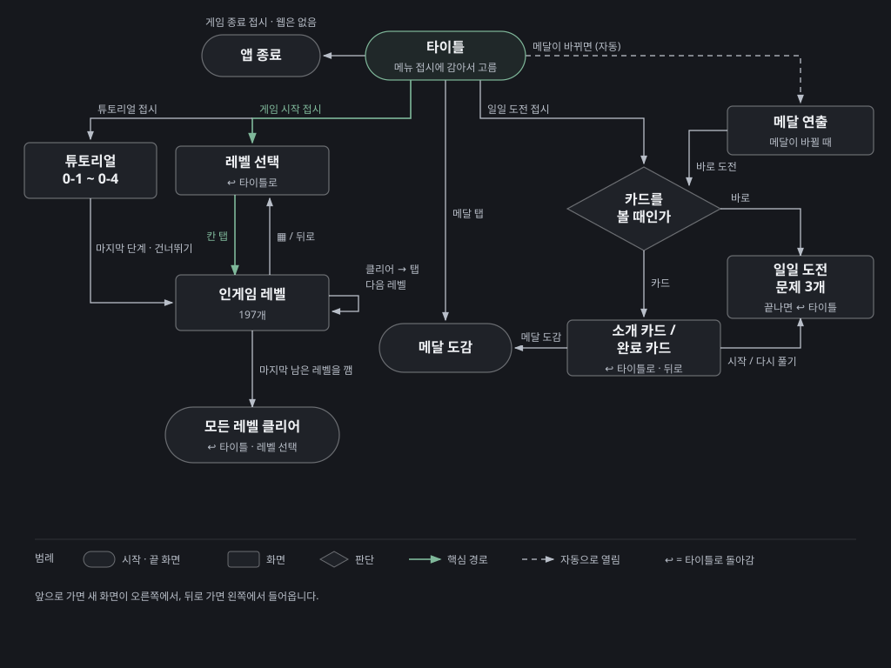
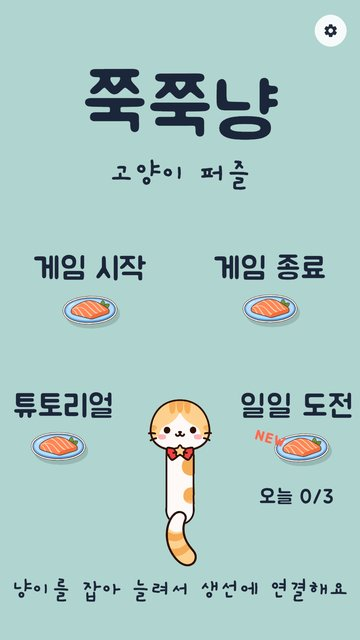

# 쭉쭉냥 : 고양이 퍼즐 — 게임 기획서



> **쭉쭉냥 : 고양이 퍼즐**은 Google Play(`com.minari.zzukzzuknyang`)에 출시한 세로형 모바일 퍼즐 게임입니다. 1인 개발입니다.
> 이 문서는 **무엇을 왜 그렇게 설계했는지**를 적은 기획서입니다. 숫자는 설계 결정을 보여 줄 때만 씁니다. 화면 좌표, 계산식, 코드 구조 같은 구현 값은 [제작 명세(game-design.md)](game-design.md)에 있습니다.
> 의도는 개발 기록에 적힌 이유만 옮겼습니다. 이유가 기록에 없는 곳은 **(의도 기록 없음)**이라고 표시했습니다. 기준 버전 1.1.x(레벨 197개).

## 목차

1. [개요](#1-개요)
2. [목표와 배경](#2-목표와-배경)
3. [핵심 게임플레이](#3-핵심-게임플레이)
4. [메카닉](#4-메카닉)
5. [퍼즐 설계](#5-퍼즐-설계)
6. [진행과 밸런스](#6-진행과-밸런스)
7. [레벨 디자인 원칙](#7-레벨-디자인-원칙)
8. [아트와 사운드 방향](#8-아트와-사운드-방향)
9. [UX 흐름](#9-ux-흐름)
10. [성공 지표와 결과](#10-성공-지표와-결과)
11. [범위 밖으로 둔 것](#11-범위-밖으로-둔-것)
12. [가정과 의존성](#12-가정과-의존성)


---

## 1. 개요

### 핵심 컨셉



화면 위에 견본 그림(선 그림)이 나옵니다. 플레이어는 몸이 고무줄처럼 늘어나는 고양이 냥이를 끌어 연어 접시에 하나씩 감습니다. 냥이의 몸이 지나간 자리가 그대로 선이 되고 견본의 모든 선을 정확히 한 번씩 지나면 그림이 완성됩니다. 장르는 누구나 아는 한붓그리기이고 선을 긋는 대신 **늘어나는 고양이 몸을 감는 손맛**으로 차별화했습니다.

### 대상 플레이어

| 누구 | 근거 |
|---|---|
| 귀여운 고양이를 좋아하는 사람 | 스토어 문구 "이런 분께 추천해요" |
| 한붓그리기처럼 규칙이 단순한 퍼즐을 좋아하는 사람 | 발표 자료 "누구나 바로 이해하는 한붓그리기" |
| 매일 조금씩 새 퍼즐을 풀고 싶은 사람 | 일일 도전, 스토어 문구 |
| 그림이 "짠" 하고 완성되는 순간을 좋아하는 사람 | 스토어 문구 |

Google Play 대상 연령은 13세 이상으로 등록했습니다.

### 차별점 (USP)

이 게임만의 팔 거리인 USP(Unique Selling Point)를 항목마다 "빼면 그래도 재미있는가?"로 검사했습니다.

| # | 차별점 | 빼면? |
|---|---|---|
| 1 | **몸이 줄이 되는 고양이**: 팽팽한 몸통이 접시에 감기고 풀리는 손맛 | 흔한 "점 잇기 선 긋기"가 됩니다. 발표 자료가 꼽은 핵심 가치 1번입니다 |
| 2 | **풀이가 멜로디가 됨**: 접시에 감길 때마다 음이 한 단계씩 올라감 | 정답 경로가 그냥 조용한 동작이 됩니다. 발표 자료가 손맛과 함께 "흔한 한붓그리기와의 차별화"로 꼽았습니다 |
| 3 | **사라졌다 돌아오는 그림**: 시작할 때 잠깐 보여 준 그림이 그리는 동안 숨었다가, 클리어하면 완성 그림으로 다시 나타남 | 클리어가 "선 맞음" 판정으로 끝나고, "깼다"는 보상 순간이 약해집니다 |
| 4 | **서버 없이 매일 새로 생기는 별자리 퍼즐 3개** + 연속 기록 메달 | 197판을 다 깨면 할 것이 없습니다. 광고·결제 없는 무료 게임이라 레벨을 계속 만들어 넣는 운영이 어렵습니다 |

<sub>출처: 발표 자료(우수 프로젝트 신청서) 02장, `쭉쭉냥_인게임_설계정리.md` 1·5절, `작업정리_2026-10-01.md` 6절, `스토어_문구.md`</sub>

---

## 2. 목표와 배경

### 기획 배경

- **발상**: "고양이를 쭉 늘려서 꼭짓점에 연결해 그림을 그리면 귀엽고 재미있을 것 같은데?"에서 시작했고, "고양이를 한 번에 쭉 이어서 퍼즐을 푼다"는 방향으로 발전시켰습니다.
- **장르를 고른 이유**: 한붓그리기 퍼즐(참고 게임: BitMango "Line Puzzle: String Art")은 규칙이 단순해서 누구나 바로 이해합니다. 하지만 비슷한 게임이 많아 "그냥 선 긋기"로는 기억에 남지 않습니다. 그래서 차별점을 **손맛**에 두었습니다.
- **규칙을 바꾼 이유**: 첫 시제품(v1)은 "모든 못을 교차 없이 감기"였습니다. 목표가 눈에 잘 보이지 않아서 v2부터 **견본 그림 따라 그리기**로 바꿨습니다. 무엇을 그려야 하는지 그림이 바로 알려 줍니다.

### 프로젝트 목표

| # | 목표 | 확인 방법 · 결과 |
|---|---|---|
| G1 | 누구나 바로 이해하는 한붓그리기에 **귀여운 고양이와 손맛**을 더한다 | 조작 3가지를 모두 정답으로 인정, 튜토리얼 4단계 (4·5장) |
| G2 | **가볍게 시작해 오래 즐길 수 있는** 퍼즐을 만든다 | 레벨 197개 + 날마다 새로 생기는 일일 도전 3개 + 메달 (5·6장) |
| G3 | 기획부터 출시까지 **혼자** 해 본다 | Google Play 비공개 테스트(테스터 12명, 14일) → 프로덕션 출시 (10장) |

수치 목표(다운로드 수, 잔존율 등)는 기록에 없습니다. 출시 뒤 지표도 측정하지 않았습니다(10장).

<sub>출처: 발표 자료 02·05장, `쭉쭉냥_인게임_설계정리.md` 1절, `작업정리_2026-10-03.md` 10~12절</sub>

---

## 3. 핵심 게임플레이

### 디자인 기둥

모든 기능이 받쳐야 하는 기준을 여기서는 디자인 기둥이라고 부릅니다. 겹치지 않게 넷으로 나누고 서로 부딪히면 번호가 작은 쪽을 따릅니다.

| 순위 | 기둥 | 뜻 | 근거 |
|---|---|---|---|
| 1 | **손맛 있는 한붓그리기** | 감고 풀리고 소리 나는 감각이 재미의 중심 | 발표 자료 핵심 가치 "손맛 있는 한붓그리기" |
| 2 | **실수해도 괜찮은 조작** | 조작 습관이나 실수 때문에 지는 일이 없음 | 발표 자료 핵심 가치 "간편한 조작감" |
| 3 | **스스로 푸는 재미** | 도움은 주되 답을 빼앗지 않음 | 설계정리 3절 "답을 너무 빨리 주지 않기" |
| 4 | **가볍게 시작해 오래** | 처음엔 쉽게, 다 깬 뒤에도 매일 올 이유 | 발표 자료 목표, 설계정리 5절 |

### 핵심 루프 (코어 루프)

코어 루프란 한 판 안에서 계속 반복되는 행동의 고리를 말합니다.

```
[보기]   견본 그림을 잠깐 본다 (쉬운 판 3.5초 → 어려운 판 1초)
   ↓
[행동]   시작 접시를 골라 냥이를 끌어 접시에 감는다
   ↓
[반응]   몸이 감기며 음이 한 단계 올라감 · 남은 선 수가 줄어듦 · 냥이가 기뻐함
         틀린 선이면 빨간 선 · 냥이가 깜짝 놀람 → ↶로 바로 고침
   ↓
[보상]   "클리어!" 도장 · 숨었던 그림이 완성 그림으로 돌아옴 · 레벨마다 다른 냥이 한마디
   ↓
[다시 할 이유]  탭 한 번에 다음 레벨 · 10판마다 "도전!" 고비 · 매일 새 별자리 3개와 연속 메달
```

| 항목 | 내용 |
|---|---|
| 한 판 길이 | 측정 기록 없음. 설계가 막혔다고 보는 기준은 힌트 첫 단계 시간으로, 쉬운 판 25초 · 어려운 판 60초입니다 |
| 판마다 달라지는 것 | 그림(197가지 사물), 접시 3~14개·선 3~18개, 필요한 요령(엇갈리는 선, 같은 접시 다시 지나기, 홀수 접시에서 시작), 시작 접시를 어디로 고를지 |
| 일일 도전에서 달라지는 것 | 날짜로 만든 새 모양, 요일마다 다른 별자리 테마 |

### 승리와 실패

- **승리**: 견본의 모든 선을 정확히 한 번씩, 견본에 없는 선 없이 그리고 마지막 접시에서 손을 떼면 클리어입니다.
- **실패는 없습니다.** 시간 제한, 목숨, 이동 횟수 제한이 없습니다. 틀린 선은 빨간 선과 "틀린 선이 N개 있어요" 안내로 알려 줄 뿐입니다.
  - 이유: 틀려도 부담 없이 다시 시도할 수 있게 했습니다(설계정리 1절). 발표 자료도 "실수해도 부담 없이 다시 도전"을 핵심 가치로 적었습니다. → 기둥 2
- **되돌리기와 회복**

| 도구 | 하는 일 | 기둥 |
|---|---|---|
| ↶ 한 단계 뒤로 | 마지막 접시 하나만 뗌 | 2 |
| ↻ 처음부터 | 시작 접시 고르기로 돌아감 | 2 |
| 접시 잠금 | 한 번 감긴 접시는 몸을 반대로 휘둘러도 풀리지 않음. ↶과 ↻로만 뗌 | 2 |

접시 잠금은 테스트에서 "연결한 줄이 자꾸 끊긴다"는 의견이 나와 정했습니다. 원칙은 **"화면에서 먹힌 접시는 항상 연결"**이고, 실수로 감긴 접시는 ↶로 뗍니다.

<sub>출처: 발표 자료 02장, `쭉쭉냥_인게임_설계정리.md` 1·3절, `작업정리_2026-09-30.md` 31·33절, `계획_난이도곡선과_힌트.md` 3·4절</sub>

---

## 4. 메카닉

### 플레이어의 동사

| 동사 | 하는 일 | 받치는 기둥 |
|---|---|---|
| **고르기** | 어느 접시에서 시작할지 정함. 일반 레벨은 모두 시작이 자유 | 3 스스로 풀기 |
| **끌어 감기** | 냥이 머리를 끌면 몸이 늘어나고 접시 바깥으로 돌면 감김 | 1 손맛 |
| **지나가며 잇기** | 손을 떼지 않고 접시 위를 지나가며 꺾음 | 2 실수해도 괜찮음 |
| **놓고 다시 잡기** | 접시 위에서 손을 떼면 고정, 머리를 다시 잡아 이어 그림 | 2 실수해도 괜찮음 |
| **되돌리기** | ↶로 접시 하나 빼기, ↻로 처음부터 | 2 실수해도 괜찮음 |

세 가지 그리기 방식을 모두 정답으로 인정합니다. 사람마다 끄는 습관이 달라서, 조작 방식 때문에 실패하는 일이 없게 하려고 그렇게 했습니다. 실제로 테스트에서 "빨리 끌면 접시에 잘 안 붙고, 접시 위를 지나가며 꺾으면 연결되지 않는다"는 문제가 많아, 접시에 붙는 범위를 넓히고 "지나가며 잇기"를 정답으로 넣었습니다(발표 자료 03장 문제 해결).

### 조작

| 하고 싶은 것 | 터치 · 마우스 | PC 키 |
|---|---|---|
| 그리기 | 접시를 눌러 끌고, 다음 접시 위에서 떼기 | |
| 한 단계 뒤로 | ↶ 버튼 | Z, Backspace |
| 처음부터 | ↻ 버튼 | R |
| 레벨 이동 | ◀ ▶ 버튼, 레벨 선택 | P, N |
| 뒤로 | 안드로이드 뒤로 버튼 | Esc |

터치와 마우스의 조작은 똑같습니다. 판 위의 플레이는 한 손가락 끌기 하나로 됩니다.

### 접근성 (실제로 넣은 것)

- **자석처럼 붙는 접시**: 접시 근처에서 손을 떼면 달라붙고, 빠르게 휙 그어도 지나친 접시를 잡아 줍니다.
- **색에만 기대지 않는 오류 표시**: 틀린 선은 빨간 선과 함께 글 안내("틀린 선이 N개 있어요"), 냥이 표정, 틀림 소리로도 알려 줍니다.
- **누르는 영역**: 보이는 버튼은 작아도 누르는 영역은 48dp 이상입니다(UI 점검에서 고침).
- **글자**: 좁은 폰에서도 글자가 넘치지 않게 검사했고, 큰 글자 대비 3:1 이상으로 맞췄습니다.
- **언어**: 한국어·영어. 처음엔 기기 언어를 따르고 설정에서 바로 바꿉니다.
- **화면**: 노치·둥근 모서리를 피합니다. 1.1.1부터 태블릿·폴더블에서는 가로로도 돌아갑니다.
- **소리**: 효과음 볼륨과 음소거.
- 진동은 없습니다(의도 기록 없음). 색약 모드는 없습니다.

<sub>출처: 발표 자료 02·03장, `쭉쭉냥_인게임_설계정리.md` 1절, `홍보_조작법.md` 4절, `작업정리_2026-10-17.md` 3절, `작업정리_2026-10-22.md` 3절</sub>

---

## 5. 퍼즐 설계

### 핵심 규칙과 제약

| 규칙 | 설계 의미 |
|---|---|
| 견본의 모든 선을 **정확히 한 번씩** | 한붓그리기의 고전 규칙. 견본 그림이 목표를 바로 보여 줌 |
| 견본에 없는 선은 틀림 | 접시 사이를 아무렇게나 이으면 안 됨 → 경로를 생각하게 함 |
| 같은 **접시**는 여러 번 지나도 됨 | 같은 **선**만 두 번 안 됨. "같은 접시 다시 지나기"가 난이도의 중심이 됨(6장) |
| 시작 접시는 플레이어가 고름 | "어디서 시작할까"가 첫 번째 고민거리. 일반 레벨에 시작 고정은 하나도 없음 |
| 그림은 잠깐만 보여 줌 | 계속 보이면 이을 곳이 다 보여 너무 쉬워짐. 그래서 기억하며 푸는 요소가 생김 |

**풀이 요령**(게임이 가르치는 것): 선이 홀수 개 모인 접시가 두 곳이면 그중 한 곳에서 시작해 다른 곳에서 끝납니다. 모든 접시에 선이 짝수 개면 한 바퀴 돌아 시작한 곳으로 돌아옵니다.

### 퍼즐 진행

```
튜토리얼(조작) → 요령 소개 레벨(개념) → 섞어서 점점 어렵게(조합) → 10판마다 고비 → 마지막 레벨(최고 난도)
```

| 단계 | 무엇을 | 예 |
|---|---|---|
| 튜토리얼 4단계 | 조작을 **한 단계에 한 가지씩** | 끌어서 놓기 → 접시에서 꺾기 → 한 단계 뒤로 → 견본 따라 그리기 |
| 요령 소개 | 새 요령이 처음 필요한 레벨 **바로 앞에** 그 요령만 쉬운 레벨 | 물고기(같은 접시 두 번), 깃발(홀수 접시에서 시작), 리본(엇갈리는 선) |
| 조합 | 쉬움·보통·어려움을 섞되 갈수록 어려운 비율이 늘어남 | 1~20번 어려움 4개 → 181~197번 어려움 14개 |
| 고난도 | 10, 20 … 190번 고비 레벨, 197번 해바라기(접시 14개, 선 18개) | 고비 화살표(10번) → 호랑나비(190번) |

튜토리얼 3단계(한 단계 뒤로)는 고치는 방법을 먼저 몸으로 익히도록 **일부러 틀린 선이 그려진 채로 시작**합니다. 이미 아는 사람은 건너뛰기로 바로 넘어갑니다.

### 레벨 구조



| 항목 | 내용 | 이유 |
|---|---|---|
| 개수 | 일반 197개 + 튜토리얼 4단계 + 일일 도전(매일 3개, 끝없음) | 8개에서 시작해 25 → 40 → 60 → 100 → 200개로 늘린 뒤 3개를 뺌 |
| 묶음 | 레벨 선택 한 쪽에 20개, 10쪽. 10판마다 고비(금색 칸) | |
| 잠금 | **없음.** 모든 레벨을 언제든 고를 수 있음 | 판 안의 ◀ ▶로 원래 모든 레벨을 오갈 수 있게 만들어서, 레벨 선택도 거기에 맞춤 |
| 진행 표시 | 깬 레벨에 "클리어" 도장, 마지막으로 하던 레벨 칸에 냥이가 앉아 있음 | |

### 플레이어 도움

| 도움 | 내용 | 기둥 |
|---|---|---|
| 단계별 힌트 | 막힌 시간이 쌓이면 **약한 도움부터**: ① 그림 다시 보기 → ② 냥이의 순서 요령 한마디 → ③ 시작할 수 있는 접시 반짝임 | 3 |
| 힌트 시간 | 쉬운 판은 빨리, 어려운 판은 늦게. ①②③ = 쉬움 25·40·55초, 어려움 60·90·120초. 고비 레벨은 1.5배 늦게 | 3 |
| 실패하면 앞당김 | 3번 실패하면 다음 힌트를 앞당김. 단 ① 15초 · ② 25초 · ③ 35초보다 빨리는 안 나옴 | 2, 3 |
| 되돌리기 · 처음부터 | ↶ ↻, 언제든 (3장) | 2 |
| 건너뛰기 | 잠금이 없어 ◀ ▶나 레벨 선택으로 아무 레벨로 감. 튜토리얼은 "건너뛰기" 버튼 | 4 |

힌트 설계의 이유:
- 예전에는 힌트 문구가 처음부터 "여기서 시작해요"라고 시작 위치를 알려 줬습니다. 그러면 퍼즐의 가장 큰 고민거리가 사라지므로, 시작 위치를 말하던 문구 49개를 **그리는 순서 요령**으로 바꾸고 시작 위치는 마지막 ③단계로 미뤘습니다.
- 쉬운 레벨에서 오래 막혔다면 빨리 도와야 하고, 어려운 레벨은 고민할 시간을 더 줘야 해서 시간을 레벨 난이도에 맞췄습니다.
- 시간만으로 정하면 계속 틀리는 사람도 오래 기다려야 해서, 실패가 쌓이면 앞당깁니다.
- 정답 경로 전체를 보여 주는 힌트는 없습니다(스토어 문구 "정답을 한꺼번에 알려 주지는 않아요").

### 반복 플레이

 

| 장치 | 내용 | 이유 |
|---|---|---|
| **일일 도전** | 날짜로 매일 새 별자리 퍼즐 3개(쉬움 → 보통 → 어려움). 같은 날이면 누구에게나 같은 퍼즐. 요일마다 다른 테마 | 한 번 만들면 **업데이트 없이 계속 돌아가는** 콘텐츠. 서버도 추가 작업도 필요 없음 |
| **연속 기록과 메달** | 3·7·14·30·50·100일 연속, 그 뒤 100일마다 메달. 타이틀에 지금 메달이 붙어 있음 | "오늘도 해 볼까?"를 만들기 |
| **메달 깨짐 연출** | 기록이 끊기면 메달이 깨지고 [바로 도전] 버튼 | 끊긴 순간도 이야기로 보여 주고 다시 시작하게 이끔 |
| **메달 도감** | **받은 메달만** 보여 줌(6칸) | 끝이 있는 목표. 별자리 수집은 퍼즐이 끝없이 늘어나 도감이 끝나지 않아 뺌 |
| **모든 레벨 클리어** | 197개를 다 깬 순간 한 번 나오는 축하 화면 | |

일일 도전은 그림 힌트와 문구 힌트가 없고, 오래 막히면 시작 접시만 반짝입니다(의도 기록 없음). 연속 기록은 마지막으로 다 깬 날보다 뒤의 날을 깰 때만 늘어나므로 기기 시계를 되돌려도 기록은 늘지 않습니다.

<sub>출처: `쭉쭉냥_인게임_설계정리.md` 1~5절, `계획_난이도곡선과_힌트.md` 4절, `계획_메달과_도감.md`, `작업정리_2026-10-01.md` 6절, `작업정리_2026-10-02.md` 4절, `스토어_문구.md`</sub>

---

## 6. 진행과 밸런스

### 진행 방식

레벨 번호를 따라 앞으로 나아가는 **선형 진행**이지만 잠금이 없어서 자유롭게 건너뛸 수 있습니다. 진행은 레벨 이름으로 저장하기 때문에 레벨 순서를 다시 배치해도 깬 기록이 그대로 남습니다. 일일 도전은 레벨 진행과 따로 날짜별로 기록합니다.

### 난이도 단계: "같은 접시를 다시 지나는 횟수"


| 다시 지나는 횟수 | 단계 | 표시 | 레벨 수 |
|---|---|---|---|
| 0번 | 쉬움 | 발바닥 1개 | 69 |
| 1번 | 보통 | 발바닥 2개 | 38 |
| 2번 이상 | 어려움 | 발바닥 3개 | 90 |

- **바꾼 이유**: 처음에는 선 수, 갈림길, 막다른 길 확률 등을 더한 점수로 단계를 나눴습니다. 그런데 실제로 사람들이 어렵게 느끼는 건 **이미 지나간 접시를 다시 지나야 할 때**였습니다. 출시 전(2026-10-18)에 단계 기준을 이 횟수 하나로 바꿨습니다.
- 여러 요소를 더한 점수는 버리지 않고 같은 단계 안의 순서와 그림 보여 주는 시간·힌트 시간에 씁니다.

### 난이도 곡선: 톱니형으로 오르는 곡선

10판마다 확 어려운 고비가 있고 바로 다음 판에 평소로 내려옵니다. 이런 **톱니(파도) 모양**이 전체적으로 완만하게 올라갑니다.

| 구간 | 평균 점수 | 쉬움 / 보통 / 어려움 |
|---|---|---|
| 1–20 | 2.69 | 11 / 5 / 4 |
| 61–80 | 4.06 | 8 / 2 / 10 |
| 121–140 | 5.75 | 6 / 4 / 10 |
| 181–197 | 10.56 | 3 / 0 / 14 |

| 설계 결정 | 이유 |
|---|---|
| **10판마다 고비 레벨**: 그 구간 평균보다 점수가 2.5 이상 높은 레벨. "도전!" 도장, "이번 건 좀 어렵다냥!", 금색 배지 | 계속 어려워지기만 하면 지침. 확 어려운 고비 뒤에 다시 평소로 돌아오는 리듬 |
| **세 단계를 섞기**: 쉬움은 앞쪽에, 어려움은 뒤쪽에 몰리게 펼침 | 쉬움 → 보통 → 어려움으로 몰아 두면 앞은 지루하고 뒤는 어려움만 줄지음. 뒤쪽에도 쉬운 레벨이 쉬어 가기로 나옴 |
| 섞는 정도를 한 번 낮춤 | 처음 값에서는 마지막 구간이 어려움 11연속으로 빡빡했음 → 지금은 어려움이 많아야 6번 연속 |
| 처음 3판은 모두 쉬움, 마지막 판이 가장 어려움 | (의도 기록 없음) |
| 고비 레벨은 그림을 70%만 보여 주고 힌트를 1.5배 늦게 | (의도 기록 없음) |

고비 레벨 후보를 만들려고 7개 레벨(시계, 자동차, 케이크, 텔레비전, 우유팩, 컵케이크, 자물쇠)에 그림 속 물건의 일부로 고리(알람 종, 택시 표시등, 초 불꽃 등)를 붙였습니다. 고리를 먼저 그리지 않고 지나가면 돌아올 수 없어서 어려워집니다.

### 경제

**게임 안 경제는 없습니다.** 화폐, 상점, 광고, 결제, 로그인이 모두 없습니다.

- 이유 1: 고양이 캐릭터가 다른 게임 캐릭터를 모델로 한 팬 창작물이고 그 IP 정책상 광고 수익은 사전 승인이 필요해 광고 없이 무료로만 공개합니다.
- 이유 2: 스토어에서 "누구나 편하게"(광고·결제·로그인 없음, 인터넷 없이 플레이)를 내세웠습니다.
- 보상은 모두 **보는 보상**입니다: 클리어 도장, 완성 그림, 냥이 대사, 메달.

### 밸런스의 한계

난이도 수치는 우선 감으로 정해 넣고 나중에 플레이 기록으로 다시 맞추기로(리밸런싱) 했습니다. 레벨별 클리어 시간·실패 횟수·힌트 사용을 기록하는 기능은 아직 만들지 않았습니다. 발표 자료도 "퍼즐 난이도에 대한 평가가 사람마다 편차가 커서 난이도 설계에 아쉬움이 남았다"고 적었습니다.

<sub>출처: `쭉쭉냥_인게임_설계정리.md` 2절, `작업정리_2026-10-18.md` 5·13·14절, `계획_난이도곡선과_힌트.md` 1·6절, `StringPuzzle_작업내역.md` 1절, 발표 자료 04·05장, [레벨 표](data/level_table.md)</sub>

---

## 7. 레벨 디자인 원칙

### 레벨 유형

| 유형 | 수 | 특징 |
|---|---|---|
| 튜토리얼 | 4 | 시작 접시 고정, 손가락 안내 |
| 요령 소개 | 4 | 새 요령을 처음 알려 주는 판(삼각형·리본·물고기·깃발) |
| 일반 (사물 그림) | 나머지 | 삼각형, 집, 하트부터 기타, 자전거, 해바라기까지 일상 사물 |
| 고비 | 19 | 10의 배수 번. 그 구간에서 확실히 어려운 판 |
| 일일 도전 (별자리) | 매일 3 | 날짜로 만든 모양. 아무 모양이어도 되도록 그림 대신 "별자리"로 꾸밈 |

### 진행 모델

손으로 순서를 정하지 않고 **규칙으로 배치**합니다. 레벨이 많아질수록 순서를 손으로 정하기 어려워져서 그림만으로 난이도를 계산하는 기준을 만들었습니다. 배치 규칙: 단계별 점수 순 → 전체에 섞어 펼침 → 요령 소개 레벨은 필요한 첫 레벨 앞 → 10판마다 고비 → 마지막이 가장 어려움.

### 설계 원칙 (실제로 지킨 것)

1. **풀 수 있는 것만 넣는다.** 모든 레벨은 세 가지 그리기 방식으로 자동 재생해 통과해야 들어갑니다. 일일 도전은 정답 경로를 먼저 그리고 그 위에 모양을 만들어 항상 풀 수 있게 합니다(10년 치 10,950개를 만들어 확인).
2. **조작이 애매한 배치는 만들지 않는다.** 꺾이는 곳에 접시 3개를 일직선으로 두거나, 접시를 거의 일직선(170° 넘게)으로 지나가는 순서는 버립니다. 손으로는 맞게 그렸는데 접시를 건너뛸 수 있기 때문입니다.
3. **그림에 없는 선을 만들지 않는다.** 난이도를 올릴 때 선만 이어 붙이면 그림에 없는 대각선이 생깁니다. 대신 그림 속 물건의 일부(종, 불꽃, 받침대)를 고리로 붙였습니다. 붙일 자연스러운 자리가 없는 레벨(메달, 쌍둥이 집, 버섯, 머그컵, 잠수함)은 그대로 두었습니다.
4. **무슨 그림인지 알아볼 수 있게.** 점과 선만 있으면 제목을 봐야 무슨 모양인지 알 수 있으니 레벨마다 배경 그림을 넣었습니다.
5. **요령은 미리 가르친다.** 새 요령이 처음 필요한 레벨 앞에 그 요령을 알려 주는 레벨을 둡니다.
6. **힌트 문구는 순서 요령만.** 시작 위치는 말하지 않습니다(요령 소개 레벨만 예외).

<sub>출처: `쭉쭉냥_인게임_설계정리.md` 1·2·5절, `계획_난이도곡선과_힌트.md` 1절, `작업정리_2026-10-01.md` 6절, `작업정리_2026-10-17.md` 1절</sub>

---

## 8. 아트와 사운드 방향

### 아트

    

| 결정 | 내용 | 의도 |
|---|---|---|
| 스타일 | 귀여운 2등신 치비 스티커, 평면 채색, 갈색 윤곽선, 파스텔 배경 | 발표 자료 목표 "한붓그리기에 귀여운 고양이와 손맛을 더해" |
| 냥이 표정 | 평소 · 기쁨 · 놀람 · 깜빡 | 맞히면 기뻐하고 틀리면 놀람. 표정이 곧 판정 반응 |
| 연어 접시 | 냥이와 같은 치비 화풍, 하늘색 접시 위 연어 한 점 | 원작 아이템 그림을 쓰지 않으려고 새로 그림(IP 정책) |
| 레벨 배경 그림 | 판 뒤에 반투명 그림. 시작 때 잠깐 → 그리는 동안 숨김 → 클리어 때 다시 | 무슨 모양인지 알게 하고 클리어 때 깼다는 느낌을 살림 |
| 일일 도전 | 밤하늘 판, 별, 별똥별. 깨면 그린 선을 따라 빛이 번지고 접시가 별처럼 빛남 | 아무 모양이어도 어울리게 "별자리" 콘셉트 |



### 사운드

| 결정 | 내용 | 의도 |
|---|---|---|
| **감을 때 음이 올라감** | 접시에 감길 때마다 밝은 5음 음계로 한 음씩 올라감 → 풀이 하나가 짧은 멜로디 | 손맛과 함께 흔한 한붓그리기와 차별화(발표 자료). 5음 음계를 고른 이유는 기록 없음 |
| 놓아서 붙일 때 | 멜로디 음 대신 "딱" 하는 나무 소리 | (의도 기록 없음) |
| 틀림 | 짧고 낮은 "붑" | 냥이 놀람과 함께 오류 피드백 |
| 고비 입장 | "두둥 탁" | 묵직한 버전을 만들어 봤지만 원래의 가벼운 소리로 되돌림(개발자 취향: 가벼운 느낌) |
| 배경음 | 없음, 효과음만 | (의도 기록 없음) |

<sub>출처: 발표 자료 02장, `쭉쭉냥_인게임_설계정리.md` 1·5절, `작업정리_2026-10-01.md` 6절, `작업정리_2026-10-01_대화요약.md` 2절, `작업정리_2026-10-02.md` 2절, `작업정리_2026-10-22.md` 3절</sub>

---

## 9. UX 흐름

### 화면 흐름

[](images/screen-flow.svg)

<sub>그림: `diagram-design` 스킬로 그린 순서도(누르면 크게). 핵심 경로(초록)는 타이틀 → 게임 시작 → 레벨입니다.</sub>

### 첫 실행 경험



1. **타이틀이 곧 첫 조작 연습입니다.** 메뉴가 버튼이 아니라 접시이고, 냥이를 늘려 접시에 감아야 고를 수 있습니다. 끄는 길이에 따라 냥이가 "영차영차", "쭈욱~ 늘어난다!", "으앗, 너무 늘어나!"라고 반응하고, 머리로 제목 글자를 치면 글자가 날아갑니다. 타이틀을 이렇게 만든 이유는 기록에 없습니다(의도 기록 없음). 홍보 문구는 이것을 "타이틀부터 놀이"라고 소개합니다.
2. **튜토리얼은 고를 수 있습니다.** 타이틀 왼쪽 아래 "튜토리얼" 접시로 들어가고, 강제로 시키지 않습니다. 0.8초 동안 손을 대지 않으면 손가락 그림이 남은 풀이를 따라 끌어 보입니다.
3. **첫 레벨은 삼각형**(접시 3개, 선 3개)이고 그림을 가장 길게(3.5초) 보여 줍니다. 처음 3판은 모두 쉬움입니다.
4. 언어는 기기 언어를 따릅니다. 로그인·권한 요청이 없어 바로 시작합니다.

<sub>출처: `쭉쭉냥_인게임_설계정리.md` 4·6절, `홍보_조작법.md` 3절, [제작 명세](game-design.md) 6장</sub>

---

## 10. 성공 지표와 결과

근거가 있는 결과만 적습니다.

| 항목 | 결과 |
|---|---|
| 출시 | Google Play 비공개 테스트(2026-10-03 시작, 테스터 12명 · 14일) → 프로덕션 1.1.0, 178개 국가·지역. PC·웹 빌드도 있음 |
| 개발 기간 | 시제품 ~9.29 → 핵심 플레이 9.30 → 콘텐츠 확장 10.1~2 → 출시 10.2~3 → 테스트 반영 10.17~22 (1인 개발) |
| 콘텐츠 | 일반 레벨 197개(배경 그림 197장), 튜토리얼 4단계, 일일 도전 매일 3개(끝없음), 메달 6종 |
| 품질 | 자동 테스트 1,573개 통과(원본 README 기준). 모든 레벨을 세 가지 방식으로 자동 재생해 확인 |
| 일일 도전 생성 | 10년 치 10,950문제를 만들어 봤을 때 대체용 안전망이 한 번도 쓰이지 않음 |
| 테스트 반영 사례 | 빨리 끌면 안 붙음 → 붙는 범위 넓힘 / 지나가며 꺾으면 안 이어짐 → "지나가며 잇기" 인정 / 줄이 자꾸 끊김 → 감긴 접시 잠금 |
| 스스로 본 한계 | 난이도 체감이 사람마다 크게 달랐음. 플레이 데이터로 다시 맞추는 일이 남음(6장) |

다운로드 수, 잔존율, 평점 같은 출시 뒤 지표는 기록에 없습니다.

<sub>출처: 발표 자료 03~05장, `작업정리_2026-10-03.md` 10~12절, `작업정리_2026-10-19.md` 1절, `쭉쭉냥_인게임_설계정리.md` 5절, 원본 README</sub>

---

## 11. 범위 밖으로 둔 것

| 하지 않은 것 | 이유 |
|---|---|
| 광고 · 결제 · 로그인 | 캐릭터 IP 정책상 광고 없이 무료로만 공개. "누구나 편하게" |
| 서버 | 일일 도전을 날짜만으로 만들어 서버가 필요 없음 |
| 실패 조건(시간 제한, 목숨) | 실수해도 부담 없이 다시 도전(기둥 2) |
| 레벨 잠금 | 판 안 ◀ ▶로 원래 모든 레벨을 오갈 수 있게 만든 것에 맞춤 |
| 시작 고정 레벨 | 일반 레벨은 모두 시작 자유. 레벨 1·2의 시작 고정도 풀었음(의도 기록 없음). 힌트 설계는 시작 위치를 "퍼즐의 가장 큰 고민거리"로 봄(기둥 3) |
| 정답 경로 전체를 보여 주는 힌트 | 직접 푸는 재미를 남김(기둥 3) |
| 별자리 수집 도감 | 퍼즐이 끝없이 늘어나 도감이 끝나지 않음 |
| 못 받은 메달 실루엣, 숫자 기록 줄 | 넣지 않기로 함(메달 기획). 일일 소개 카드도 처음엔 달력·기록 줄을 넣었다가 너무 복잡해서 줄임 |
| 일일 도전 달력 | 나중에 따로(다음 업데이트 계획) |
| 플레이 기록 기반 리밸런싱 | 계획만 있고 아직 안 함 |
| 일부 레벨의 고리 추가 | 자연스러운 자리가 없고, 붙이면 끝 구간만 무거워짐 |
| 배경음 · 진동 | (의도 기록 없음) |

<sub>출처: `StringPuzzle_작업내역.md` 1절, `쭉쭉냥_인게임_설계정리.md` 3·5절, `계획_메달과_도감.md` 3절, `계획_난이도곡선과_힌트.md` 1절, `작업정리_2026-10-01_대화요약.md` 1절, 발표 자료 05장</sub>

---

## 12. 가정과 의존성

| 구분 | 내용 |
|---|---|
| 가정 | 한붓그리기 규칙은 따로 설명하지 않아도 누구나 이해한다(발표 자료). 난이도 수치는 감으로 정했고 플레이 기록으로 다시 맞춘다는 전제 |
| IP | 냥이는 이터널 리턴(님블뉴런) 캐릭터를 모델로 한 **비공식 팬 창작물**입니다. 그 IP 이용 정책을 따라 공식 명칭·로고·이미지를 쓰지 않고, 광고 없이 무료로만 공개합니다. 정책이 바뀌면 이 게임의 공개 방식도 영향을 받습니다 |
| 제작 도구 | 레벨 그림·앱 아이콘 등은 AI 이미지 도구(GPT·Codex)로 만들었습니다. 효과음은 대부분 직접 합성하고 일부는 Kenney(CC0), 글꼴은 Jua·Gaegu(OFL), 버튼 아이콘은 Material Icons(Apache 2.0) |
| 플랫폼 | Google Play 정책(새 개인 계정은 테스터 12명 · 14일 비공개 테스트 뒤 출시). 인터넷 없이 실행 |
| 구현 | 엔진, 화면 좌표, 계산식은 [제작 명세](game-design.md)를 따릅니다 |
